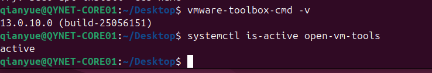
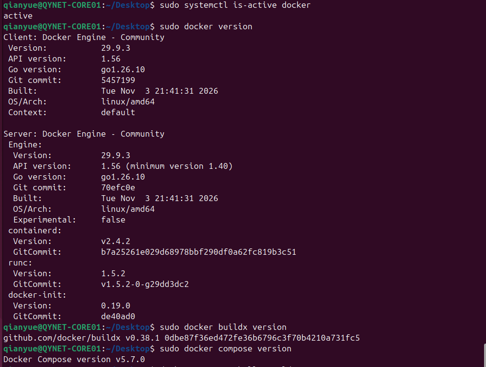
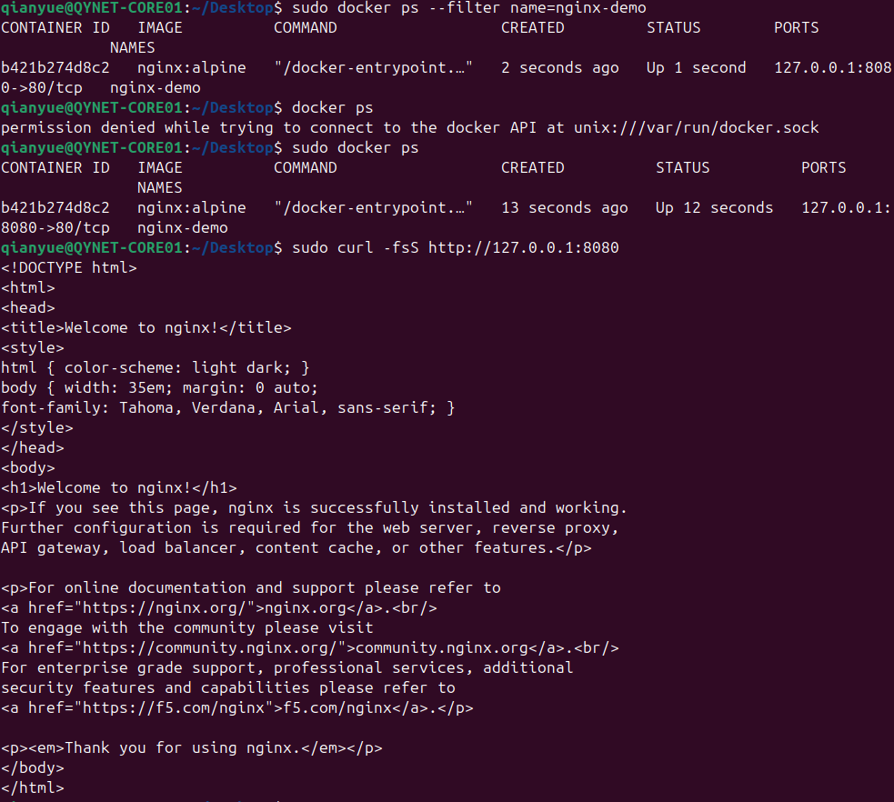
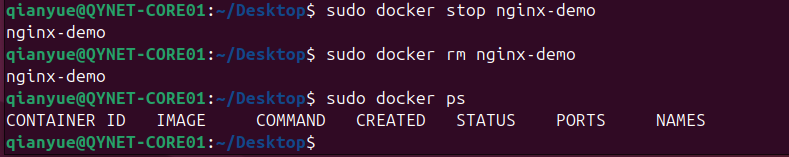
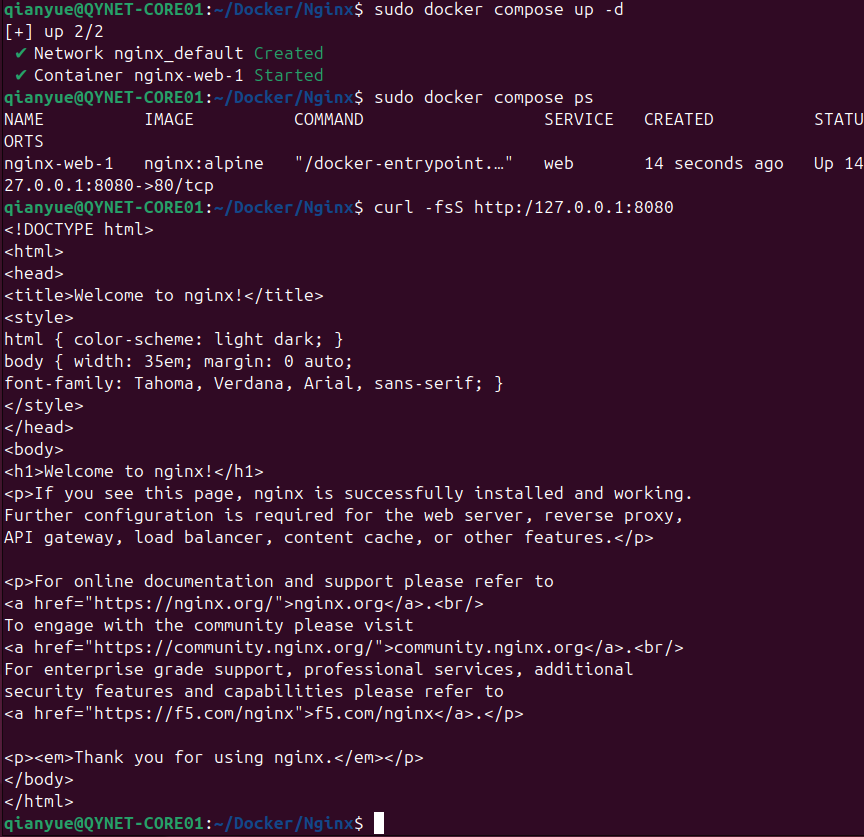

那么从今天开始，我要把过去 Blog 的关于 Docker 的笔记迁移至此，并使用 GPT6 进行简单重写。让内容更加详细，顺带复习复健一下。

## 一、准备 Ubuntu 虚拟机：安装 VMware Tools

我的练习环境是 VMware 里的 Ubuntu。安装 Docker 之前，先把虚拟机的集成工具配置好。Ubuntu 可以直接通过 APT 安装 VMware 推荐的 `open-vm-tools`。 [VMware 官方说明](https://knowledge.broadcom.com/external/article/313371/how-to-install-vmware-tools.html)

### 安装

在 **Ubuntu 虚拟机内**打开终端，先更新 APT 软件包索引：

```bash
sudo apt update
```

如果使用 **Ubuntu Server**，平时通过终端或 SSH 操作，安装基础包即可：

```bash
sudo apt install open-vm-tools
```

如果使用 **Ubuntu Desktop**，并且需要窗口缩放等桌面集成功能，同时安装桌面组件：

```bash
sudo apt install open-vm-tools open-vm-tools-desktop
```

### 验证

```bash
vmware-toolbox-cmd -v
systemctl is-active open-vm-tools
```

第一条显示工具版本，第二条返回 `active`，就可以继续安装 Docker Engine 和 Compose。如果服务没有运行，用 `systemctl status open-vm-tools --no-pager` 查看状态和最近的日志。装了桌面组件的话，还可以注销并重新登录 Ubuntu，再调整 VMware 窗口大小，观察桌面分辨率是否随之变化。



## 二、在 Ubuntu 上安装 Docker Engine

以下命令都在 Ubuntu 虚拟机内执行。先确认系统版本和架构，再用 Docker 官方 APT 仓库安装。 [Docker Engine Ubuntu 安装文档](https://docs.docker.com/engine/install/ubuntu/)

```bash
cat /etc/os-release
dpkg --print-architecture
```

如果这台虚拟机之前装过 Docker，先检查已有软件包和 APT 源：

```bash
dpkg -l | grep -E 'docker|containerd|runc'
grep -l 'download.docker.com/linux/ubuntu' /etc/apt/sources.list.d/* 2>/dev/null
```

从 Ubuntu 自带的 `docker.io` 切换到官方 `docker-ce` 时，先按官方文档确认并处理冲突包。已有容器的虚拟机还要先确认 `containerd` 等组件是否被其他服务使用。如果已经有指向同一个 Docker 仓库的 `docker.list`，先检查旧配置，避免和下面的 `docker.sources` 重复启用。已经装好官方 Docker Engine 的话，可以直接跳到验证环节。

### 添加 Docker 官方 APT 源

先下载仓库签名公钥，并让 APT 能读取该文件：

```bash
sudo apt update
sudo apt install ca-certificates curl
sudo install -m 0755 -d /etc/apt/keyrings
sudo curl -fsSL -o /etc/apt/keyrings/docker.asc https://download.docker.com/linux/ubuntu/gpg
sudo chmod a+r /etc/apt/keyrings/docker.asc
```

接着写入仓库配置。下面会从当前 Ubuntu 读取发行版代号和软件包架构，`Signed-By` 则指定这个仓库使用的签名公钥。

```bash
ubuntu_suite="$(. /etc/os-release && printf '%s' "${UBUNTU_CODENAME:-$VERSION_CODENAME}")"
apt_arch="$(dpkg --print-architecture)"

sudo tee /etc/apt/sources.list.d/docker.sources >/dev/null <<EOF
Types: deb
URIs: https://download.docker.com/linux/ubuntu
Suites: $ubuntu_suite
Components: stable
Architectures: $apt_arch
Signed-By: /etc/apt/keyrings/docker.asc
EOF

sudo apt update
```

### 安装并验证

```bash
sudo apt install docker-ce docker-ce-cli containerd.io docker-buildx-plugin docker-compose-plugin

sudo systemctl is-active docker
sudo docker version
sudo docker buildx version
sudo docker compose version
sudo docker run --rm hello-world
```

看到 Docker 服务返回 `active`、`docker version` 同时显示 Client 和 Server、Buildx 与 Compose 能打印版本，并且最后输出 `Hello from Docker!`，就可以继续部署。这里的 `--rm` 会在测试容器退出后自动删除它。

如果 Docker 服务未启动，先执行 `sudo systemctl start docker`。启动失败时，用 `sudo journalctl -u docker -n 50 --no-pager` 查看原因。如果 Client 能连上 Server，但拉取镜像报错，先用 `getent hosts registry-1.docker.io` 检查 Ubuntu 的 DNS，再根据报错检查 HTTPS 连通性、代理或仓库鉴权。APT 下载软件包和 Docker 拉取镜像走的是两条链路，可以分开排查。



## 2. 部署第一个容器

用 Nginx 验证镜像拉取、后台运行和端口映射。先把端口绑定到 **Ubuntu 虚拟机自己的回环地址**，并在虚拟机内测试：

```bash
sudo docker run -d --name nginx-demo -p 127.0.0.1:8080:80 nginx:alpine
sudo docker ps --filter name=nginx-demo
curl -fsS http://127.0.0.1:8080/
sudo docker logs --tail 20 nginx-demo
```

`-d` 让容器在后台运行，`8080` 是 Ubuntu 上的端口，`80` 是 Nginx 容器内的端口。看到 Nginx 欢迎页的 HTML，就验证了从虚拟机到容器的访问链路。请求失败时，先用 `sudo docker ps -a` 看容器是否退出，再查容器日志和端口映射。

练完后清理测试容器：

```bash
sudo docker stop nginx-demo
sudo docker rm nginx-demo
```




## 3. 用 Compose 重复同一次部署

新建一个空目录，在里面创建 `compose.yaml`。把刚才的镜像与端口映射写成配置：

```yaml
services:
  web:
    image: nginx:alpine
    ports:
      - "127.0.0.1:8080:80"
```

在文件所在目录执行：

```bash
sudo docker compose config --quiet
sudo docker compose up -d
sudo docker compose ps
curl -fsS http://127.0.0.1:8080/
sudo docker compose logs --tail=20 web
sudo docker compose down
```

如果提示 `8080` 已被占用，先确认上一步的 `nginx-demo` 是否还在运行。也可以把 Compose 配置中的 Ubuntu 端口改成 `8081`，再用对应的地址测试。能从 `compose.yaml` 启动服务、访问页面、查看日志并清理容器，就完成了第一轮部署。


