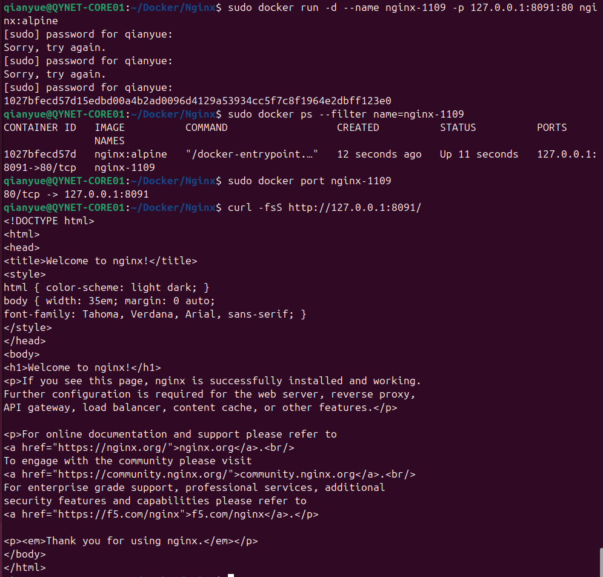
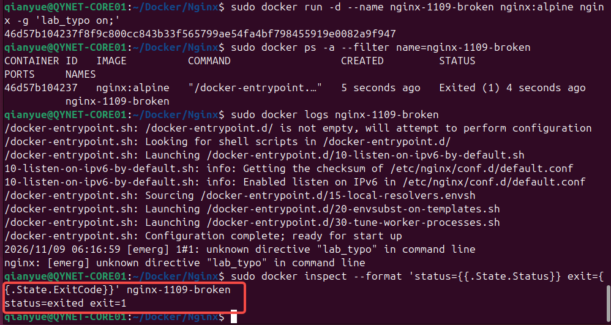

这次用同一个 Nginx 镜像完成三轮练习。先从现成镜像启动一个服务，再故意写错启动参数，最后把自己的页面构建进镜像。预计用时 60 分钟，命令在 Ubuntu 虚拟机内执行。

**本次进度**：已验证 Nginx 欢迎页，并定位启动故障。下次从第二节的「修复并验证」继续，然后做 Dockerfile 构建。

| 用时 | 练习 | 验收 |
| --- | --- | --- |
| 10 分钟 | 用命令启动 Nginx | `curl` 能访问欢迎页 |
| 20 分钟 | 制造并修复启动故障 | 找到错误日志和退出码，修复后重新访问成功 |
| 25 分钟 | 写 Dockerfile 并构建两个版本 | 页面从 `v1` 切到 `v2`，能解释缓存命中 |
| 5 分钟 | 整理证据并清理 | 填完实训记录，删除本次实验容器 |

## 一、热身：启动 Nginx

先试着不看命令，用 `nginx:alpine` 启动一个名为 `nginx-1109` 的后台容器，把 Ubuntu 的本地端口 `8091` 映射到容器的 `80`，再用 `curl` 验证。卡住时对照下面的命令。

```bash
sudo docker run -d --name nginx-1109 -p 127.0.0.1:8091:80 nginx:alpine
sudo docker ps --filter name=nginx-1109
sudo docker port nginx-1109
curl -fsS http://127.0.0.1:8091/
```

实测 `docker ps` 显示容器正在运行，`docker port` 返回 `80/tcp -> 127.0.0.1:8091`。在 Ubuntu 虚拟机内请求 `http://127.0.0.1:8091/`，返回了包含 `Welcome to nginx!` 的 HTML。这里的 `8091` 是 Ubuntu 的本地端口，`80` 是容器里的 Nginx 端口。



## 二、排障：Nginx 启动后立刻退出

用一个独立容器模拟发版时传错启动参数。下面的 `lab_typo` 是故意写进去的无效 Nginx 指令。先保留退出现场。

```bash
sudo docker run -d --name nginx-1109-broken nginx:alpine nginx -g 'lab_typo on;'
```

尝试用这三条命令找出容器为什么退出：

```bash
sudo docker ps -a --filter name=nginx-1109-broken
sudo docker logs nginx-1109-broken
sudo docker inspect --format 'status={{.State.Status}} exit={{.State.ExitCode}}' nginx-1109-broken
```

`docker ps -a` 显示 `Exited (1)`，`docker inspect` 返回 `status=exited exit=1`。日志里的关键一行是：

```text
nginx: [emerg] unknown directive "lab_typo" in command line
```

由这行日志可知，Nginx 无法识别 `-g` 传入的 `lab_typo` 指令，主进程随即退出。后台启动时返回容器 ID 只说明容器已创建，服务是否持续运行还要看状态和日志。



### 修复并验证（下次从这里继续）

先用 `sudo docker ps -a --filter name=nginx-1109` 确认两个实验容器是否还在。以下清理命令对应截图中的状态。如果容器已经清理，直接从 `docker run` 开始。修复时去掉错误参数，按镜像的默认启动方式重建，并用 `curl` 确认欢迎页重新可访问：

```bash
sudo docker stop nginx-1109
sudo docker rm nginx-1109 nginx-1109-broken
sudo docker run -d --name nginx-1109 -p 127.0.0.1:8091:80 nginx:alpine
curl -fsS http://127.0.0.1:8091/
sudo docker stop nginx-1109
sudo docker rm nginx-1109
```

确认 `curl` 返回欢迎页后，将恢复结果补到第四节，再继续构建镜像。

## 三、Dockerfile：构建页面的两个版本

在专用目录里准备一个最小静态页面：

```bash
mkdir -p ~/Docker/Lab-2026-11-09
cd ~/Docker/Lab-2026-11-09
printf '<h1>Docker lab v1</h1>\n' > index.html
```

用 `vim Dockerfile` 新建文件。先试着自己写出基础镜像、准备目录和复制页面三步，再对照这个版本：

```dockerfile
FROM nginx:alpine
RUN mkdir -p /usr/share/nginx/html/lab
COPY index.html /usr/share/nginx/html/lab/index.html
```

`RUN` 在构建时创建目录，`COPY` 从构建上下文读取页面。这个镜像继承基础镜像的 Nginx 启动配置，因此这里可以省略 `CMD`。

```bash
sudo docker build --progress=plain -t nginx-page-1109:v1 .
sudo docker run -d --name nginx-page-1109 -p 127.0.0.1:8091:80 nginx-page-1109:v1
curl -fsS http://127.0.0.1:8091/lab/
```

确认看到 `Docker lab v1` 后，只改页面内容，再构建 `v2`。对照两次构建日志，找出哪一步标了 `CACHED`。

```bash
printf '<h1>Docker lab v2</h1>\n' > index.html
sudo docker build --progress=plain -t nginx-page-1109:v2 .
sudo docker stop nginx-page-1109
sudo docker rm nginx-page-1109
sudo docker run -d --name nginx-page-1109 -p 127.0.0.1:8091:80 nginx-page-1109:v2
curl -fsS http://127.0.0.1:8091/lab/
```

预期第二次构建复用 `RUN mkdir ...` 的结果，`COPY index.html ...` 因文件内容变化而重新执行。访问结果应变为 `Docker lab v2`。构建出新标签后，需要用新镜像创建容器，才能在同一个地址看到新页面。

最后清理实验容器，两个版本的镜像可以留给下次练回滚：

```bash
sudo docker stop nginx-page-1109
sudo docker rm nginx-page-1109
```

## 四、实训记录

| 检查项 | 实测结果 |
| --- | --- |
| Nginx 的端口映射与首次访问 | 已验证。容器 `80/tcp` 映射到 Ubuntu 的 `127.0.0.1:8091`，`curl` 返回欢迎页。 |
| 故障容器的状态、退出码和错误日志 | 已定位。`status=exited exit=1`，Nginx 日志指出 `lab_typo` 是未知指令。 |
| 修复并确认服务恢复 | 待验证。按默认命令重建，再请求 `http://127.0.0.1:8091/`。 |
| `v1` 和 `v2` 的页面输出 | 待实测。 |
| 第二次构建命中的缓存步骤 | 待实测。 |
