本篇以 GUI 配置为主，PowerShell 用于检查。已完成部分结合本人提供的输出和截图记录；未完成部分仍是任务步骤，不预填成功结论。证书环节已出现并定位的故障，与后续待执行修正分别标明。

## 一、场景与目标

公司部署 Gitea 保存运维脚本，希望员工通过 qy.net 域账号认证，并在首次登录时自动创建应用账户。本次采用 Windows 版 Gitea + Git for Windows + SQLite，聚焦 AD FS 与应用之间的身份接入，不展开 Gitea 内部仓库授权。

本次实训范围限定为：

1. **域账号联合登录**：Gitea 跳转到 AD FS，完成域认证后返回应用。
2. **资源选择与声明传递**：确认 client、resource、scope 和用户资料声明的关系，排查默认资源与 UserInfo 的兼容性问题。
3. **OIDC 首次自动建号**：由 Gitea 根据返回的身份与资料创建普通应用账户，不依赖管理员预建账户。

本次先跑通已有账户的联合登录，随后集中排查 OIDC 首次登录自动建号。2026-10-15 在修正声明描述、更新 FS01 并使用本机发现文档适配后，本人反馈已自动创建账户；第八节保留故障、日志证据与最终实验方案。成功页面截图及同一账户再次登录尚未补充，不能扩大为完整生产验收。仓库授权、AD 组自动授权、第二实例和服务化不列为本文任务。

AD FS 登录页可用不等于应用接入成功；本次以实际资源选择、声明处理和自动开户结果判断，不将单应用登录扩写为已验证跨应用 SSO。

本次不做跨林联合身份、外网发布、MFA、高可用或 Entra ID 接入；不改原共享 ACL、GPO 和信任关系。

**执行顺序：第三～五节搭 AD FS → 第六节跑通 Gitea → 第七～八节完成域认证、资源选择、声明与自动建号排障 → 第九节总结。** 任一基础检查失败时先停在该步骤，不跳过证书或身份核对继续配置。

## 二、复用现有三台机器

| 机器 | 地址参考 | 本次职责 |
| --- | --- | --- |
| QYNET-CORE01 | 192.168.254.10 | AD、DNS，创建实验对象 |
| QYNET-FS01 | 192.168.254.20 | 保留文件共享，新增 AD FS 与测试应用 |
| QYNET-USER01 | 192.168.254.30 | 普通域用户的浏览器验证 |

以上地址沿用既有实验记录，执行前重新核对，不代表本任务书创建时重新连接 VM 验证过。

实验复用 FS01 是为了节省资源；生产环境应按安全隔离、负载和故障影响设计部署。FS01 安装角色可能需要重启，会暂时影响共享。

### 2.1 规划名称与对象

| 项目 | 建议值 | 说明 |
| --- | --- | --- |
| 联合身份服务名称 | fs.qy.net | 新 DNS 名，不修改 FS01 计算机名 |
| Gitea | https://gitea.qy.net:3000/ | 指向 FS01；443 留给 AD FS |
| 服务账号 | svc_adfs_lab | 放在 Organization/Service/User；专用普通域账号，不加入管理员组 |
| Gitea 运行账号 | FS01 本地 gitea_lab | 普通本地用户，与 AD FS 服务账号分开 |
| 测试用户 | lab_share_ro、lab_share_rw | 沿用已有普通实验账号，不改变原共享授权 |

AD FS 服务账号放在 Organization/Service/User，便于以后集中管理服务身份，具体结构与操作见 4.3 节；不再另建 ADFSLab OU，不移动原测试用户。若同名 OU 或账号已存在，先检查用途，不覆盖。不新建“域管理员映射组”，也不把任何测试用户提升为 Gitea 站点管理员。

### 2.2 先留回退手段

1. 记录 FS01 原有共享、服务和端口；备份必要配置。
2. 可额外创建实验快照，方便回退。快照不是正式备份，不随意回滚域控制器。
3. 记录所有新增 DNS、账号、组、证书和应用，便于清理。
4. 不把密码、客户端密钥、Cookie、完整令牌或证书私钥写进文章与截图。

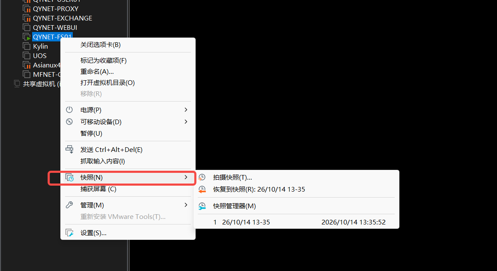

## 三、部署前检查：先确认能不能做

### 3.1 FS01：管理员 PowerShell，只查询

```powershell
# 核对系统版本，后续示例应用必须匹配 AD FS 版本
Get-CimInstance Win32_OperatingSystem |
    Select-Object Caption,Version,BuildNumber

# 核对域成员身份
Get-CimInstance Win32_ComputerSystem |
    Select-Object Name,Domain,PartOfDomain

# 核对资源和原共享
Get-Volume -DriveLetter C |
    Select-Object DriveLetter,Size,SizeRemaining
Get-SmbShare | Select-Object Name,Path

# AD FS 使用 HTTPS；同时检查候选应用端口
Get-NetTCPConnection -State Listen |
    Where-Object { $_.LocalPort -in 443,3000 } |
    Select-Object LocalAddress,LocalPort,OwningProcess

# 时间异常会干扰域身份验证
w32tm /query /source
w32tm /query /status
```

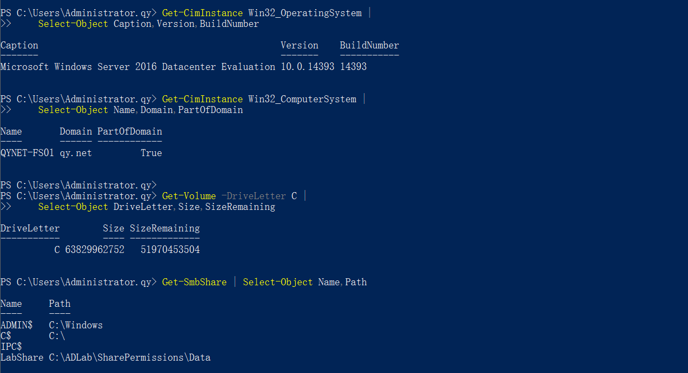
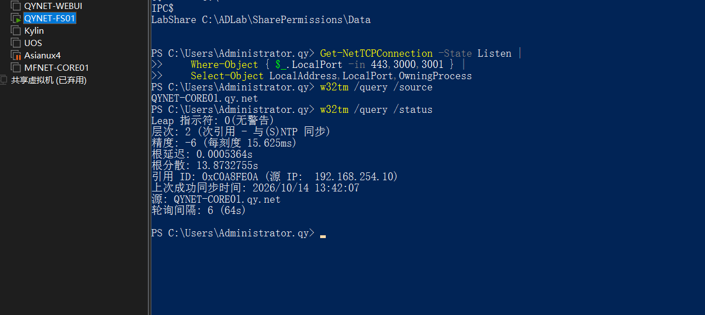

GUI 对照：服务器管理器 → 本地服务器；任务管理器 → 性能；计算机管理 → 共享文件夹。

如 443 已被占用，先查对应进程、服务及 HTTP.sys 绑定，不直接结束进程。3000 也需无冲突。本轮 Gitea 直接提供 HTTPS，不需要额外安装 IIS、Docker 或反向代理。

**记录／截图：**系统版本、域成员身份、资源、端口检查结果。

### 3.2 纯内网需要提前准备的安装包

在可联网的宿主机下载，再复制进 FS01：

| 文件 | 来源／注意事项 |
| --- | --- |
| Gitea Windows x64 稳定版 | [官方下载](https://dl.gitea.com/gitea/)；选匹配系统的 Windows amd64 发行文件，不选 Linux 或开发预览版 |
| Git for Windows x64 安装包 | [官方入口](https://git-scm.com/downloads/win)；核对所选版本支持 FS01 的 Windows Server 版本 |
| 校验信息／签名 | 按对应发行页验证文件完整性，记录实际版本和来源 |

Gitea 二进制包含 SQLite 支持，不需要额外下载 MySQL、PHP 或 Node.js。选定版本后使用对应版本文档，菜单名称可能不同。[二进制安装说明](https://docs.gitea.com/installation/install-from-binary/)

本轮要求 AD FS 2016 或更新版本。若第一节查到更旧系统，先停在这里讨论方案，不把 OIDC 步骤硬套上去。本文是按官方能力整理的待执行路线，尚未在你的 VM 上验证端到端兼容性。

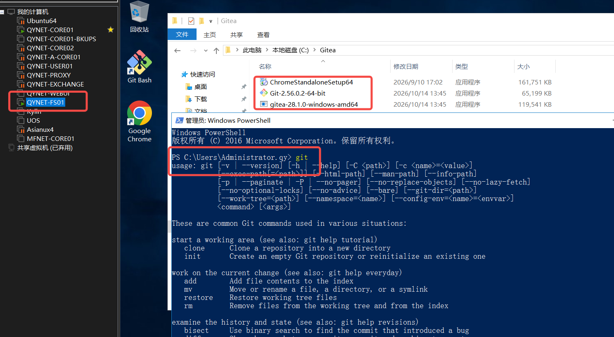

## 四、准备 DNS、HTTPS 证书与服务账号

### 4.1 CORE01：GUI 配置 DNS

打开 DNS 管理器（dnsmgmt.msc）→ 正向查找区域 → qy.net：

1. 检查 fs、gitea 是否已有记录。
2. 无冲突时，新建两个 A 记录，地址填写核对后的 FS01 IP。
3. 不改 FS01 原主机记录，不将客户端 DNS 改为外部 DNS。
4. 在 USER01 验证解析：

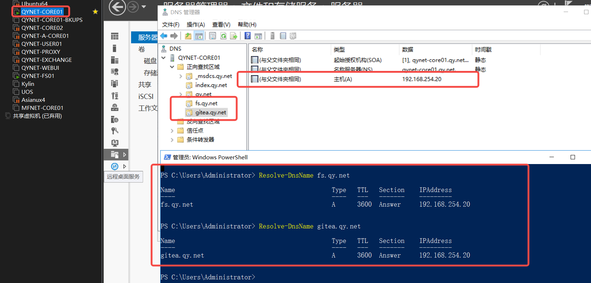
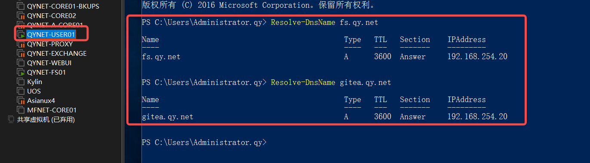

```powershell
Resolve-DnsName fs.qy.net
Resolve-DnsName gitea.qy.net
```

### 4.2 使用现有 CA 申请 AD FS 的 HTTPS 证书

CORE01 已部署实验 CA，名称为 DEMO-CA-2026，并提供 HTTPS 8443 的 Web 注册入口。本次优先使用现有 CA，不再执行另一套 AD FS 自签名申请步骤。

目标证书必须同时满足：

| 检查项 | 本次要求 |
| --- | --- |
| 使用者备用名称 SAN | 包含 DNS Name=fs.qy.net |
| 用途 EKU | 服务器身份验证，OID 为 1.3.6.1.5.5.7.3.1 |
| 私钥 | FS01 上具有与证书对应的私钥 |
| 存储位置 | FS01 本地计算机 → 个人，即 Cert:\LocalMachine\My |
| 证书链 | FS01 和 USER01 信任签发 CA，证书有效且链验证正常 |

**申请成功、颁发者正确、有私钥，并不等于证书名称也正确。** 以下先记录实际踩坑，再按专用模板修正。

#### 4.2.1 已定位：CA 网站本机可访问，FS01 不能访问

本次 FS01 的实际查询显示：

- qy.net 同时解析到 192.168.254.10 和 192.168.254.11，不适合作为只部署在 CORE01 的 CA 网站固定入口。
- qynet-core01.qy.net 解析到 192.168.254.10。
- FS01 到 CORE01 的 Ping 成功，但按主机名及 IP 测试 TCP 8443 均失败。
- CORE01 的 8443 存在监听，LocalAddress 为 ::，OwningProcess 为 4。System／HTTP.sys 承接 IIS 连接时可以出现该结果，它不是“进程异常”的证据。
- 添加仅允许 FS01 地址访问的入站放行规则后，本人确认网页已可访问。该对照表明放行规则解决了本次连接问题，不等于所有网页访问失败都由防火墙引起。

排查命令，FS01 执行：

```powershell
Resolve-DnsName qy.net -Type A
Resolve-DnsName qynet-core01.qy.net -Type A
Test-NetConnection qynet-core01.qy.net -Port 8443
Test-NetConnection 192.168.254.10 -Port 8443
```

CORE01 管理员只读检查：

```powershell
Get-NetTCPConnection -State Listen -LocalPort 8443 |
    Select-Object LocalAddress,LocalPort,OwningProcess
```

需要重现实验放行时，先核对已有规则，不重复添加：

```powershell
# CORE01：本次已有规则时只查询，不重复创建
Get-NetFirewallRule -Name 'Lab-CAWeb-8443-FS01' -ErrorAction SilentlyContinue |
    Select-Object Name,Enabled,Direction,Action,Profile

# 仅在规则不存在、地址已核对且确认需要放行时执行
# New-NetFirewallRule -Name 'Lab-CAWeb-8443-FS01' `
#     -DisplayName 'Lab CA Web 8443 from FS01' `
#     -Direction Inbound -Action Allow -Protocol TCP -LocalPort 8443 `
#     -RemoteAddress 192.168.254.20 -Profile Any
```

用明确的主机名访问 https://qynet-core01.qy.net:8443/certsrv/；同时核对 IIS HTTPS 绑定和网站证书名称。端口通了不代表证书已受信任，证书错误仍需单独处理，不能靠忽略浏览器警告完成验收。

此 Web 页面提供申请、获取已签发证书及下载 CA 证书等不同功能；不是只要下载一个 CER 就完成申请。[微软 Web 注册说明](https://learn.microsoft.com/en-us/windows-server/identity/ad-cs/certificate-authority-web-enrollment)

#### 4.2.2 已遇到：CA 证书、用户证书库与计算机证书混淆

本次操作中先后遇到三个问题：

1. 下载证书“颁发给”和“颁发者”均为 DEMO-CA-2026，且没有 SAN。应结合基本约束确认它是不是 CA 证书，不能因为扩展名为 CER 就认作 fs.qy.net 的服务器证书。
2. Web 申请后将证书安装进当前用户库，同时将私钥设为不可导出。不能通过重新下载 CER 或把 CER 导入计算机库，把该用户私钥一起迁移过去；本次选择重新在本地计算机上下文申请，不强行绕过私钥保护。
3. 改用 certlm.msc 后选择了默认“计算机”模板：申请成功，有对应私钥和服务器身份验证用途，但实际 SAN 只有 QYNET-FS01.qy.net，不包含 fs.qy.net，因此不能作为本次规划名称的 AD FS HTTPS 证书。

两个“个人”库不是同一个位置：

| 工具 | 位置 | 本次适用性 |
| --- | --- | --- |
| certmgr.msc | 当前用户 → 个人 | 属于当前登录用户，不作为本次 AD FS HTTPS 证书目标位置 |
| certlm.msc | 本地计算机 → 个人 | 本次在 FS01 生成私钥并注册证书的位置 |

“个人”是证书存储分类，不表示不能供服务使用。把证书放进计算机库也不等于已经配置给 AD FS，后续还要在向导里选择它。

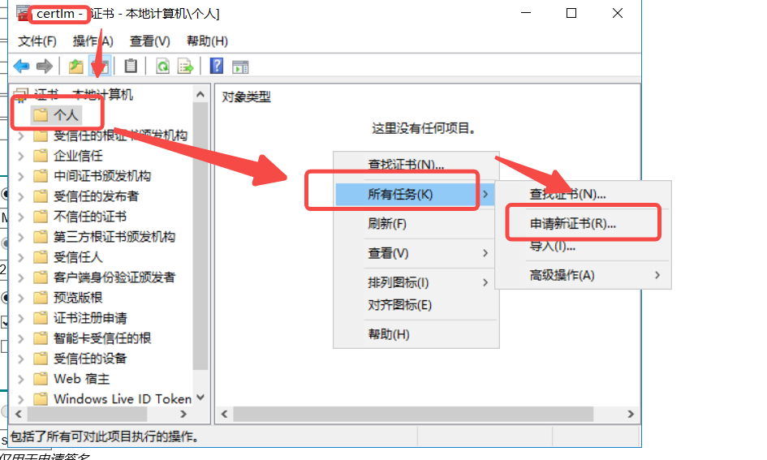

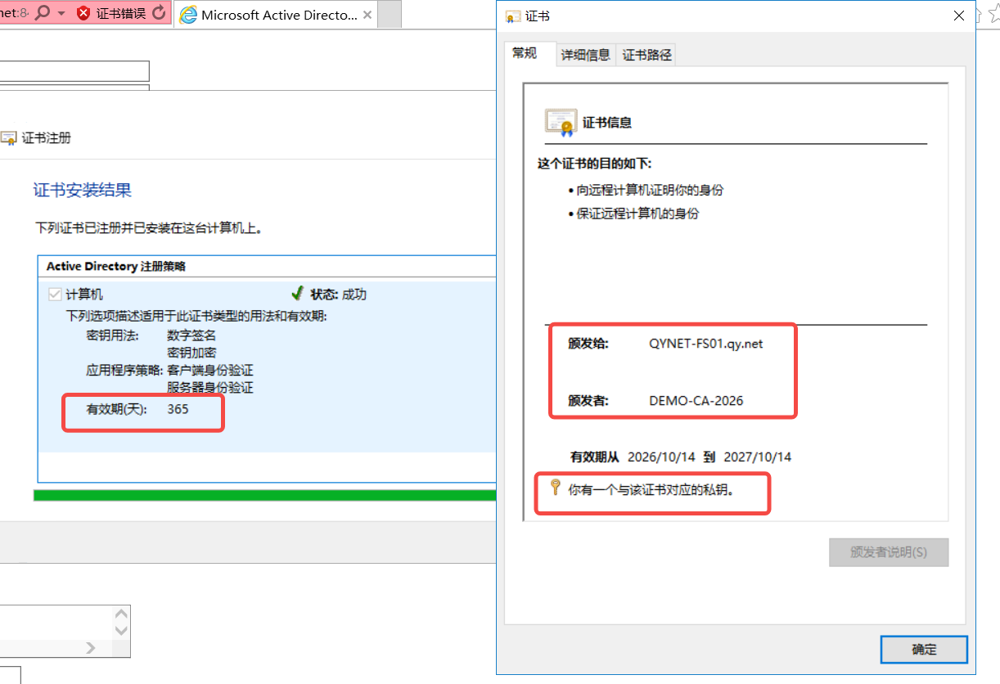

这张计算机证书先保留；证书签发后不能原地修改 SAN，也不能改文件名解决名称不匹配。下面的专用模板和重新申请是**待执行修正步骤**，不把上述截图作为修正完成的证据。

#### 4.2.3 CORE01：复制 Web Server 模板，允许提供服务名称

管理员运行 certtmpl.msc：

1. 找到 Web Server／Web 服务器模板，右键 → 复制模板；不修改默认“计算机”模板。
2. “常规”页将显示名称设为 ADFS Lab TLS，记录内部模板名称。若同名模板存在，先核对用途，不覆盖。
3. “兼容性”选择 CA 和 FS01 实际支持的版本，不高于本环境版本。
4. **“使用者名称”页选择“在请求中提供”**，允许填写 fs.qy.net，而不是从 AD 自动取 FS01 的主机名。出现安全提示时理解含义：申请者能提供名称，所以必须限制注册权限。
5. “扩展” → 应用程序策略：本实验只保留服务器身份验证，不增加客户端身份验证、智能卡登录、任意用途等不需要的 EKU。
6. “安全”页 → 添加 → 对象类型勾选“计算机” → 添加 QYNET-FS01，给它读取、注册权限；不授予自动注册、写入或完全控制。
7. 检查 Domain Users、Domain Computers、Authenticated Users 等广泛主体不具有注册／自动注册权限；可以保留必要读取及管理员管理权限，不把所有读取 ACE 一并删掉。
8. 密钥选择 RSA，最小 2048 位；服务器私钥不启用需要交互确认的强私钥保护。兼容选项允许时使用传统 RSA SChannel CSP／交换密钥，符合所选 AD FS 版本要求。
9. 本轮直接在 FS01 计算机库使用，可保持私钥不可导出，不必为了之前的迁移问题改成可导出。保存模板。

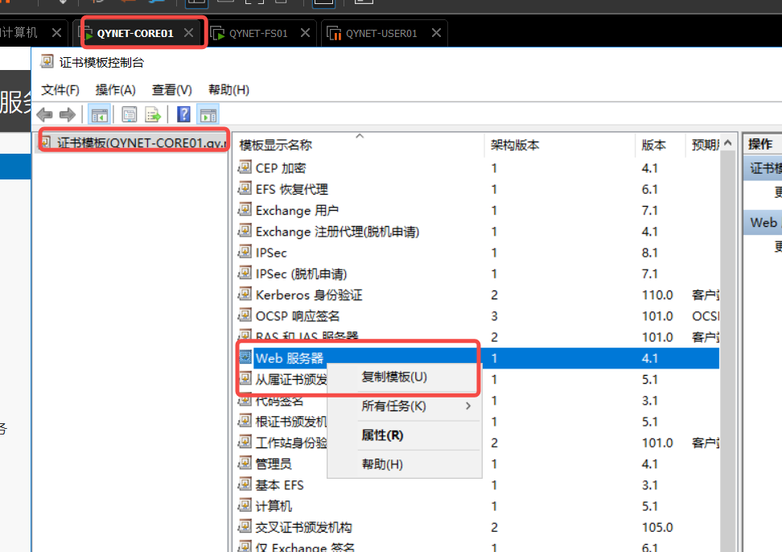
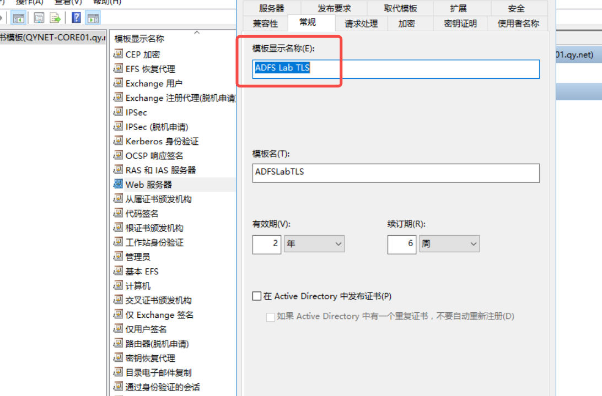
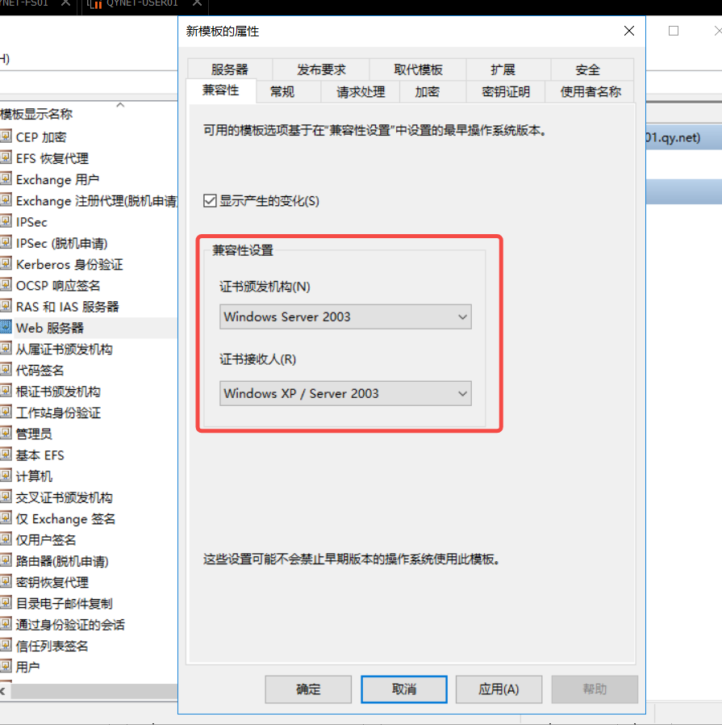
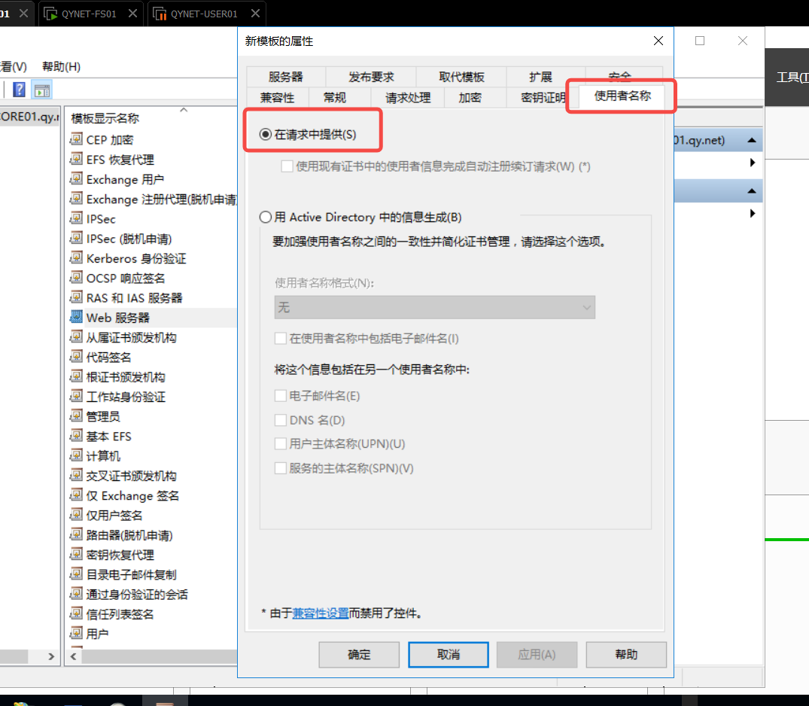
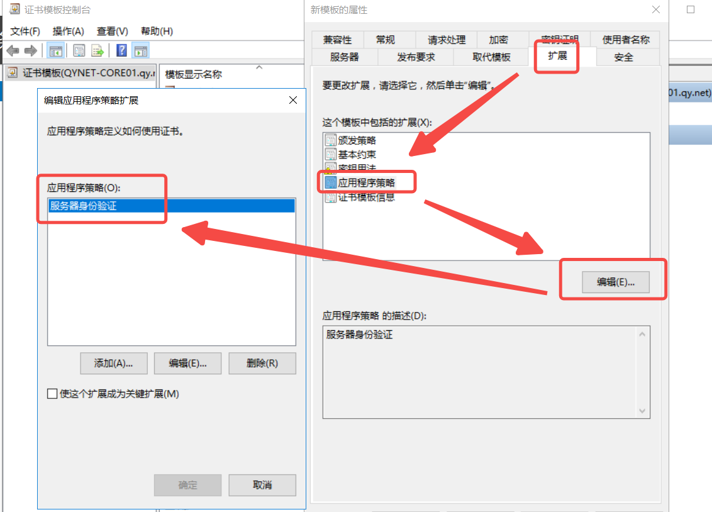
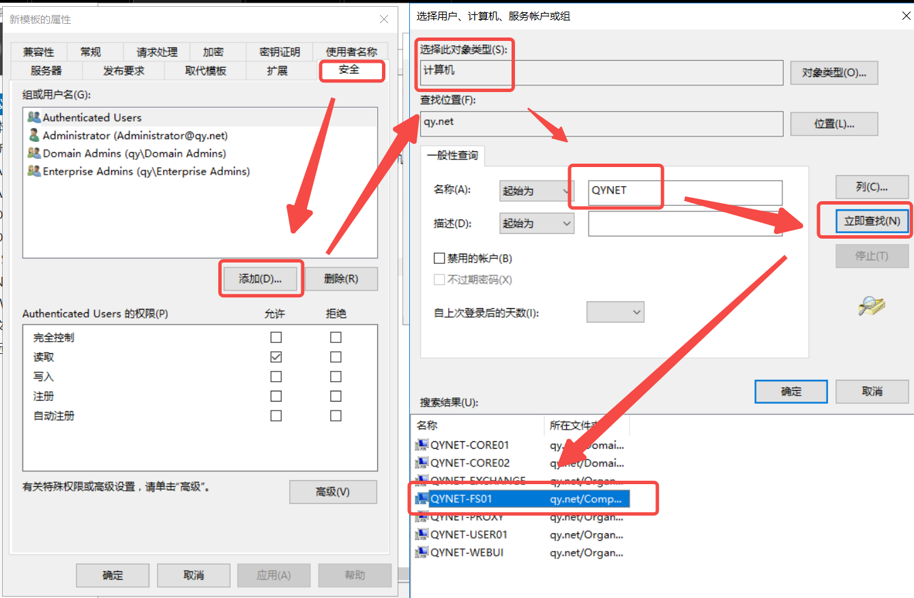
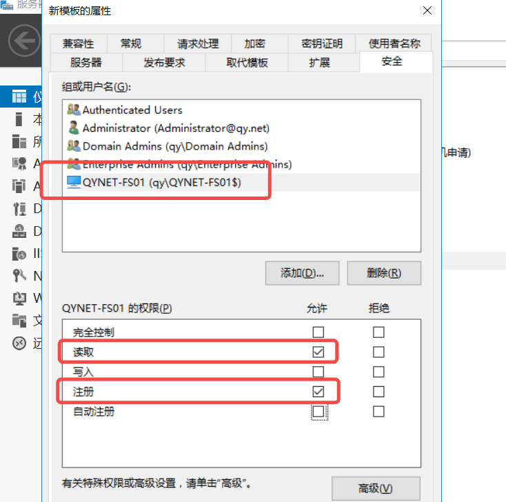

**不要为了 SAN 开启 CA 全局接受任意 SAN 请求属性的开关，也不把此模板注册权授予全域用户。** 本轮只新增用途明确、权限受限的 HTTPS 模板。[微软模板管理说明](https://learn.microsoft.com/en-us/windows-server/identity/ad-cs/manage-certificate-templates)

#### 4.2.4 CORE01：发布新模板

运行 certsrv.msc → 展开 DEMO-CA-2026 → 右键“证书模板” → 新建 → 要颁发的证书模板 → 选择 ADFS Lab TLS。

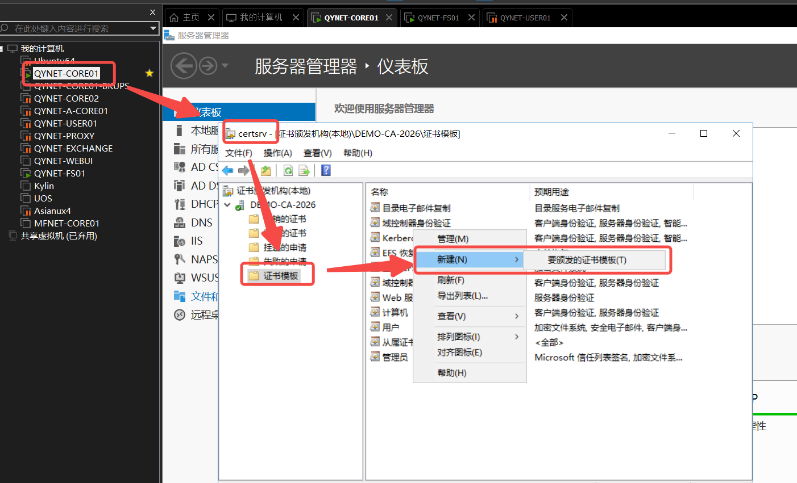
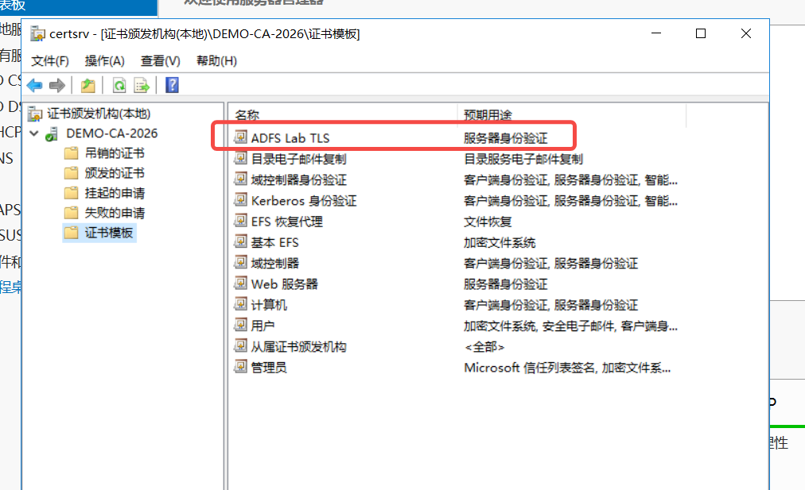

确认发布列表出现新模板，记录模板配置与发布截图；截图未产生时不预放图片链接。

#### 4.2.5 FS01：在计算机库填写 CN 与 SAN，再注册

管理员打开 certlm.msc → 个人 → 证书 → 所有任务 → 申请新证书 → Active Directory 注册策略：

1. 选择 ADFS Lab TLS，不再选默认“计算机”模板。
2. 点击“需要更多信息才能注册此证书……”链接，打开证书属性。
3. “使用者”页按以下两行分别填写并点击“添加”，确认值出现在对应列表：

| 区域 | 类型 | 值 |
| --- | --- | --- |
| 使用者名称 | 公用名／Common name | fs.qy.net |
| 备用名称 | DNS | fs.qy.net |

4. “常规”页可将好记名称设为 ADFS HTTPS - fs.qy.net，这个标签不代替 SAN。
5. 核对私钥、算法、用途等与模板一致，确定后点击“注册”。
6. 如 CA 要求审批，记录申请编号并由管理员核对后批准，不把“挂起”当失败而反复申请。

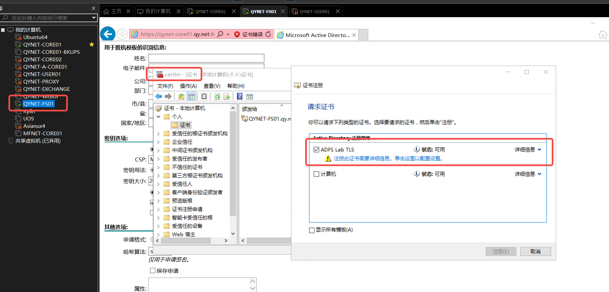
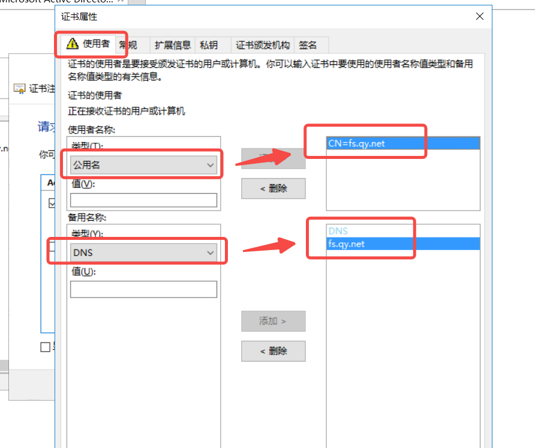
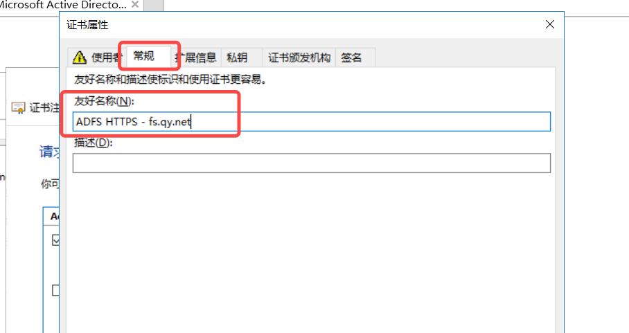
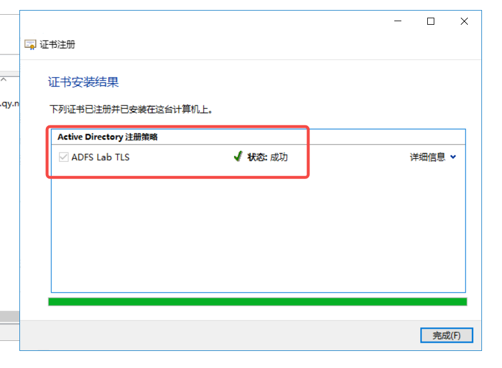
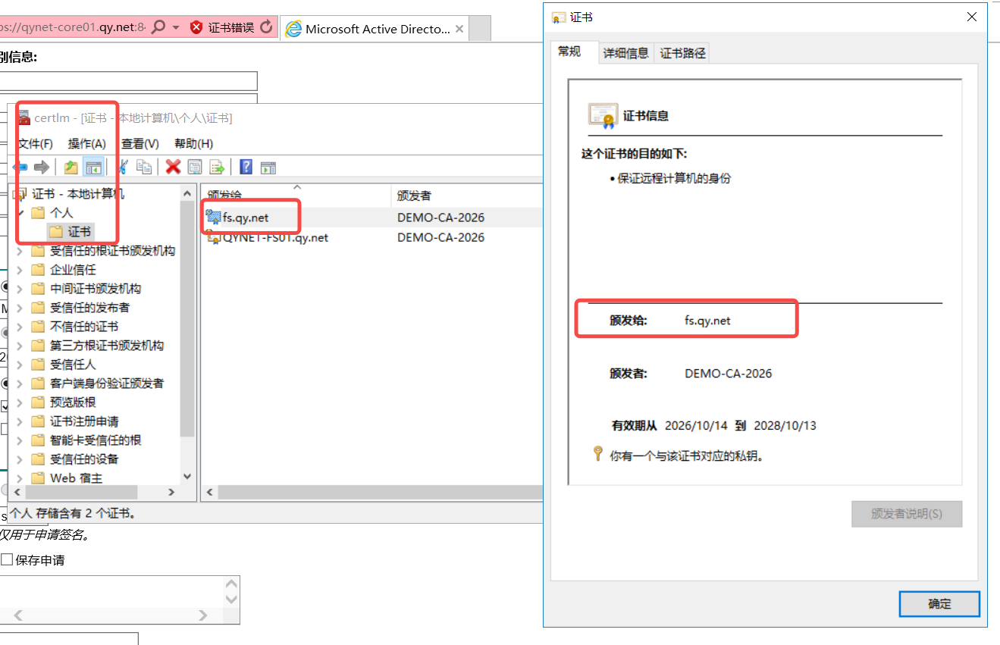

看不到模板时，勾选“显示所有模板”，读取不可用原因；依次检查发布状态、兼容性、FS01 计算机的读取／注册权限，重新打开注册向导。不要立即重启 CA、扩大注册权限或换用户模板凑合。[微软注册说明](https://learn.microsoft.com/en-us/windows-server/identity/ad-cs/request-renew-certificates-certificates-mmc)

#### 4.2.6 FS01：验证新证书，避免只看“注册成功”

在 certlm.msc → 个人 → 证书打开新证书：

- “常规”显示具有与证书对应的私钥。
- “详细信息” → 使用者备用名称：包含 DNS Name=fs.qy.net。
- “详细信息” → 增强型密钥用法：服务器身份验证。
- “证书路径”：链状态正常；有效期符合实际日期。

PowerShell 只读验证，用 SAN 扩展筛选，避免把 Subject 中的名字误当 SAN：

```powershell
$adfsCandidates = @(Get-ChildItem Cert:\LocalMachine\My | Where-Object {
    $dnsNames = @($_.DnsNameList | ForEach-Object { $_.Unicode })
    $hasSan = @($_.Extensions | Where-Object { $_.Oid.Value -eq '2.5.29.17' }).Count -gt 0
    $hasSan -and ($dnsNames -contains 'fs.qy.net')
})

if ($adfsCandidates.Count -eq 0) {
    '本地计算机个人库没有 SAN 包含 fs.qy.net 的证书，请继续排查。'
} else {
    $adfsCandidates |
        Format-List Subject,Issuer,DnsNameList,EnhancedKeyUsageList,
            HasPrivateKey,NotBefore,NotAfter,Thumbprint
}
```

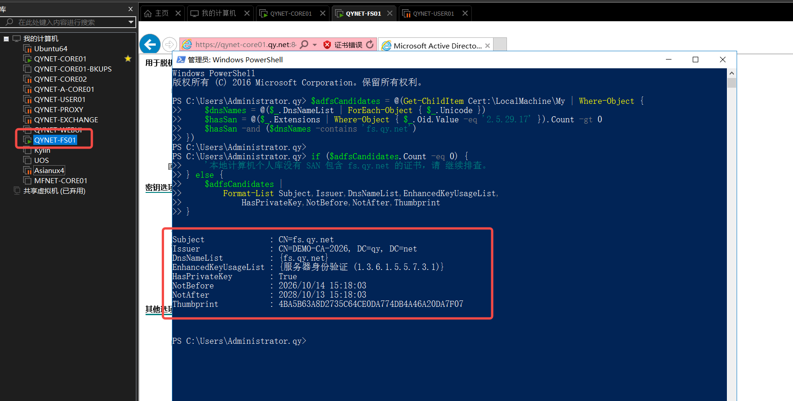

存在多张同名证书时，按有效期、颁发者、指纹和私钥状态明确选定，不默认第一张就是新申请。记录待用证书指纹，后续 AD FS 配置时选择同一张。

截图中“指纹算法 sha1”是指纹计算方式，不等于证书签名算法；检查签名算法须查看其独立字段。

#### 4.2.7 核对 CA 信任与证书用途边界

FS01 和 USER01 在 certlm.msc 中核对签发 CA 的证书链。若信任已通过域策略建立，验证即可，不重复导入。缺失时只导入已核对指纹的 CA 公钥证书：根 CA 放“受信任的根证书颁发机构”，中间 CA 放“中间证书颁发机构”。不要把 fs.qy.net 的叶证书当根 CA 导入。

CER 可以是 CA 公钥证书，也可以是服务器公钥证书；单看文件扩展名无法区分。PFX 可以携带证书与私钥，不能上传博客或 Git。私钥应始终保留在实际使用它的 FS01 上。

Gitea 的 PEM 证书与私钥在第六节按另一条实验路线准备，本节 CA 签发的 AD FS 证书不等于已经覆盖 gitea.qy.net。

**HTTPS 证书与令牌签名证书用途不同**：前者保护连接并标识服务器；后者让应用验证令牌来源。[微软 AD FS 要求](https://learn.microsoft.com/en-us/windows-server/identity/ad-fs/design/ad-fs-requirements)

### 4.3 CORE01：创建专用服务账号

服务账号不要求放在特定 OU，OU 用于组织管理、GPO 作用范围与权限委派。本次沿用 Organization，按以下结构组织；图中 Service、User 和 Group 都是 OU，不是安全组：

```text
qy.net
└─ Organization
   └─ Service
      ├─ User
      │  └─ svc_adfs_lab    ← 普通域服务账号
      └─ Group             ← 可选，留给服务相关安全组
```

CORE01 打开 AD 用户和计算机（dsa.msc）：

1. 在 Organization 下新建 Service OU，再在 Service 下新建 User OU。已有同名 OU 时先核对用途，不重复创建。
2. Group 子 OU 可以同时建立，也可以等有服务相关安全组时再建；AD FS 不要求先创建一个组。
3. 在 Service/User 下创建用户 svc_adfs_lab，设置独立强密码，不勾选“用户下次登录时须更改密码”。
4. 保持普通域用户身份，不加入 Domain Admins 或其他管理员组，不拿它日常交互登录。
5. 填写说明，例如“AD FS 实验服务运行账号”；记录用途、负责人及密码维护方式，不在说明或截图中写密码。
6. 核对账号位置与组成员，后续向导选择 qy\svc_adfs_lab。服务运行账号与 FS01 本地的 Gitea 运行账号 gitea_lab 分开。

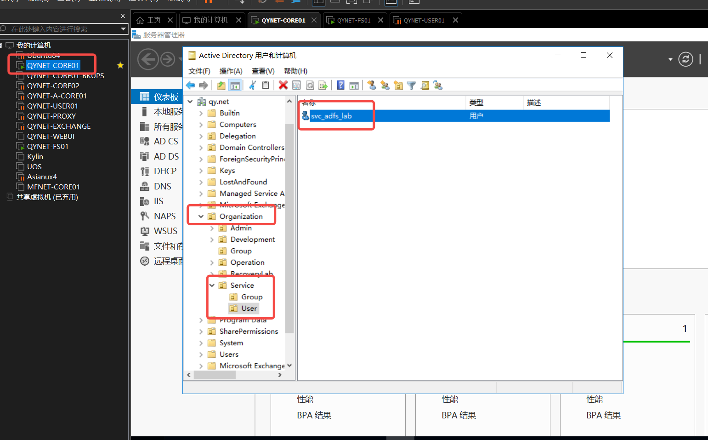

本次预期 DN 为：

```text
CN=svc_adfs_lab,OU=User,OU=Service,OU=Organization,DC=qy,DC=net
```

Organization 下的新 OU 默认会继承上级适用的 GPO 链接。部署前在组策略管理中查看 Service/User 的继承和设置，尤其关注用户配置、登录权限与限制；不要为了省事直接阻止继承或解除现有策略链接。基于计算机的服务登录权限还要核对 FS01 所在作用域，不能仅凭服务账号 OU 判断全部服务权限。

CORE01 管理员 PowerShell，只读核对：

```powershell
Get-ADUser -Identity svc_adfs_lab -Server QYNET-CORE01.qy.net `
    -Properties Description,PasswordLastSet,PasswordNeverExpires |
    Select-Object Name,SamAccountName,Enabled,DistinguishedName,
        Description,PasswordLastSet,PasswordNeverExpires

Get-ADPrincipalGroupMembership -Identity svc_adfs_lab -Server QYNET-CORE01.qy.net |
    Select-Object Name,GroupScope,GroupCategory

Get-GPInheritance -Target 'OU=User,OU=Service,OU=Organization,DC=qy,DC=net' |
    Format-List Path,GpoInheritanceBlocked,GpoLinks,InheritedGpoLinks
```

Get-GPInheritance 需要 GroupPolicy 模块，结果用于查看链接与继承，不替代实际应用结果和服务启动验证。

本轮可用普通域服务账号降低前置复杂度，但必须记录密码生命周期：账号密码变更或过期后，要同步处理服务凭据。不要要求服务账号下次登录必须改密。gMSA 自动管理密码可留到后续课题。

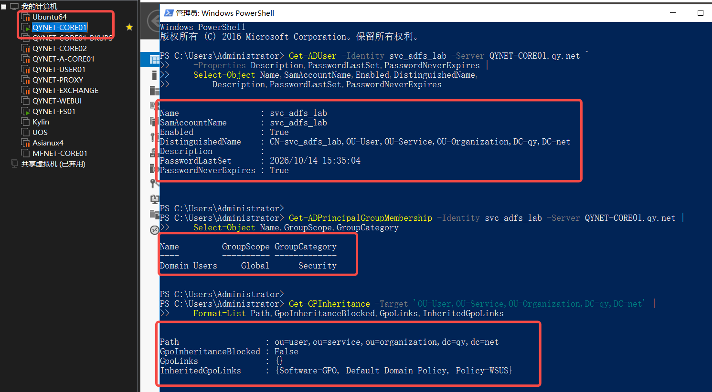

配置向导使用的管理员身份，与服务长期运行使用的账号，是两种不同用途。

## 五、FS01 安装并配置 AD FS

### 5.1 安装角色

服务器管理器 → 添加角色和功能 → 基于角色或基于功能的安装 → 当前 FS01 → 勾选 Active Directory Federation Services，按向导安装。

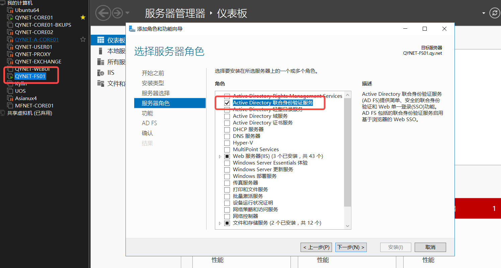
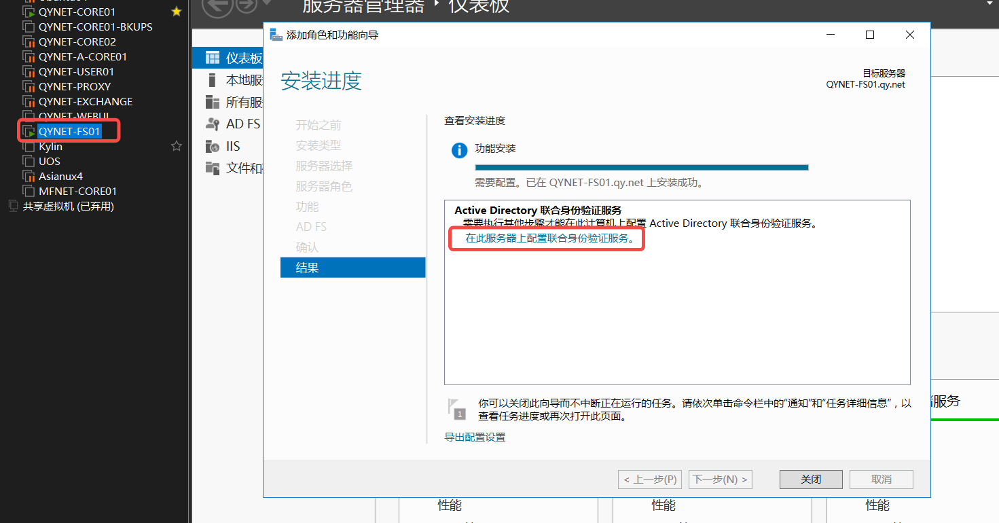

本次只做内网，不安装 Web Application Proxy，也不改共享目录权限。

### 5.2 配置第一个联合服务器

安装完成后点击通知旗标 → 配置联合身份验证服务：

1. 选择“在联合服务器场中创建第一个联合服务器”。实验只有一台，也选择此项。
2. 使用有相应权限的域管理员身份完成初始配置。
3. 选择前面准备的 HTTPS 证书。
4. 联合身份服务名称填 fs.qy.net；显示名称可填 QY Lab Federation。
5. 服务账号选择 qy\svc_adfs_lab。
6. 配置数据库选择本机 Windows Internal Database（WID）。
7. 审阅选项，检查先决条件；有错误先处理，不忽略后强行继续。
8. 配置完成后记录结果与警告。

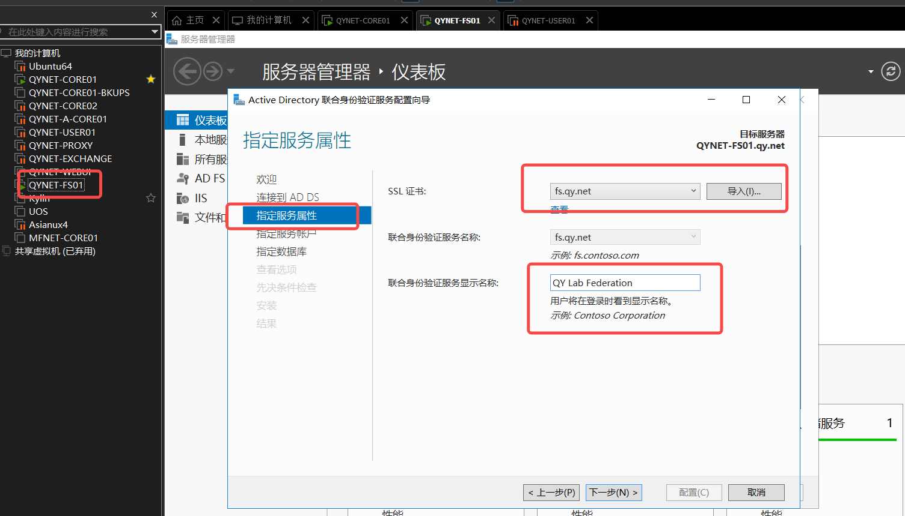
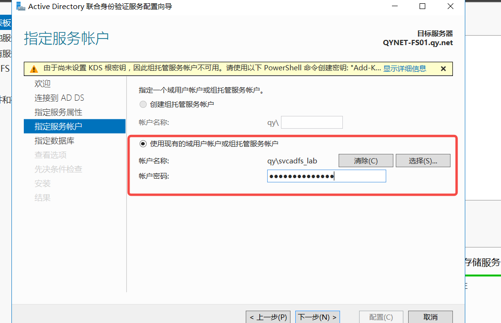
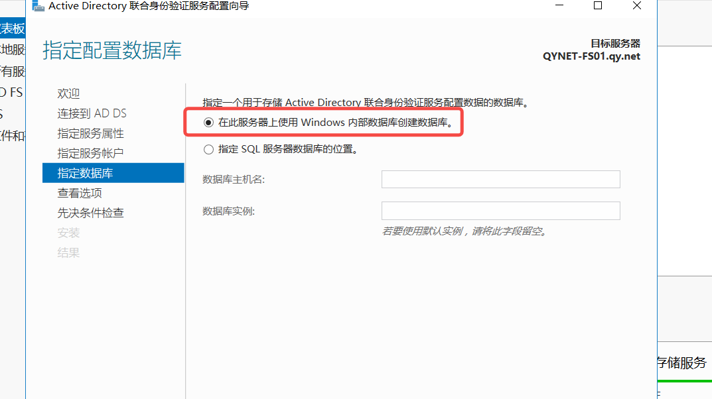
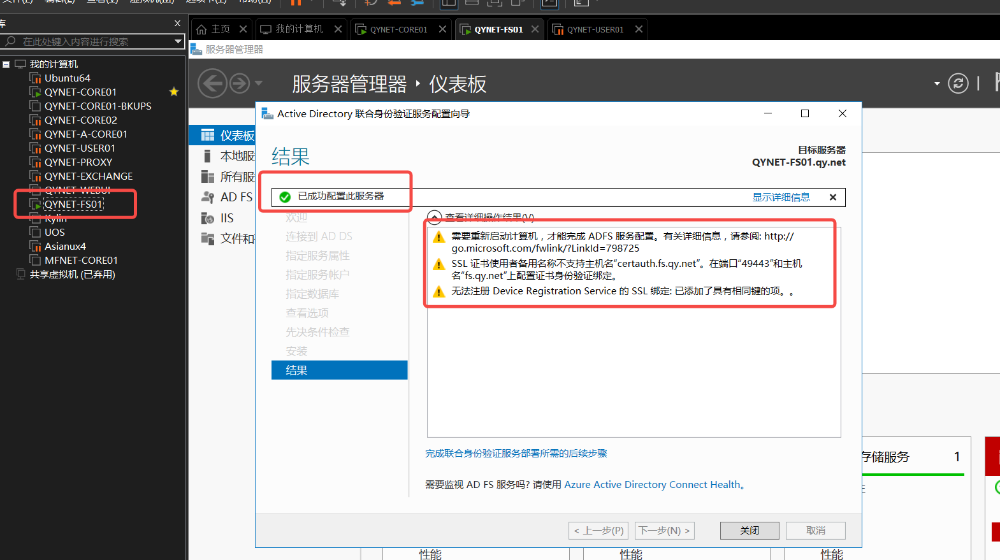

三条警告留意一下即可，设备注册警告记录为未解决事项，暂时不要删 HTTP.sys 绑定，也不需要开放 49443。第二条是微软明确说明的备用绑定行为，不是说你刚申请的 fs.qy.net HTTPS 证书无效。

界面细节以系统版本为准。[微软：配置联合服务器](https://learn.microsoft.com/en-us/windows-server/identity/ad-fs/deployment/configure-a-federation-server)

### 5.3 验证服务基础状态

FS01 管理员 PowerShell：

```powershell
Get-Service adfssrv
Get-AdfsProperties | Select-Object HostName,Identifier
Get-AdfsCertificate |
    Select-Object CertificateType,IsPrimary,Thumbprint
```

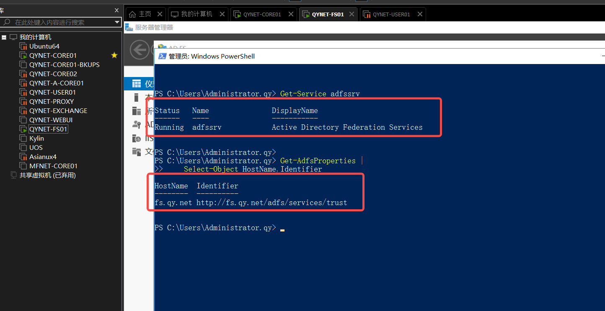

USER01：

```powershell
    Test-NetConnection fs.qy.net -Port 443

# 获取 OIDC 发现文档，同时检查 HTTPS 证书信任
Invoke-RestMethod 'https://fs.qy.net/adfs/.well-known/openid-configuration' |
    Select-Object issuer,authorization_endpoint,token_endpoint,jwks_uri
```

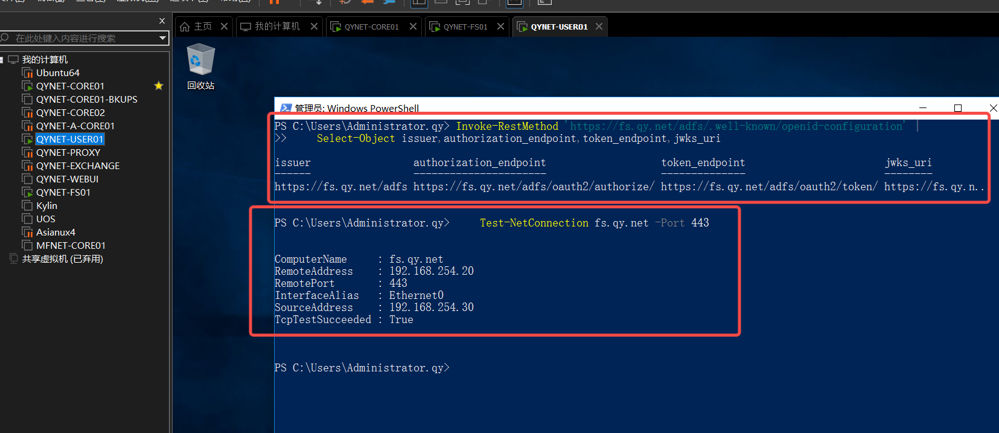

发现文档可读取，仅证明基础端点可用，不证明用户已认证。不要为了看到登录页就随意启用额外端点或修改全局认证策略。

## 六、FS01 安装 Windows 版 Gitea

### 6.1 准备普通本地运行账号与目录

FS01 管理员打开计算机管理 → 本地用户和组 → 用户，创建 gitea_lab，设置独立强密码，不加入 Administrators。不要要求下次登录改密；记录密码到期与后续维护方式。此账号只运行 Gitea，不使用域管理员运行网站。

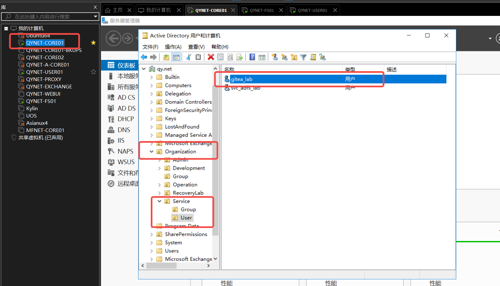

创建 C:\GiteaLab，目录布局如下；已存在时先核对，不覆盖：

```text
C:\GiteaLab
├─ gitea.exe
├─ custom\conf\app.ini
├─ certs\cert.pem
├─ certs\key.pem
├─ data\gitea.db
├─ repositories\
└─ log\
```

通过文件夹属性 → 安全 → 高级，限制为本机 Administrators、SYSTEM 完全控制，以及本地 gitea_lab 修改；不要给 Domain Users 或 Everyone 访问。若取消继承，先转换继承权限，再逐项检查，不删除自己的管理员管理入口。该目录不创建 SMB 共享。

将下载并校验后的 Gitea 程序放入根目录，重命名为 gitea.exe。安装 Git for Windows，确保命令行可调用 Git，安装后重新打开终端。

管理员为 gitea_lab 准备目录权限后，按 Shift 右键 PowerShell 快捷方式 → 以其他用户身份运行 → 输入 QYNET-FS01\gitea_lab（计算机名以实际 hostname 为准）。后面的 Gitea 命令在这个普通账号的终端执行，不用提升权限。

```powershell
whoami
git --version
C:\GiteaLab\gitea.exe --version
```

### 6.2 生成 Gitea 的实验 HTTPS 证书

以下命令供首次生成时使用。**已有证书就不要重复执行**：gitea cert 会覆盖同名输出。将生成步骤放在同一个脚本块中，切换目录失败或发现已有文件时终止，不能忽略报错后单独继续执行生成命令。

```powershell
& {
    $ErrorActionPreference = 'Stop'
    $certDir = 'C:\GiteaLab\certs'
    if (-not (Test-Path -LiteralPath $certDir)) {
        New-Item -ItemType Directory -Path $certDir | Out-Null
    }
    Set-Location -LiteralPath $certDir -ErrorAction Stop
    foreach ($name in @('cert.pem','key.pem','gitea.qy.net.cer')) {
        if (Test-Path -LiteralPath (Join-Path $certDir $name)) {
            throw "文件已存在，先检查，不覆盖：$name"
        }
    }
    & 'C:\GiteaLab\gitea.exe' cert --host gitea.qy.net
    if ($LASTEXITCODE -ne 0) { throw '生成证书失败，请检查原始错误。' }

    # PEM 公钥转成方便 GUI 导入的 CER；不转换或分发 key.pem
    certutil.exe -decode .\cert.pem .\gitea.qy.net.cer
    if ($LASTEXITCODE -ne 0) { throw '证书转换失败，请检查原始错误。' }
}
```
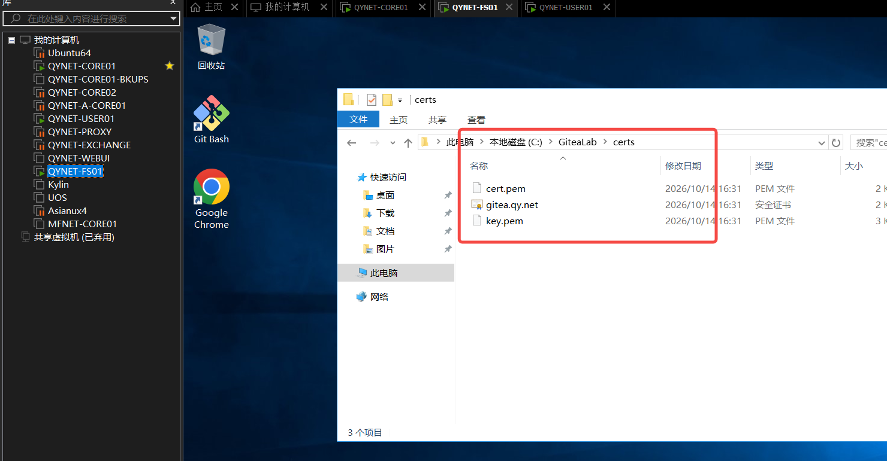

本次曾因 certs 目录不存在导致 Set-Location 失败，当前目录仍是 C:\Users\gitea_lab；随后单独执行生成命令，三个文件实际落在该用户目录中。处理时先核对文件时间与目标是否存在，再复制到 C:\GiteaLab\certs，不重复生成、不覆盖、不立即删除源文件。报错后继续执行也可能覆盖旧证书，已有服务引用时需额外核对影响。

| 文件 | 作用 | 是否分发给客户端 |
| --- | --- | --- |
| cert.pem | Gitea 使用的公钥证书 | 本实验使用转换后的 CER 建立信任 |
| key.pem | 对应私钥 | **不分发、不共享、不上传 Git** |
| gitea.qy.net.cer | 同一证书的公钥副本 | 可交给实验客户端管理员，核对后导入 |

Gitea 这张由程序自签名，Subject 和 Issuer 显示 CN=Gitea, O=Acme Co；是否匹配网站看 SAN 是否包含 gitea.qy.net，不只看 CN。信任 DEMO-CA-2026 并不会自动信任这张自签名证书，它与第四节 CA 签发的 fs.qy.net 是两条不同证书链。[Gitea 证书命令](https://docs.gitea.com/administration/command-line/#cert)

目录权限不足时，由管理员按 6.1 节创建并授权，不改用管理员长期运行网站。本轮自签名证书仅用于实验。

### 6.3 写入最小初始配置

用记事本创建 C:\GiteaLab\custom\conf\app.ini，UTF-8 保存，确认扩展名不是 .txt。文件不存在才新建；配置是本实验模板，实际 IP、运行用户名需要先核对。

**如果已经初始化过 Gitea，先备份现有配置，只调整对应字段，不用下方模板整份覆盖。** 保留原数据库路径及初始化生成的安全密钥；INTERNAL_TOKEN、LFS_JWT_SECRET、OAuth2 JWT_SECRET 等必须在日志、配置截图和文章中脱敏，已暴露的密钥应另行安排轮换。

```ini
APP_NAME = QY Lab Gitea
RUN_MODE = prod
RUN_USER = gitea_lab
WORK_PATH = C:/GiteaLab

[server]
PROTOCOL = https
DOMAIN = gitea.qy.net
HTTP_ADDR = 192.168.254.20
HTTP_PORT = 3000
ROOT_URL = https://gitea.qy.net:3000/
CERT_FILE = C:/GiteaLab/certs/cert.pem
KEY_FILE = C:/GiteaLab/certs/key.pem
APP_DATA_PATH = C:/GiteaLab/data
DISABLE_SSH = true

[database]
DB_TYPE = sqlite3
PATH = C:/GiteaLab/data/gitea.db

[repository]
ROOT = C:/GiteaLab/repositories

[log]
MODE = console,file
ROOT_PATH = C:/GiteaLab/log

[service]
DISABLE_REGISTRATION = false
ALLOW_ONLY_EXTERNAL_REGISTRATION = true
REQUIRE_SIGNIN_VIEW = true
REGISTER_EMAIL_CONFIRM = false

[oauth2_client]
ENABLE_AUTO_REGISTRATION = true
USERNAME = preferred_username
ACCOUNT_LINKING = login
REGISTER_EMAIL_CONFIRM = false
```
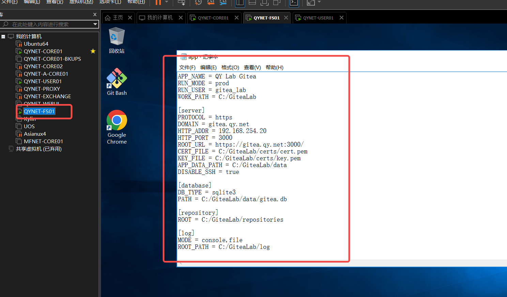

RUN_USER 必须匹配实际进程身份；不要先照搬官方服务示例的 COMPUTERNAME$，那是 LocalSystem 场景。本轮先以前台普通用户进程跑通。

普通用户改为通过 OIDC 自动建号，完整配置见 8.1；不按同名邮箱自动接管已有账户，ACCOUNT_LINKING 保持 login。安装器会生成安全密钥，初始化后不要将 app.ini 原文公开。[Gitea 配置参考](https://docs.gitea.com/administration/config-cheat-sheet/)

HTTPS 直接由 Gitea 提供，3000 是 HTTPS 端口，不是把 http 链接简单改成 https。[Gitea HTTPS 配置](https://docs.gitea.com/administration/https-setup/)

### 6.4 首次启动与本地初始化

先不要向 USER01 放行 3000。确认 FS01 没有既有宽泛允许规则使安装页面暴露给无关机器；实验网若有其他人，应临时限制访问或隔离初始化。

gitea_lab PowerShell：

```powershell
Set-Location 'C:\GiteaLab'
& .\gitea.exe web --config 'C:\GiteaLab\custom\conf\app.ini'
```

程序占用当前终端是正常现象，关闭终端或 Ctrl+C 会停止网站。另开 FS01 浏览器，访问 https://gitea.qy.net:3000/，证书必须正常受信任，不点击忽略警告继续。

#### 6.4.1 本机 HTTPS 警告：先确认协议，再建立信任

本次 Gitea 最初启动日志为 HTTP，ROOT_URL 还是 localhost。按 6.3 节配置并重启后，实际日志确认加载 C:\GiteaLab\custom\conf\app.ini，监听为 https://192.168.254.20:3000，ROOT_URL 为 https://gitea.qy.net:3000/。这证明 HTTPS 已启用，但还不代表浏览器信任证书。

浏览器仍警告时，查询发现本机计算机根证书库没有对应 Gitea 证书；导入后，本人确认 FS01 浏览器已显示安全。处理步骤：

1. FS01 管理员运行 certlm.msc。
2. 受信任的根证书颁发机构 → 证书 → 右键 → 所有任务 → 导入。
3. 选择 C:\GiteaLab\certs\gitea.qy.net.cer，核对来源和指纹，只导入已确认的本实验自签名公钥证书。
4. 完全退出浏览器再打开 https://gitea.qy.net:3000/，确认不再有证书警告。这次仅新增客户端信任，不需要因此重启 Gitea。

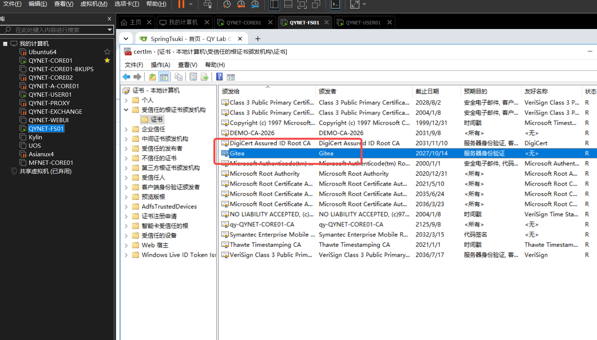

公钥证书和本机信任的只读检查：

```powershell
$giteaCert = Get-PfxCertificate -FilePath 'C:\GiteaLab\certs\gitea.qy.net.cer'
$giteaCert | Format-List Subject,Issuer,Thumbprint,NotBefore,NotAfter

# 确认实际 SAN，不把 Subject 中的 Gitea 当作域名错误
$giteaCert.Extensions |
    Where-Object { $_.Oid.Value -eq '2.5.29.17' } |
    ForEach-Object { $_.Format($true) }

# 无输出表示未在这个本地计算机根库找到同一张证书
Get-ChildItem Cert:\LocalMachine\Root |
    Where-Object { $_.Thumbprint -eq $giteaCert.Thumbprint } |
    Format-List Subject,Thumbprint
```

比较指纹须使用同一种算法；浏览器可能展示 SHA-256，PowerShell Thumbprint 通常是 SHA-1，不能仅因两串不同判定不是同一证书。若仍有警告，记录错误码并检查 SAN、当前时间、有效期和浏览器实际收到的证书，先不要重新生成。

**本机证书信任与远程端口放行是两件事。** 此时 USER01 的 3000 尚未放行，不影响 FS01 本机导入证书；后续 USER01 访问时也要在 USER01 核对并建立信任。

#### 6.4.2 核对初始化状态与管理员回退入口

安装页面核对：

| 项目 | 填写／选择 |
| --- | --- |
| 数据库 | SQLite3，C:/GiteaLab/data/gitea.db |
| 仓库根目录 | C:/GiteaLab/repositories |
| 运行用户 | gitea_lab，与终端身份匹配 |
| 域名／HTTP 端口 | gitea.qy.net／3000 |
| 基础 URL | https://gitea.qy.net:3000/ |
| 邮件服务 | 本次不配置，不要求邮箱验证 |
| 管理员账户 | gitea_lab_admin，独立强密码，实验邮箱 gitea_lab_admin@qy.net |

这个管理员是 Gitea 内部账号，不是 AD 账号，也不是 Windows 管理员。保留它作为 OIDC 失效时的回退入口，不能拿它绑定域普通用户。

安装后用管理员登录，核对配置已有 [security] INSTALL_LOCK = true；若安装页仍可用，先修复再开放访问。保存生成的安全配置，不手动清空密钥。

### 6.5 只向 USER01 开放测试网站

FS01 管理员运行，先核对 USER01 当前 IP；同名规则存在时先检查，不重复添加：

```powershell
if (Get-NetFirewallRule -DisplayName 'ADFS Lab Gitea 3000' -ErrorAction SilentlyContinue) {
    throw '同名规则已存在，请先核对。'
}
New-NetFirewallRule -DisplayName 'ADFS Lab Gitea 3000' `
    -Direction Inbound -Action Allow -Protocol TCP -LocalPort 3000 `
    -RemoteAddress 192.168.254.30 -Profile Domain `
    -Program 'C:\GiteaLab\gitea.exe'
```

此规则限制新增允许范围，不会覆盖其他既有允许规则；要一并核对原规则。FS01 网卡若不处于 DomainAuthenticated，应先查域连通性，不直接关闭防火墙。

USER01 验证解析、3000 连通性、证书与首页。还需要将已核对的 gitea.qy.net.cer 公钥副本复制给 USER01 管理员，按 6.4.1 节导入 USER01 的本地计算机根信任库；FS01 本机信任不会自动传给 USER01。截图证明 Gitea 本身已正常，之后再排 OIDC。

## 七、AD FS 注册 Gitea：先走基础 OIDC

### 7.1 固定应用名称与回调地址

本轮 Gitea 身份源名称固定使用 **adfs**，不要加空格或中文。应用回调地址为：

```text
https://gitea.qy.net:3000/user/oauth2/adfs/callback
```

身份源名称是回调路径的一部分；后面改名也要同步修改 AD FS 注册。DNS、端口、HTTPS、路径都不能随意更换。

### 7.2 FS01：GUI 创建服务器应用

打开 AD FS 管理 → 应用程序组 → 添加应用程序组：

1. 名称填写 Gitea-Lab-A。
2. 模板选择独立应用中的“服务器应用程序”（Server application），即能保管客户端密钥的保密客户端；不是原生／公共客户端。
3. 记录向导生成的 Client Identifier（客户端标识符）。
4. Redirect URI 添加上面的完整回调地址，点击添加。
5. 配置应用程序凭据时生成共享密钥，立即保存至私密记录；不要拍到截图里。
6. 完成向导，重新打开属性检查客户端标识与回调地址。

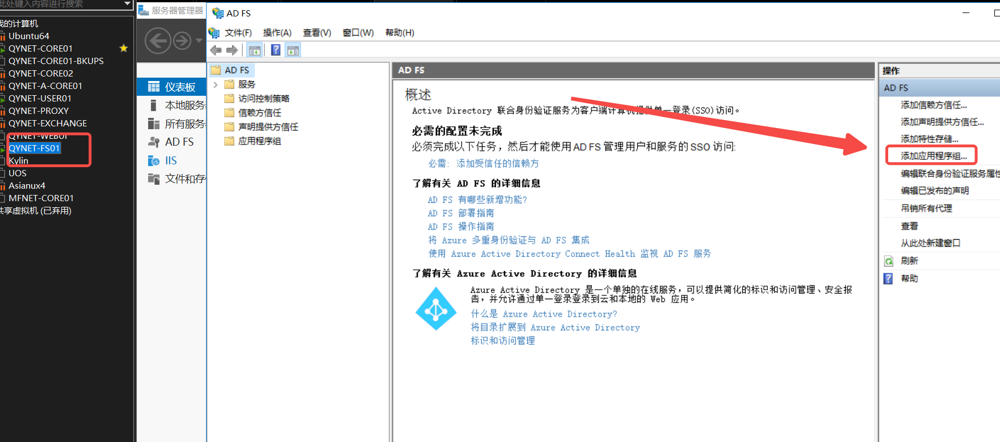
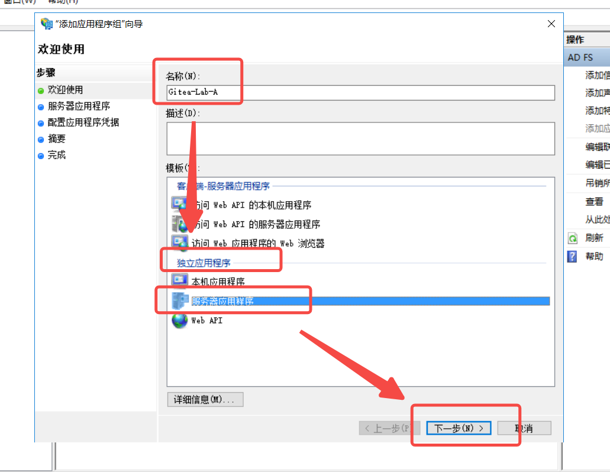
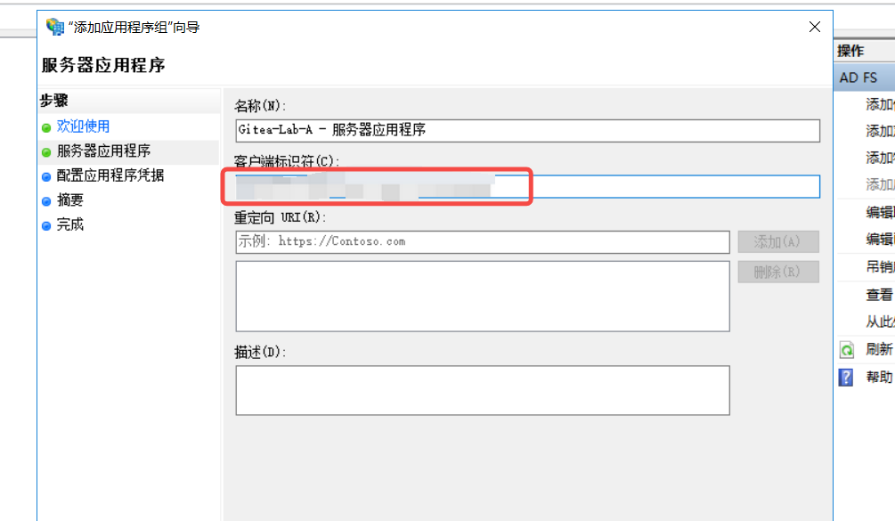
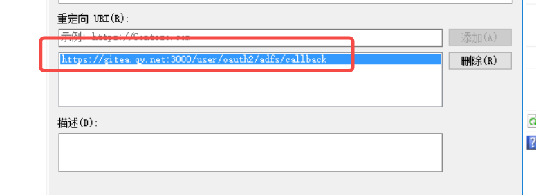


基础登录阶段只请求 openid，使用 AD FS 默认用户信息资源；不假设 profile／email 会自动给出完整 AD 属性。自动建号的额外声明适配见 8.3，不能将基础登录成功当成自动建号成功。不创建 SAML 的“信赖方信任”来代替这里的 OIDC 客户端注册。

若实际版本只有组合模板，先核对该版本向导，不自行以公共客户端代替；可使用该系统自带的服务器应用 cmdlet 进行等价注册：

```powershell
# 只在确认没有同名组、且未完成 GUI 注册时执行，不与 GUI 重复创建
$groupId = 'Gitea-Lab-A'
$clientId = [guid]::NewGuid().Guid
Add-AdfsApplicationGroup -Name $groupId -ApplicationGroupIdentifier $groupId

# -GenerateClientSecret 的输出含密钥，只保存到私密记录，不截图／转贴
Add-AdfsServerApplication -Name 'Gitea-Lab-A-Server' `
    -ApplicationGroupIdentifier $groupId -Identifier $clientId `
    -RedirectUri 'https://gitea.qy.net:3000/user/oauth2/adfs/callback' `
    -GenerateClientSecret -PassThru
```

执行命令前先用 Get-Command Add-AdfsServerApplication -Syntax 核对本机参数。默认资源与自定义资源的区别见 [微软 OIDC 概念](https://learn.microsoft.com/en-us/windows-server/identity/ad-fs/development/ad-fs-openid-connect-oauth-concepts)，注册参数见 [Add-AdfsServerApplication](https://learn.microsoft.com/en-us/powershell/module/adfs/add-adfsserverapplication)。

**记录／截图：**应用组、客户端标识、回调地址；密钥隐藏。

### 7.3 先验证 Gitea 服务器自己能访问 AD FS

在 FS01 的 gitea_lab 会话执行：

```powershell
Resolve-DnsName fs.qy.net
Invoke-RestMethod 'https://fs.qy.net/adfs/.well-known/openid-configuration' |
    Select-Object issuer,authorization_endpoint,token_endpoint,userinfo_endpoint
```

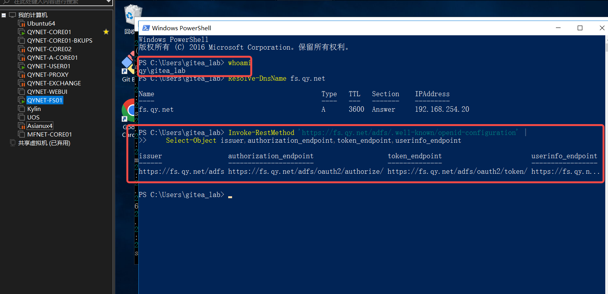

浏览器能访问不代表 Gitea 后台能访问；两台服务虽然同机，仍涉及 DNS、证书信任与网络访问。不要通过关闭证书验证解决。

### 7.4 Gitea 添加认证源

用 gitea_lab_admin 登录，打开站点管理 → 身份／认证源 → 添加认证源。旧版可能叫“管理面板 → 认证”。

| 字段 | 本轮值 |
| --- | --- |
| 认证类型 | OAuth2 |
| 认证名称 | adfs |
| OAuth2 提供方 | OpenID Connect |
| Client ID／Key | 第七节记录的 AD FS 客户端标识 |
| Client Secret | 第七节生成的共享密钥 |
| 自动发现 URL | https://fs.qy.net/adfs/.well-known/openid-configuration |
| 额外 Scopes | 第一轮留空，Gitea 会包含 openid |
| 必需声明／组声明／管理员组 | 第一轮留空，不自动授予管理员权限 |
| 启用 | 勾选 |

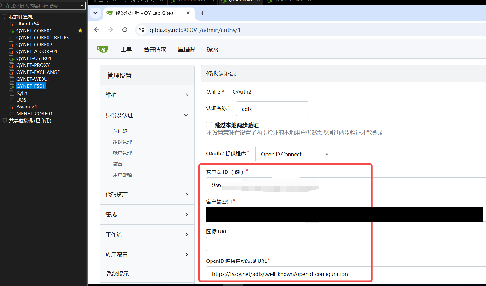

不要选 Azure AD 专用提供方，不要用 LDAP 或 SSPI 代替 OIDC。保存后打开退出登录状态的页面，应能看到该认证入口。[Gitea 认证说明](https://docs.gitea.com/administration/authentication/)

如果保存失败且提示访问内网地址被安全策略阻止，按所装 Gitea 版本检查 OAuth2 后台请求的出站访问策略，只允许 fs.qy.net；不能把全局网络限制全部关闭。此类设置随版本变化，保留完整脱敏报错再定位。

## 八、OIDC 自动建号与声明排障

### 8.1 Gitea：允许外部认证自动注册

不再由管理员预建 lab_share_ro／lab_share_rw 的 Gitea 账户。保留第六节的本地管理员作为回退入口；普通域用户通过 adfs 认证源首次登录时，由 Gitea 根据 OIDC 身份和声明创建账户。

停止对应 Gitea 进程，备份实际加载的 C:\GiteaLab\custom\conf\app.ini，再替换下列两个配置节。已有同名节要合并，不在文件末尾重复追加，也不覆盖其他节和安装器生成的密钥。

```ini
[service]
DISABLE_REGISTRATION = false
ALLOW_ONLY_EXTERNAL_REGISTRATION = true
ALLOW_ONLY_INTERNAL_REGISTRATION = false
REQUIRE_SIGNIN_VIEW = true
REGISTER_EMAIL_CONFIRM = false
REGISTER_MANUAL_CONFIRM = false
REQUIRE_EXTERNAL_REGISTRATION_PASSWORD = false
ENABLE_NOTIFY_MAIL = false
ENABLE_CAPTCHA = false
DEFAULT_KEEP_EMAIL_PRIVATE = false
DEFAULT_ALLOW_CREATE_ORGANIZATION = true
NO_REPLY_ADDRESS = noreply.gitea.qy.net

[oauth2_client]
ENABLE_AUTO_REGISTRATION = true
USERNAME = preferred_username
ACCOUNT_LINKING = login
REGISTER_EMAIL_CONFIRM = false
```

DISABLE_REGISTRATION=false 与 ALLOW_ONLY_EXTERNAL_REGISTRATION=true 配合，允许外部身份注册，但不开放普通本地自助注册。ENABLE_AUTO_REGISTRATION=true 仍依赖认证源返回完整的用户名和邮箱；它不会自动读取全部 AD 属性。[Gitea 配置参考](https://docs.gitea.com/administration/config-cheat-sheet/)

ACCOUNT_LINKING 保持 login：若用户名／邮箱与已有账户冲突，需要证明对原账户的控制权，不能改为 auto 直接接管。旧的手工创建账户截图已从正文移除，原文件保留；已有账户和仓库不因更换实验流程而删除。

重新按原启动方式运行 Gitea，核对日志中的 ConfigFile 路径。出现“自动注册已启用，但缺少 email、preferred_username”说明开关已生效，但声明适配尚未完成，不是自动建号成功。

### 8.2 USER01：登录入口与后续验收方法

先使用独立浏览器会话，从 Gitea 登录页点击 adfs，核对实际认证的域用户，避免将 Administrator 身份关联给普通应用账户。

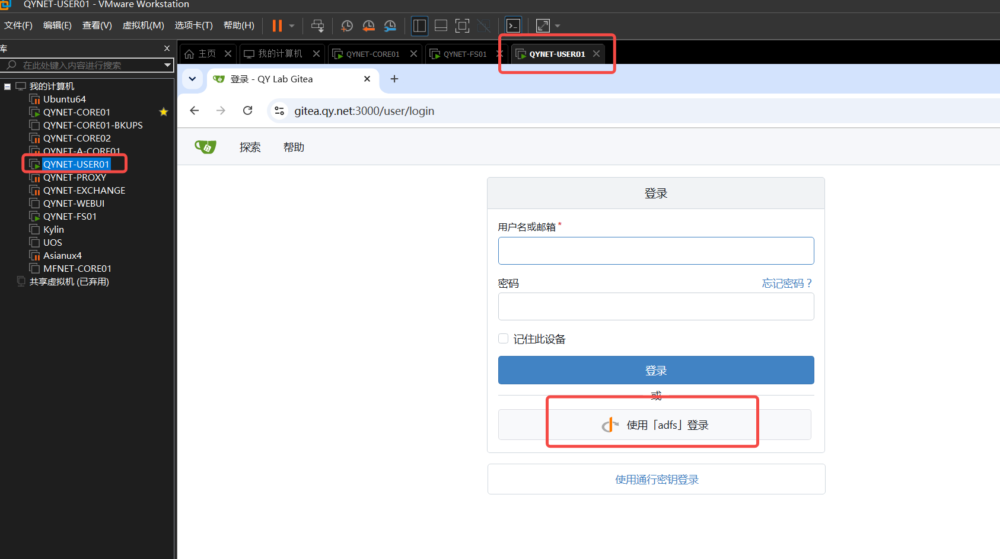
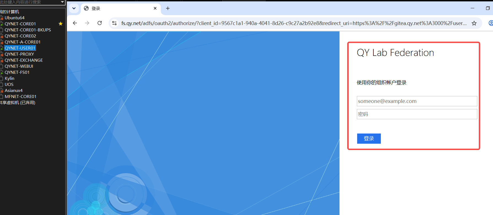

本轮保留 AD FS 表单认证。首次仍需输入域账号密码，并不代表 OIDC 失败；无感 Windows 集成登录、已有 AD FS 会话复用和 Gitea 自动建号是不同的验收项。

完成 8.3 的适配后，再用一个未在 Gitea 创建、也未关联过的新 AD 测试用户验收，例如 lab_oidc_new，填写其 UPN 和 mail，但不要预建同名 Gitea 用户。这里的 mail 是属性值，不代表已经部署邮箱服务。

预期：域认证后直接进入新建的普通 Gitea 账户，无需手工补填用户名／邮箱；核对账户关联的是 adfs，再次登录进入同一账户。已有 ro／rw 的登录成功只能证明原有账户的联合登录，不能代替此次自动建号验收。**后续本人反馈自动创建账户成功，解决过程见 8.4；本段原有图片不作为自动建号成功截图。** 全新测试用户的前后对照、实际生成的用户名、账户关联与重复登录结果仍待补充。

### 8.3 AD FS：补充 Web API、作用域和用户声明

环境为 Windows Server 2016（10.0.14393）。AD 中 lab_share_rw 的 UPN 和 mail 已检查，均为 lab_share_rw@qy.net；AD 有值，不代表这些值已经出现在 Gitea 收到的令牌中。

#### 8.3.1 新建声明用 Web API

原服务器应用位于 Gitea-Lab-A。此次实际操作另建应用程序组 Gitea-Lab-A-Claims，选择独立应用程序中的 Web API，不是重新生成一个 OIDC 客户端。

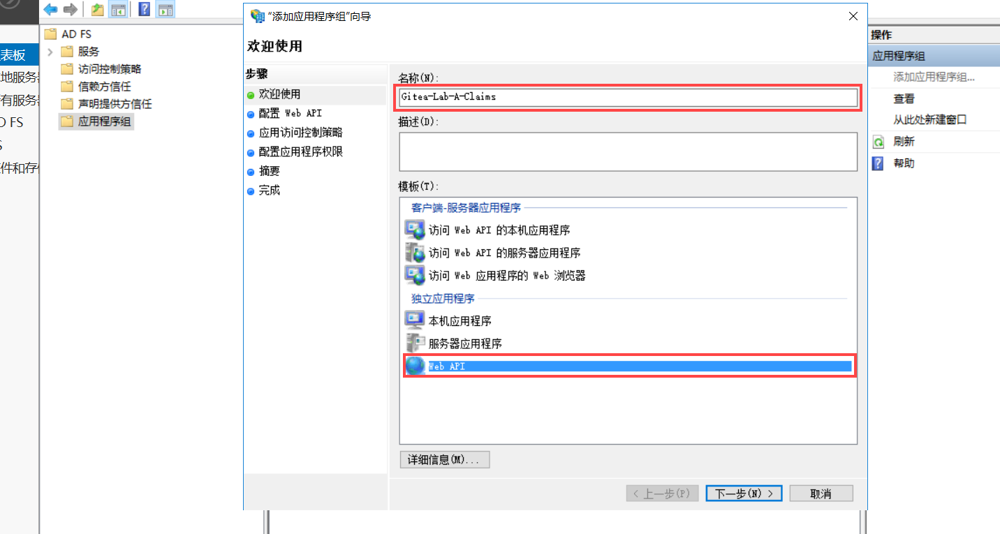

Web API 标识符填写此次已注册服务器应用的客户端标识：9567c1a1-940a-4041-8d26-c9c27a2b92e8。此值只对应本次实验；复现实验应以实际注册值为准。

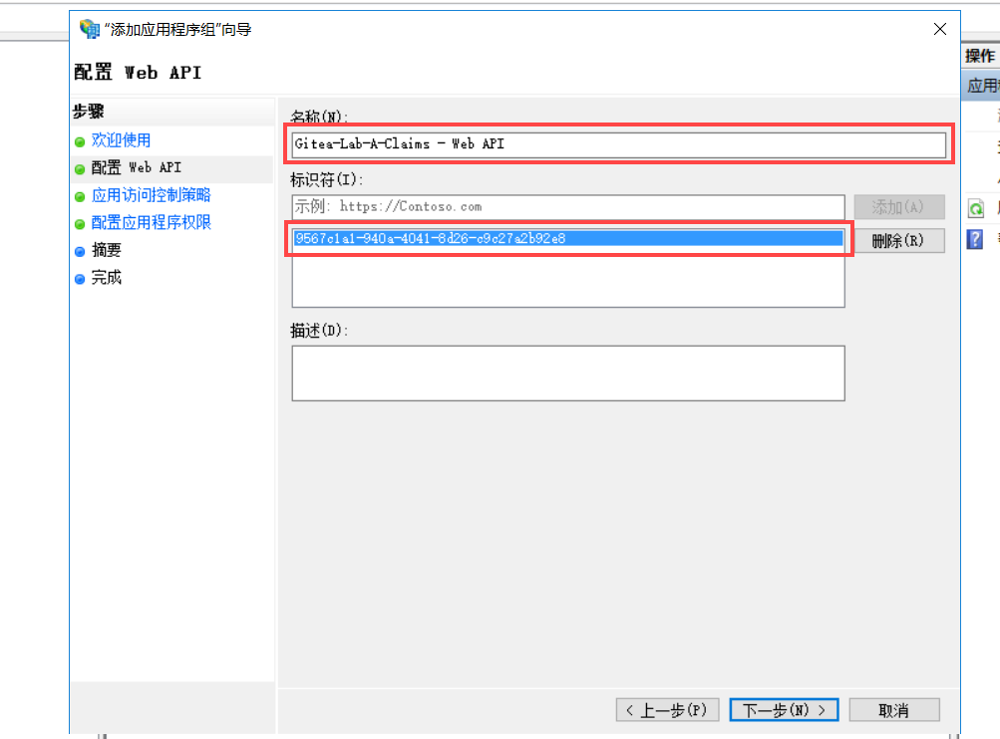

实验访问控制选择“允许所有人”，客户端选择原有 Gitea-Lab-A 服务器应用程序。这里不是允许匿名访问，而是资源的访问控制策略；生产应按实际授权范围限制。初始仅勾选 openid，后续补充 allatclaims。

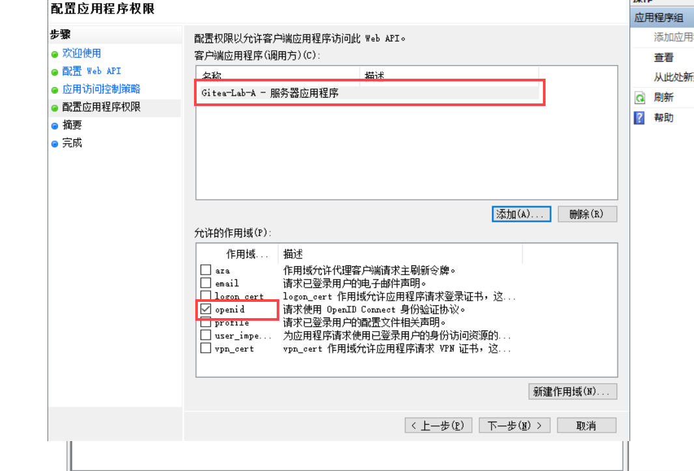
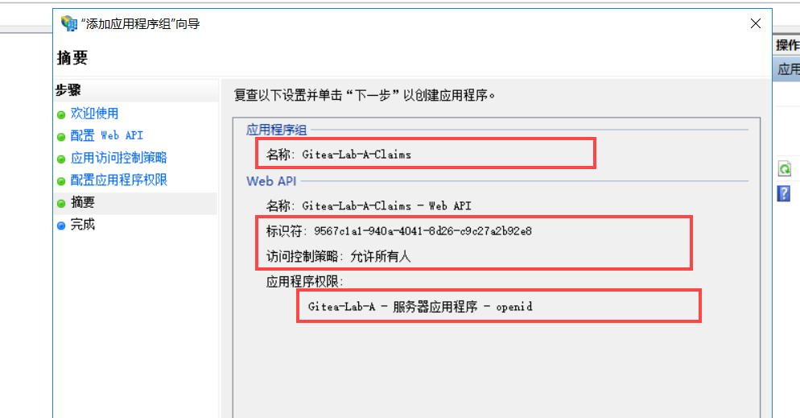

摘要截图只是创建前的配置记录，不单独证明后续声明发行或自动建号成功。

#### 8.3.2 作用域列表中没有 allatclaims

最初客户端权限列表没有 allatclaims，不能仅靠反复查找复选框解决。先在 FS01 管理员 PowerShell 查询本机作用域定义：

```powershell
Get-AdfsScopeDescription | Select-Object Name,Description
```

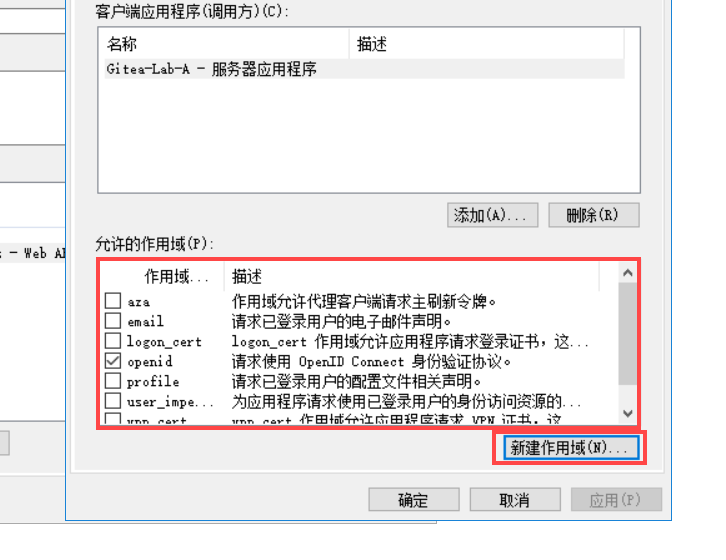

确认确实不存在后，在“新建作用域”中填写名称 allatclaims，或采用等价命令；已经存在则不重复添加：

```powershell
$adfsScopes = Get-AdfsScopeDescription -ErrorAction Stop
if (-not ($adfsScopes | Where-Object Name -eq 'allatclaims')) {
    Add-AdfsScopeDescription -Name 'allatclaims' `
        -Description 'Request access-token claims in the ID token' -PassThru
}
```

重新打开该 Web API 的“客户端权限”，选中原 Gitea 服务器应用，勾选 openid 和 allatclaims，应用并保存。


作用域定义存在、客户端已获授权、客户端实际请求，是三个不同环节。手工新增定义不等于系统已经具备对应功能；Windows Server 2016 还需核对微软文档所列更新支持（KB4019472 或包含相关修复的后续累积更新），不能盲目安装旧补丁。[AD FS 的 OIDC 概念与自定义 ID token 条件](https://learn.microsoft.com/en-us/windows-server/identity/ad-fs/development/ad-fs-openid-connect-oauth-concepts)

#### 8.3.3 修正用户名与邮箱的声明映射

Web API 属性 → 颁发转换规则 → 添加规则 → “以声明方式发送 LDAP 属性”。以下两张保留了排障过程，**不是最终配置**：第一张尚未填规则名称和特性存储；第二张虽选了 Active Directory，但直接输入短字符串，尚未确认声明类型与 JWT 短名称的对应关系。


查询声明描述，检查实际 ClaimType 与 ShortName，而不是只看 GUI 显示文字：

```powershell
Get-AdfsClaimDescription |
    Where-Object {
        $_.ShortName -in @('preferred_username','email') -or
        $_.ClaimType -in @('preferred_username','email')
    } |
    Format-List Name,ClaimType,ShortName
```


内置“电子邮件地址”的 ClaimType 为 http://schemas.xmlsoap.org/ws/2005/05/identity/claims/emailaddress，ShortName 为 email。用户名需要对应的声明描述：后续实际注册名称为“Gitea OIDC 用户名”、ClaimType 为 urn:gitea:preferred_username、ShortName 为 preferred_username，注册证据见 8.4.2。创建前先查询，已存在则复用，不重复添加或覆盖其他应用定义。[声明描述与短名称参数](https://learn.microsoft.com/en-us/powershell/module/adfs/add-adfsclaimdescription)

这一阶段 GUI 中的规则名称为 Gitea-UserProfile，特性存储选择 Active Directory，曾显示如下映射；**显示名称不代表后台已经保存了正确的声明类型**：

| LDAP 属性 | 传出声明的显示名称 | 对应 JWT 短名称 |
| --- | --- | --- |
| SAM-Account-Name | Gitea 用户名 | preferred_username |
| E-Mail-Addresses | 电子邮件地址 | email |


后续后台查询发现用户名类型被保存成了字面文本“Gitea 用户名”，实际修正见 8.4.2。不修改 sub 来凑用户名或邮箱，也不凭下拉框显示文字宣布声明已正确发行。

#### 8.3.4 核对服务端授权与 Gitea 实际请求

在 FS01 查询此次客户端与资源之间的授权：

```powershell
$clientId = '9567c1a1-940a-4041-8d26-c9c27a2b92e8'
Get-AdfsApplicationPermission |
    Where-Object {
        $_.ClientRoleIdentifier -eq $clientId -and
        $_.ServerRoleIdentifier -eq $clientId
    } |
    Format-List ClientRoleIdentifier,ServerRoleIdentifier,ScopeNames
```


浏览器开发者工具 → Network，重新从 Gitea 点击 adfs，查看跳转响应的 Location。下面截图中，实际授权请求仍为 response_type=code、scope=openid，未携带自定义 resource，也没有请求 allatclaims。


**以上是 2026-10-14 的停点：服务端权限核对通过，Gitea 侧请求适配尚未完成。** 后续排查与实验性解决方案见 8.4，不能把这一阶段写成自动建号已通过，也不能将历史停点当作目前仍未解决。

排查只在受控本机查看必要字段，不把令牌、Cookie、客户端密钥上传到公开解码网站或报告中。

### 8.4 2026-10-15：资源选择与 UserInfo 的连续排障

#### 8.4.1 先区分“允许自动注册”和“资料声明已收到”

最初 Gitea 提示自动注册已启用，但缺少 email、preferred_username，转到手工补全账户页面。说明开关已经生效，不代表 AD FS 已返回完整开户资料；此时不手工填写表单来冒充自动建号成功。


在 Gitea 管理员页面编辑 adfs 认证源，将“附加授权范围”加入 allatclaims 并保存。随后实际授权请求出现 scope=allatclaims+openid；加号是空格编码，作用域顺序不是故障原因。


原截图曾显示客户端密钥，公开版本已实心遮挡，未遮挡原图留在仓库外。仍建议在 AD FS 轮换该客户端密钥、同步 Gitea 并撤销旧密钥；本次没有密钥已轮换的验证记录。

allatclaims 的含义是请求把访问令牌中的声明也加入 ID token，不是自动查询所有 AD 属性。认证源中的“全名声明”“SSH 公钥声明”“外部 ID”“必需声明”分别用于资料读取、身份识别或准入检查，不能代替 resource 参数。保持 sub 作为身份标识，不按邮箱自动接管账户。

#### 8.4.2 声明显示名称不等于实际 ClaimType

在 FS01，以 qy\Administrator 运行后台查询后发现，规则实际保存的是 types=("Gitea 用户名", "…/emailaddress")；声明描述查询也只有 email。此前仅根据 GUI 中文名称判断配置完成，证据不足。


确认对应声明描述确实不存在后注册：

```powershell
Add-AdfsClaimDescription `
    -Name 'Gitea OIDC 用户名' `
    -ClaimType 'urn:gitea:preferred_username' `
    -ShortName 'preferred_username' `
    -IsOffered $true `
    -PassThru `
    -ErrorAction Stop |
    Format-List Name,ClaimType,ShortName
```

已有同名／同类型定义时先核对，不重复执行；本次成功输出三个字段后才进入规则编辑。


重新打开 AD FS 管理，编辑 Web API 的 Gitea-UserProfile，选择已注册的“Gitea OIDC 用户名”；若使用可编辑类型框，填写实际 URN，而不是中文显示名称。保存后查询：

```powershell
Get-AdfsWebApiApplication |
    Where-Object {
        $_.Identifier -contains '9567c1a1-940a-4041-8d26-c9c27a2b92e8'
    } |
    Format-List IssuanceTransformRules
```


这张修正截图仍使用 sAMAccountName。后续本人将来源调整为 User-Principal-Name（LDAP 属性 userPrincipalName），邮箱继续取 mail，传出声明仍对应 preferred_username／email。改用 UPN 只改变来源值，不会自动解决资源选择或声明未传递；最终 UPN 规则及开户用户名尚无补充截图。

#### 8.4.3 核对的是 FS01，不是 USER01 的补丁

曾误在 USER01 查询出 Windows 10 LTSB 的补丁；客户端版本不能证明 AD FS 服务器满足条件。回到 FS01 后，完整构建号为 14393.693。微软的自定义 ID token 方案列出 KB4019472，其对应版本为 14393.1198，旧构建尚不满足该更新条件；但补丁不是后续所有问题的唯一原因。[方案条件](https://learn.microsoft.com/en-us/windows-server/identity/ad-fs/development/ad-fs-openid-connect-oauth-concepts)、[KB4019472 版本](https://support.microsoft.com/en-us/servicing/os/windows-10/2017/05/may-9-2017-kb4019472-os-build-14393-1198)


本次离线更新安排为先安装服务堆栈 KB5126649，再安装累积更新 KB5126868。实际更新后构建号截图为 14393.9612；不据此补写未提供的 SSU 单独安装截图。不同时间复现应重新核对微软的适用版本、前置条件和已知问题，不将这一组包永久当作最新版。[SSU 说明](https://support.microsoft.com/en-us/help/5126649)、[累积更新说明](https://support.microsoft.com/en-us/servicing/os/windows-10/2026/10/kb5126868-windows-10-1607-security-update)

更新前应备份并安排 FS01 的共享、AD FS、Gitea 中断窗口。本次未确认完成完整目录备份，不补写“备份已完成”。重装程序不能代替恢复数据库、仓库、配置和私钥。

安装时进度条长时间不动，通过下面的只读命令观察后台：

```powershell
Get-Content 'C:\Windows\Logs\CBS\CBS.log' -Tail 15 -Wait
```


这是提取 CAB、应用差分阶段的内部进度，不等于整个安装完成百分比。Ctrl+C 只结束日志查看；不能仅凭界面停留判断卡死，亦不强制关机。更新完成并重启后核对：

```powershell
hostname
Get-ItemProperty 'HKLM:\SOFTWARE\Microsoft\Windows NT\CurrentVersion' |
    Select-Object ProductName,CurrentBuild,UBR
Get-Service adfssrv
Invoke-RestMethod 'https://fs.qy.net/adfs/.well-known/openid-configuration' |
    Select-Object issuer,authorization_endpoint,token_endpoint
```


#### 8.4.4 真正的定位证据：实际访问了默认资源

Gitea 日志最新失败仍为缺少 email、preferred_username。早些时候另有 could not find a matching session for this request，属于其他请求的会话问题，不能混作同一次声明失败。曾手工追加 resource 做临时测试，但没有取得稳定、完整的请求链路，后续停止重放旧登录／回调地址。

普通 AD FS/Admin 错误／警告查询没有记录，不代表声明已正确发行。因此改用事件查看器：查看 → 显示分析和调试日志 → AD FS Tracing → Debug。只在复现窗口临时启用，USER01 正常登录一次后恢复原日志状态，导出短时间段到本机分析。[微软日志说明](https://learn.microsoft.com/en-us/windows-server/identity/ad-fs/troubleshooting/ad-fs-tshoot-logging)

1000／1001 可作为声明排查入口，但不只按这两个 ID 筛选。本次 debug.evtx 共 290 条，覆盖 14:10:38～14:12:52，关键证据实际出现在其他事件中：

| 时间／记录 | 事件 ID | 必要证据 | 判断 |
| --- | --- | --- | --- |
| 14:10:38，记录 6 | 180 | 客户端未获对 urn:microsoft:userinfo 的 allatclaims 授权 | 请求的资源与已授权的自定义 Web API 不同 |
| 14:10:50，记录 226 | 129 | AppliesTo、Target 均为 urn:microsoft:userinfo | 本次选择的是默认资源 |
| 14:10:50，记录 235 | 180 | allATClaims scope assigned?: False；Add access token claims?: False | 勾选自定义资源权限，没有对当前资源生效 |
| 14:10:50，记录 273 | 180 | 令牌响应成功，资源仍为 urn:microsoft:userinfo | 不是客户端密钥或令牌端点连接失败 |
| 14:10:50，记录 283 | 89 | UserInfo endpoint successfully constructs JSON response | 当时 UserInfo 请求成功，但日志未展示完整响应正文 |

同一授权请求结合 Activity ID 关联，令牌与 UserInfo 调用再结合紧邻时间和客户端信息追踪，不能假设跨 HTTP 请求的 Activity ID 全部相同。

**结论：声明规则已配置，不代表当前请求选择并执行了它。** 自定义 Web API 的授权没有消失，而是 Gitea 未携带 resource，落入默认资源。原始 evtx、包含授权码的 Gitea 日志和客户端密钥截图不进入公开仓库；这里只摘录必要文本。

#### 8.4.5 不重编译 Gitea：临时发现文档适配

曾考虑通过修改 Gitea 源码添加参数，但进一步核对后发现，所用 OAuth 库会保留 authorization_endpoint 原有查询参数。因此“必须重编译”结论过早；本次最终没有替换 gitea.exe，也没有强行启用 form_post。[URL 拼接实现](https://github.com/golang/oauth2/blob/v0.37.0/oauth2.go#L146-L171)

在 FS01 使用本机临时服务，先从真实 AD FS 拉取发现文档，只修改副本：

1. 给 authorization_endpoint 追加 resource=9567c1a1-940a-4041-8d26-c9c27a2b92e8。
2. 保留 issuer、token_endpoint 和 jwks_uri；认证、换令牌仍直接连接 AD FS。
3. 仅监听 127.0.0.1:18080，不开放 USER01 入站，不代理密码或令牌。

首次保留 UserInfo 端点测试后，出现新的 401／MSIS9921：访问令牌的 audience 已是自定义 Web API，而 UserInfo 要求 urn:microsoft:userinfo。这是资源切换生效后的另一个兼容性问题，不是要求关闭 audience 校验。


Goth 的实现先读取 ID token，再按需查询 UserInfo；发现文档未提供 userinfo_endpoint 时会跳过后者。因此增加显式开关 -SkipUserInfo，只从副本移除该端点，让 Gitea 使用 ID token 中的资料；不关闭 AD FS 的 UserInfo，不伪造邮箱，也不关闭令牌或 TLS 校验。[字段读取与可选 UserInfo 实现](https://github.com/markbates/goth/blob/v1.82.0/providers/openidConnect/openidConnect.go#L196-L234)、[跳过条件](https://github.com/markbates/goth/blob/v1.82.0/providers/openidConnect/openidConnect.go#L333-L337)

下面是本次辅助脚本，保存到 FS01 的 C:\GiteaLab\Start-AdfsResourceDiscovery.ps1。仅适用于本实验名称；端点、issuer 或已有查询参数不符合预期时应停下核对，不移除保护检查。

```powershell
# Lab-only discovery override. Run on FS01 before starting/testing Gitea.
# Does not proxy authorization/token/UserInfo requests or disable TLS checks.
[CmdletBinding()]
param(
    [string]$Resource = '9567c1a1-940a-4041-8d26-c9c27a2b92e8',
    [int]$Port = 18080,
    [switch]$SkipUserInfo
)

$ErrorActionPreference = 'Stop'

function ConvertTo-ResourceDiscovery {
    param(
        [Parameter(Mandatory)]$Metadata,
        [Parameter(Mandatory)][string]$Resource,
        [switch]$SkipUserInfo
    )

    # Work on a copy; preserve issuer, token endpoint, UserInfo and signing keys.
    $copy = $Metadata | ConvertTo-Json -Depth 30 | ConvertFrom-Json
    if ($copy.issuer -ne 'https://fs.qy.net/adfs') {
        throw 'Unexpected issuer. Stop and verify the original discovery document.'
    }
    foreach ($property in @('authorization_endpoint','token_endpoint','userinfo_endpoint','jwks_uri')) {
        $endpoint = [uri]$copy.$property
        if (-not $endpoint.IsAbsoluteUri -or $endpoint.Scheme -ne 'https' -or $endpoint.Host -ne 'fs.qy.net') {
            throw "Unexpected endpoint: $property. No override has been started."
        }
    }
    $builder = [System.UriBuilder]::new([string]$copy.authorization_endpoint)
    if ($builder.Query) {
        throw 'Authorization endpoint already has query parameters; review before modifying.'
    }
    $builder.Query = 'resource=' + [uri]::EscapeDataString($Resource)
    $copy.authorization_endpoint = $builder.Uri.AbsoluteUri
    if ($SkipUserInfo) {
        # Goth skips its optional UserInfo request when this endpoint is absent.
        # It must then obtain user details from the ID token; do not fabricate them.
        $copy.PSObject.Properties.Remove('userinfo_endpoint')
    }
    return $copy
}

$metadata = Invoke-RestMethod -Uri 'https://fs.qy.net/adfs/.well-known/openid-configuration'
$adapted = ConvertTo-ResourceDiscovery -Metadata $metadata -Resource $Resource -SkipUserInfo:$SkipUserInfo
$payload = [Text.Encoding]::UTF8.GetBytes(($adapted | ConvertTo-Json -Depth 30))
$listener = [System.Net.HttpListener]::new()
$listener.Prefixes.Add("http://127.0.0.1:$Port/")

try {
    $listener.Start()
    Write-Host 'Temporary lab discovery service. Leave this window open.'
    Write-Host "Discovery URL: http://127.0.0.1:$Port/.well-known/openid-configuration"
    Write-Host "Issuer preserved: $($adapted.issuer)"
    Write-Host "Authorization endpoint: $($adapted.authorization_endpoint)"
    if ($SkipUserInfo) {
        Write-Host 'ID-token-only probe: optional UserInfo endpoint omitted.'
    } else {
        Write-Host 'UserInfo endpoint preserved.'
    }
    Write-Host 'Ctrl+C stops this helper. No token or TLS validation settings are changed.'

    while ($listener.IsListening) {
        $context = $listener.GetContext()
        try {
            if ($context.Request.HttpMethod -eq 'GET' -and
                $context.Request.Url.AbsolutePath -eq '/.well-known/openid-configuration') {
                $context.Response.StatusCode = 200
                $context.Response.ContentType = 'application/json; charset=utf-8'
                $context.Response.Headers['Cache-Control'] = 'no-store'
                $context.Response.ContentLength64 = $payload.Length
                $context.Response.OutputStream.Write($payload, 0, $payload.Length)
                Write-Host ('{0:HH:mm:ss} Discovery document requested' -f (Get-Date))
            } else {
                $context.Response.StatusCode = 404
            }
        } finally {
            $context.Response.Close()
        }
    }
} finally {
    $listener.Close()
}
```

FS01 管理员打开独立 PowerShell，启动最终实验模式并保持窗口打开：

```powershell
powershell.exe -NoProfile -ExecutionPolicy Bypass -File "C:\GiteaLab\Start-AdfsResourceDiscovery.ps1" -SkipUserInfo
```

ExecutionPolicy Bypass 仅作用于本次子进程，不要求永久修改执行策略；脚本自身须先审核。Gitea 认证源的发现 URL 临时改为：

```text
http://127.0.0.1:18080/.well-known/openid-configuration?mode=idtoken
```

mode=idtoken 只是区分配置 URL、便于重新加载的标记，**不是 Gitea 或 AD FS 内置开关**；实际移除 UserInfo 由脚本启动参数 -SkipUserInfo 控制。保存认证源后，在 USER01 新开无痕窗口，正常点击 adfs，不再手动修改地址。若发现 URL 被网络访问策略拦截，先核对该版本的最小允许范围，不关闭全局出站保护。

#### 8.4.6 实际结果、依赖和回退

本人在最终模式下反馈“已经自动创建账号”。据此记录为**本次环境自动建号实操成功反馈**；目前没有新增成功页面截图，不伪造截图，也未独立复查数据库。以下仍待补充：新账户原先不存在的证据、实际用户名和邮箱、adfs 关联、再次登录不重复建号。

最终实验链路为：

```text
Gitea 读取本机适配发现文档
  → 自动携带 resource 跳转到真实 AD FS
  → AD FS 完成域认证与令牌发行
  → Gitea 直接向真实 token_endpoint 换取令牌
  → 不调用不匹配的 UserInfo，读取 ID token 资料
  → 自动创建应用账户
```

保持辅助服务窗口打开。Gitea 可能缓存发现信息，关窗口后当前会话不一定立即失效，但进程重启／认证源重新加载会再次依赖该服务；不能把缓存造成的暂时可用写成已脱离脚本。回退时先将认证源恢复为 https://fs.qy.net/adfs/.well-known/openid-configuration 并保存，再关闭辅助服务；回退会失去本次适配，不保证仍能自动建号。不要删除现有账户、数据库或证书来“恢复”。

本方案仅用于受控实验，不将本机 HTTP 发现文档副本作为已经完成生产安全验收的部署，也不把脚本开机启动等同于生产化。[OIDC 发现规范](https://openid.net/specs/openid-connect-discovery-1_0.html#ProviderConfig)

本次结论只覆盖现有版本与参数组合：标准 OIDC 支持不等于所有产品扩展行为开箱即用；但本次通过发现文档实验适配成功，也不能反过来写成“Gitea 完全不支持自动建号”。

## 九、实训总结

本次实训止于 AD FS 联合登录、声明传递、资源选择与 OIDC 自动建号，不再追加应用内仓库权限、第二实例或服务化任务。

| 关键环节 | 已有证据与结论 |
| --- | --- |
| 声明描述与实际 ClaimType | 已注册 preferred_username 对应的 URN，并通过后台规则查询确认修正；不能只看 GUI 显示名称 |
| FS01 更新与服务状态 | 截图确认 14393.9612、adfssrv Running、发现端点正常 |
| 默认资源选择错误 | Debug 日志确认实际 Target 为 urn:microsoft:userinfo，未使用已配置声明规则的自定义 Web API |
| 自动指定自定义资源 | 本机发现文档适配后，UserInfo 报错中的 audience 已变为自定义资源，证明资源切换生效 |
| UserInfo audience 冲突 | 不放宽校验，使用 -SkipUserInfo 从临时文档移除可选端点，让 Gitea 读取 ID token 中的资料 |
| 自动创建应用账户 | 本人已反馈成功；成功页面、实际账户资料与再次登录结果尚未补充截图，不扩大为生产验收 |

核心收获是分清四件事：**AD 属性存在、声明规则配置正确、本次请求选择了相应资源、应用最终收到所需声明**。它们不能互相替代；scope 已勾选、端点可访问，也不代表整条链路已经正确。

本次没有修改或重新编译 Gitea，也没有关闭 TLS、issuer 或 audience 校验。通过后台规则查询、系统版本核对、Gitea 日志和 AD FS Debug 关联请求，最终用受控的本机发现文档适配解决实验中的自动建号问题。辅助脚本的依赖、回退和实验边界保留在 8.4.6，原始令牌与密钥不进入公开报告。
