本次课题是 **AD 对象管理权限委派**，不是 Kerberos 服务委派。

目标：让一个普通 Helpdesk 账号，只能重置指定 OU 内普通测试用户的密码；证明它不是“变成域管理员”，最后撤销并复测。

本次主要以 GUI 配置，PowerShell 用于身份、连通性和策略结果验证。文中的等价命令供复现参考；实际执行情况以截图及操作记录为准。

## 一、当前环境：2026-10-14 只读检查

### 1.1 VM 与计算机位置

以下运行状态与 IP 本次通过 VMware vmrun／VMware Tools 读取，计算机对象位置通过 CORE01 LDAP 查询：

| 机器 | 本次状态／IP | AD 对象位置 | 本次用途 |
| --- | --- | --- | --- |
| QYNET-CORE01 | 运行，192.168.254.10 | OU=Domain Controllers,DC=qy,DC=net | 管理员配置委派、查看日志 |
| QYNET-FS01 | 运行，192.168.254.20 | CN=Computers,DC=qy,DC=net | 原共享服务器；可兼作 RSAT 管理端 |
| QYNET-USER01 | 运行，192.168.254.30 | OU=Computer,OU=Admin,OU=Organization,DC=qy,DC=net | 普通用户登录与改密验证 |

CORE02 的计算机对象仍存在，但不在本次 VMware 运行清单中。存在 AD 对象不等于设备开机，本任务所有管理端查询与命令优先指定 CORE01。

### 1.2 当前存在的 OU

```text
qy.net
├─ Domain Controllers
├─ Organization
│  ├─ Admin
│  │  ├─ User
│  │  └─ Computer
│  ├─ Development
│  │  ├─ User          ← 本次查询为空，本实验不使用
│  │  └─ Computer      ← 本次查询为空，不使用
│  ├─ Operation
│  │  └─ Computer
│  ├─ Group            ← 保留原组，本实验不修改
│  └─ RecoveryLab      ← 已有 recovery_test，不改动
├─ SharePermissions
│  ├─ User             ← 已有 lab_share_ro、rw、no，不改动
│  └─ Group            ← 已有共享授权组与映射组，不改动
└─ Microsoft Exchange Security Groups
```

Organization 根 OU 有既有 Software-GPO 链接，Admin 有 Policy-User，SharePermissions/User 有上一份映射 GPO 的链接。本次不改这些链接，不移动 USER01／FS01，不修改共享 ACL。

CN=Users、CN=Computers 是容器，不是上图中的 OU。本次不需要在这些默认容器里建立委派。

## 二、设计：新建独立 Delegation OU

在 qy.net 根层新建 Delegation OU，再在其中创建 Group、User 两个子 OU。它们是第一节只读检查后为本次实训新增的对象，不是检查开始时已经存在的 OU。

为保留范围外对照，Helpdesk 和 out 放在 Delegation 根层；只有 in 放在 User 子 OU。委派配置在 **Delegation/User**，不是 Delegation 根层。

| 对象 | 放置位置 | 作用 |
| --- | --- | --- |
| lab_helpdesk | Delegation 根 OU，**不在 User 子 OU** | 普通操作员 |
| lab_delegate_in | Delegation/User | 范围内密码重置对象 |
| lab_delegate_out | Delegation 根 OU，**不在 User 子 OU** | 范围外对照对象 |
| GG_Helpdesk_PwdReset | Delegation/Group | 全局安全组，只加入 lab_helpdesk |

```text
Delegation
├─ Group
│  └─ GG_Helpdesk_PwdReset ← 成员 lab_helpdesk
├─ lab_helpdesk           ← 不在被委派的 User 范围内
├─ lab_delegate_out       ← 范围外对照
└─ User                   ← 仅在这里委派
   └─ lab_delegate_in     ← 范围内测试
```

**谁：**GG_Helpdesk_PwdReset。

**管理范围：**OU=User,OU=Delegation,DC=qy,DC=net 下的用户对象。

**允许操作：**重置密码，并设置下次登录必须改密。

不授予创建／删除用户、修改任意属性、修改组成员、管理 GPO、完全控制或解锁账号的额外权限。

向导可能建立多条 ACE，权限也会受继承、对象类型与已有授权影响。最终以高级安全页和实际操作验证为准，不把任务名称当作全部权限清单。[微软委派向导](https://learn.microsoft.com/en-us/windows-server/identity/ad-ds/manage/delegation-control-wizard)

## 三、管理员准备对象与工具

### 3.1 在 CORE01 创建对象

打开 AD 用户和计算机（dsa.msc）：

1. 在 qy.net 根层新建 Delegation OU，再新建 Group、User 两个子 OU。若同名 OU 已存在，先核对用途，不覆盖或直接对未知对象委派。
2. 在 Delegation 根 OU 创建 lab_helpdesk、lab_delegate_out。
3. 在 Delegation/User 创建 lab_delegate_in；确认该子 OU 没有非实验对象。
4. 为三人设置不同的、符合域策略的初始密码；不添加管理员身份。
5. 为减少前置干扰，初始可不要求首次登录改密，但不勾“密码永不过期”或“用户不能更改密码”。下一阶段会单独设置强制改密。
6. 在 Delegation/Group 创建 GG_Helpdesk_PwdReset，选择“全局”“安全”。
7. 将 lab_helpdesk 加入该组，不加两个目标用户。
8. 截图对象位置、组作用域／类型与成员。密码不写入文章或截图。

遇到同名用户／组先检查用途，不覆盖现有对象。

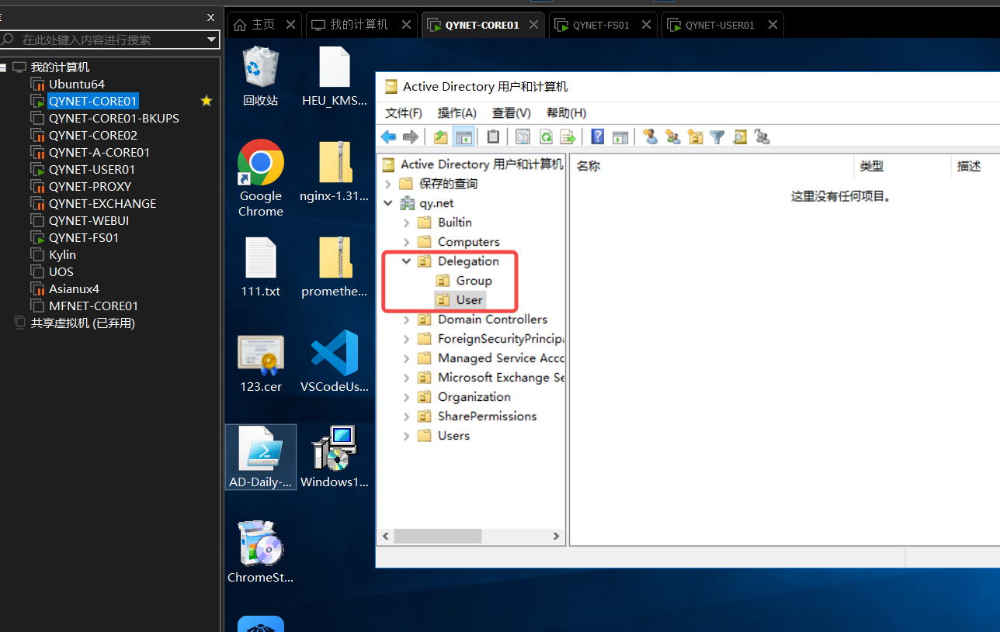
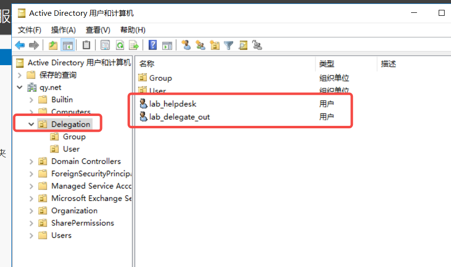
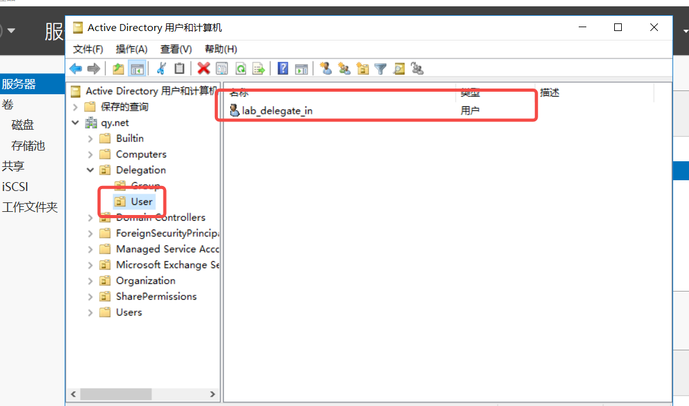
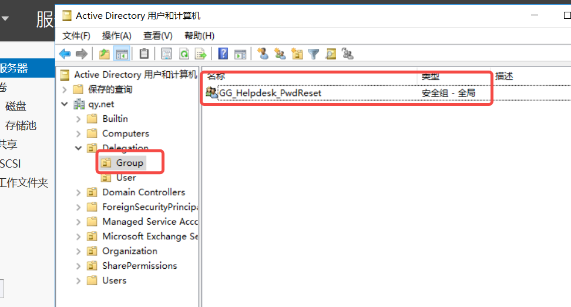
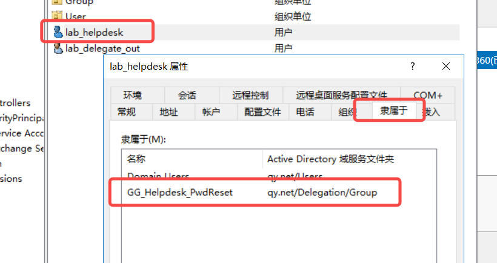

### 3.2 核对账号、DN 与密码策略

CORE01 管理员 PowerShell，仅读取：

```powershell
$dc = 'QYNET-CORE01.qy.net'
$targetOU = 'OU=User,OU=Delegation,DC=qy,DC=net'

'lab_helpdesk','lab_delegate_in','lab_delegate_out' |
    ForEach-Object {
        Get-ADUser -Identity $_ -Server $dc -Properties adminCount,PasswordNeverExpires |
            Select-Object Name,Enabled,DistinguishedName,adminCount,PasswordNeverExpires
    }

Get-ADGroup GG_Helpdesk_PwdReset -Server $dc |
    Select-Object Name,GroupScope,GroupCategory

Get-ADPrincipalGroupMembership lab_helpdesk -Server $dc |
    Select-Object Name,GroupScope,GroupCategory

Get-ADDefaultDomainPasswordPolicy -Server $dc |
    Select-Object MinPasswordLength,ComplexityEnabled,PasswordHistoryCount,MinPasswordAge

# 若目标有细粒度密码策略，应以其有效策略为准；无返回不等于没有域默认策略
Get-ADUserResultantPasswordPolicy lab_delegate_in -Server $dc
```

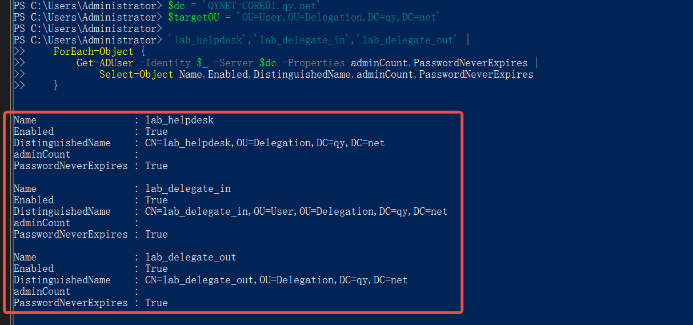
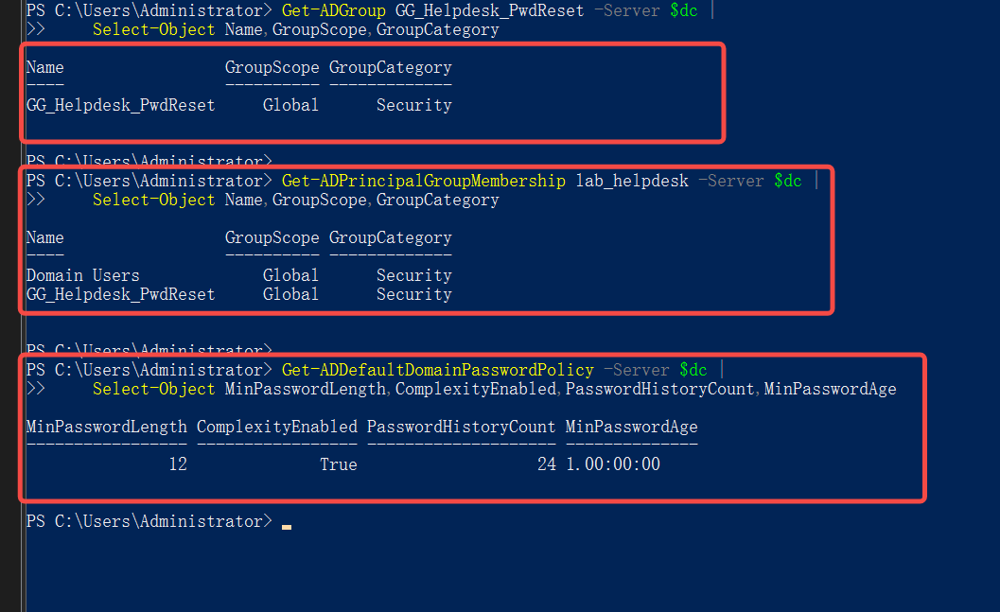

Helpdesk 不应加入 Domain Admins、Enterprise Admins、Account Operators 或其他管理组。adminCount 为空或为 0 只是辅助信息，不能单独证明没有高权限，仍要核对成员关系。

### 3.3 普通操作员在哪台机器操作？

**推荐在 FS01 的 VM 控制台，用 lab_helpdesk 登录并打开 ADUC。** FS01 是域成员服务器，安装管理工具并不把它提升成域控，也不授予 Helpdesk 管理员权限。

先在 FS01 管理员会话检查：

```powershell
Get-WindowsFeature RSAT-AD-Tools,RSAT-AD-PowerShell |
    Select-Object Name,InstallState
```

若未安装，管理员通过“服务器管理器 → 添加角色和功能 → 功能 → 远程服务器管理工具 → 角色管理工具 → AD DS 和 AD LDS 工具”安装 ADUC 与 AD PowerShell。

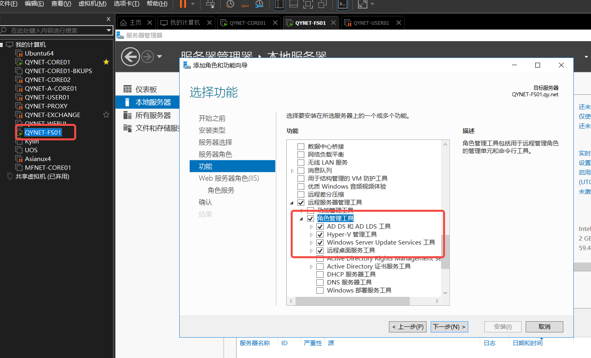

只安装管理工具，不安装／提升 AD DS 角色。组件源缺失时先处理安装介质，不假设内网一定能在线下载。

然后完整注销管理员，登录 qy\lab_helpdesk。不要给它 FS01 本机管理员身份，也不要授予域控登录权。

也可用已有 RSAT 的 USER01 管理端。USER01 先前截图的系统版本为 10.0.14393，不能照搬较新 Windows 的 Add-WindowsCapability 在线安装方法；工具可用性先核实。

## 四、委派前：证明普通账号原本无权重置

在 FS01 的 lab_helpdesk 普通会话：

1. 执行 whoami、whoami /groups，截图证明实际身份。
2. 打开 dsa.msc，右键域节点 →“更改域控制器”，选择 CORE01。
3. 找到 lab_delegate_in，右键“重置密码”。
4. 输入符合有效密码策略的新实验密码，尝试重置。
5. 预期拒绝。记录实际提示；密码不合规、DC 不可达不算“权限拒绝”的证明。

可以看到用户和 OU，并不代表可以修改它们。若重置竟然成功，停止并排查该账号已有组成员和 ACL，不继续新增委派。

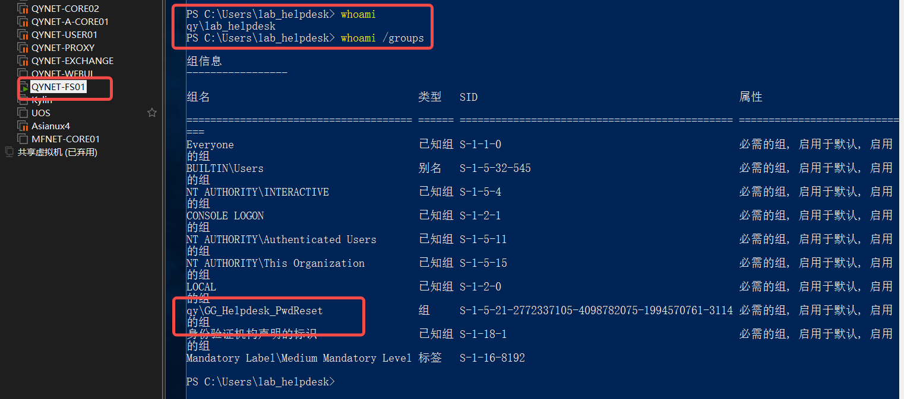
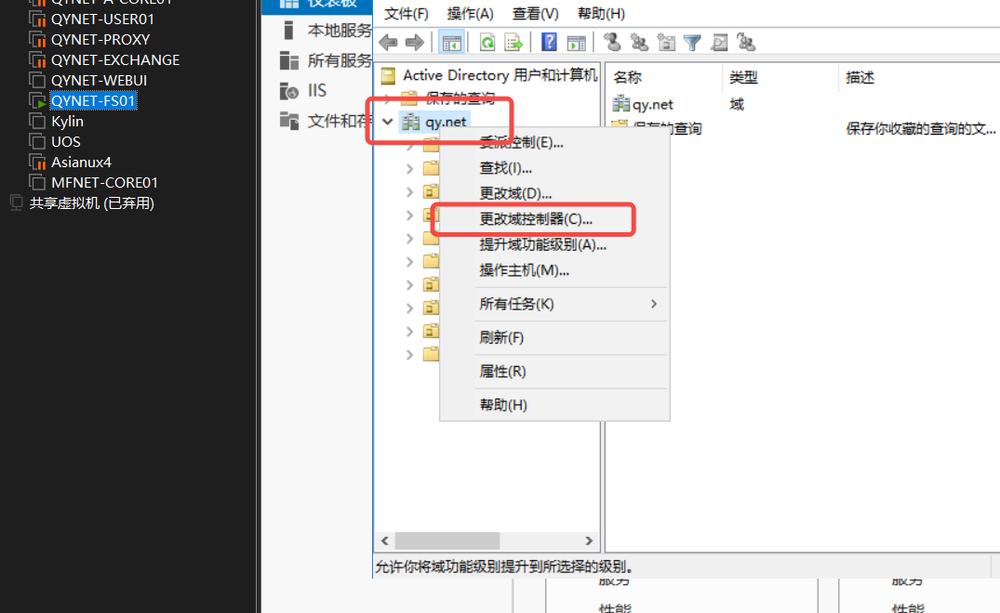
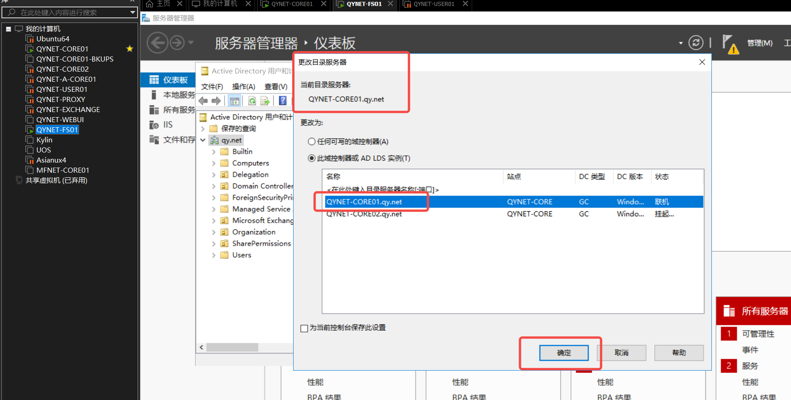
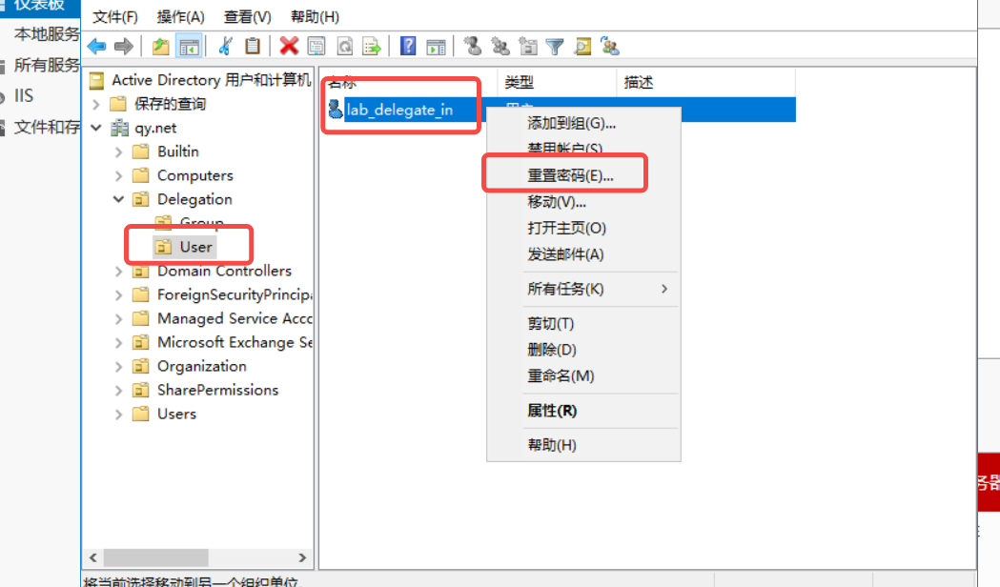
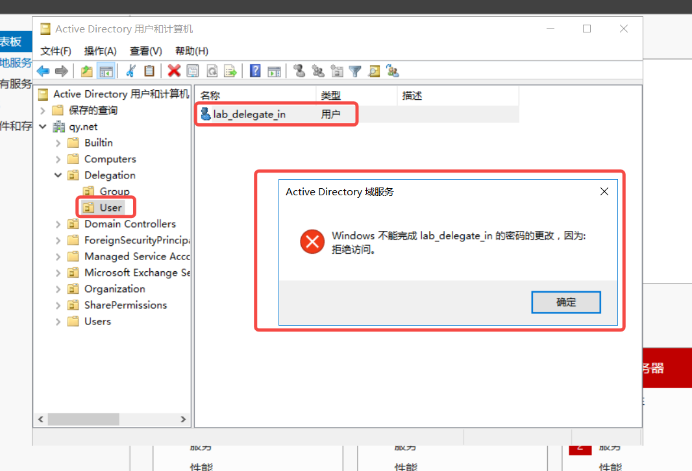

**我的基线：**

- 当前身份：lab_helpdesk
- 选择的 DC：CORE01
- 操作对象 DN：CN=lab_delegate_in,OU=User,OU=Delegation,DC=qy,DC=net
- 实际错误：拒绝访问

## 五、管理员配置最小委派

回 CORE01 管理员会话：

1. 在 ADUC 选择 **qy.net → Delegation → User**，不要选择 Delegation 根 OU。
2. 右键“委派控制”，加入 GG_Helpdesk_PwdReset。
3. 选择常见任务“重置用户密码并强制下次登录时更改密码”。
4. 不选择“创建、删除和管理用户账户”，不选择完全控制。
5. 完成前截图 OU、授权组和任务名称。
6. 在 ADUC“查看”中启用“高级功能”。
7. 打开该 User OU 的“属性 → 安全 → 高级”，找到新组的条目。
8. 记录每条 ACE 的允许权限、对象类型、应用范围及继承状态。

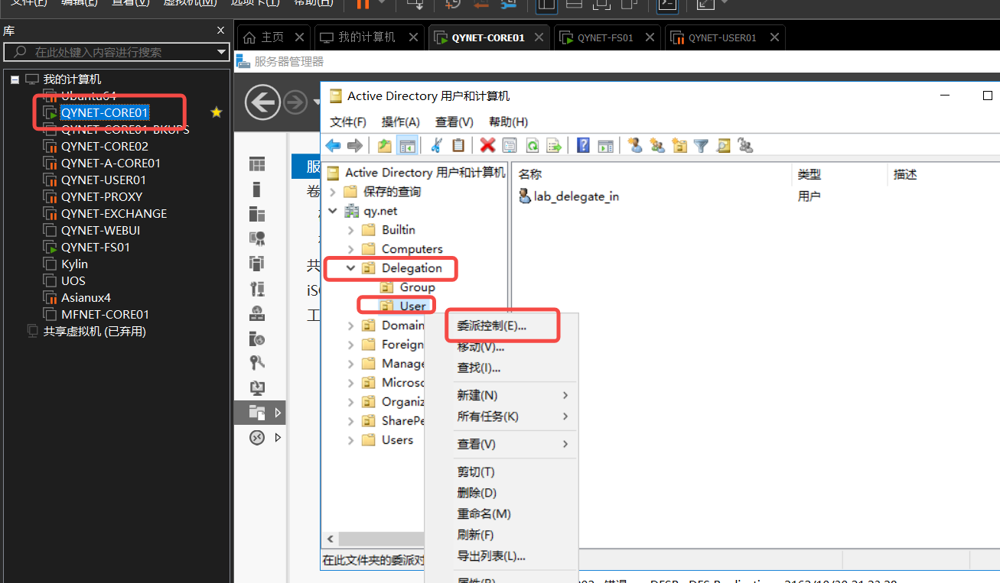
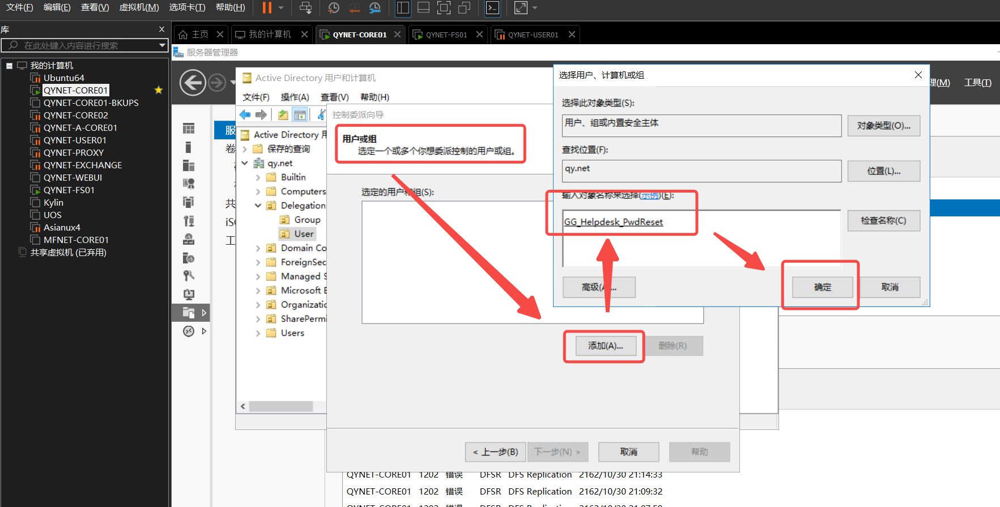
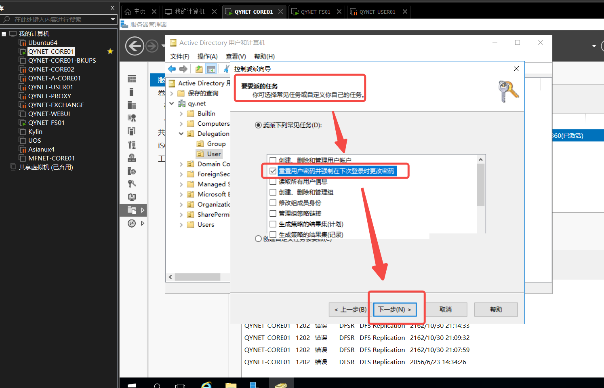
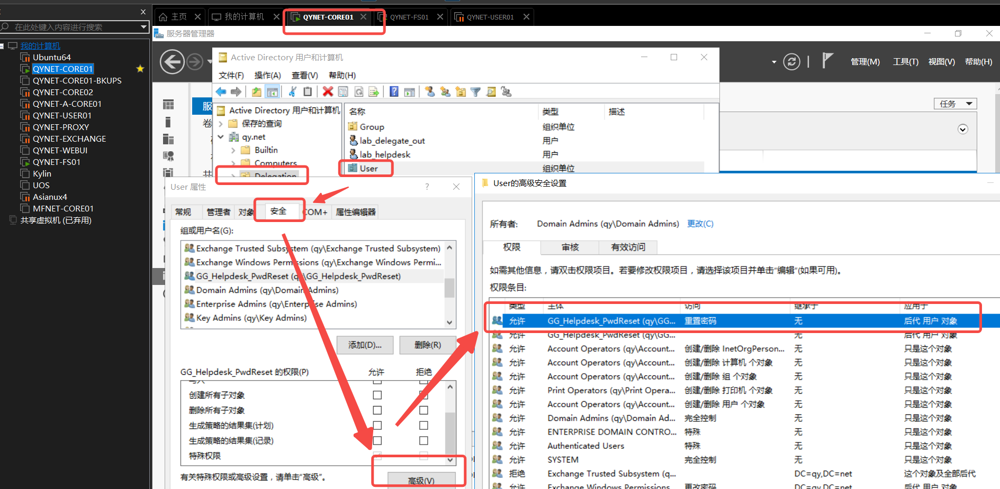
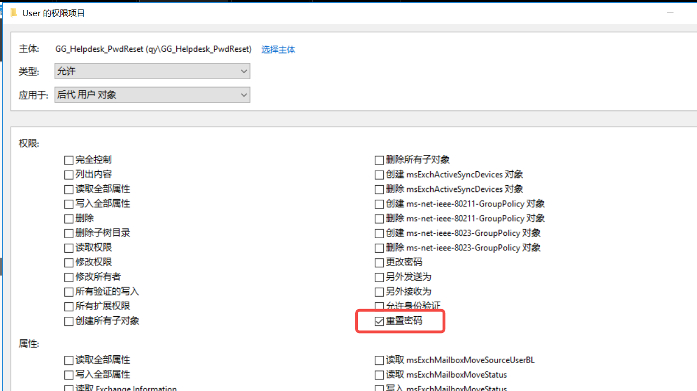

这项任务涉及重置密码的扩展权限，以及下次改密所需的相关属性写权限；重置密码与修改 pwdLastSet 是两步操作，不能只因第一步成功就宣称全部完成。

### 5.1 修改前后记录 ACL（Powershell查询、仅供参考）

以下是管理端查询，不是批量赋权脚本：

```powershell
Import-Module ActiveDirectory
$targetOU = 'OU=User,OU=Delegation,DC=qy,DC=net'

# 在配置前和配置后分别执行，保存截图／输出对照
(Get-Acl ("AD:\" + $targetOU)).Access |
    Where-Object { $_.IdentityReference -like '*GG_Helpdesk_PwdReset' } |
    Select-Object IdentityReference,ActiveDirectoryRights,AccessControlType,
        ObjectType,InheritedObjectType,InheritanceType,IsInherited
```

AD: 驱动器可能连接默认发现的 DC；本实验只有 CORE01 开启时通常比较直观，仍应核对连接来源。需要严格固定服务器时，可在高级安全 GUI 中配合 ADUC 所选 CORE01 核验，或创建指定 Server 的 AD PSDrive。

这里只展示委派组相关条目，不代表完整有效权限计算；还要考虑其他组、继承与显式拒绝。修改前没有该组 ACE，才便于后续精确撤销。

## 六、范围内成功，范围外与越权操作拒绝

切回 Helpdesk 普通会话，若刚添加组成员，等待变更可用后完整注销重登。确保 ADUC 仍连接 CORE01。

### 6.1 范围内重置及强制改密验证

1. 重置 lab_delegate_in 的密码。
2. 勾选“用户下次登录时须更改密码”。
3. 预期成功；不勾“解锁用户账户”，本次未授予解锁任务。
4. 管理员在 CORE01 查询 pwdLastSet，预期为 0。
5. 在 USER01 的 VM 控制台用该测试用户及临时密码登录，按提示设置新的合规密码。
6. 改密完成后再看 pwdLastSet，应从 0 变为实际时间值。

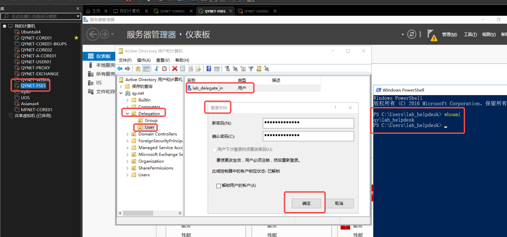
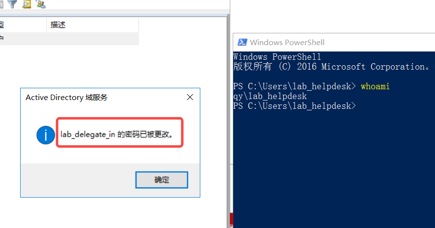
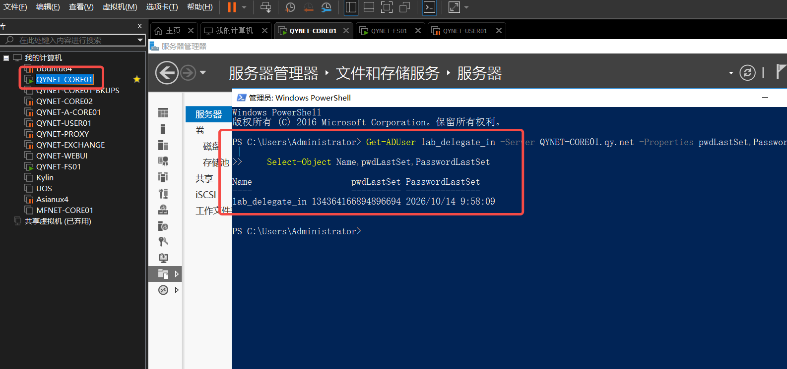

**本轮实际结果：**密码重置成功，但“下次登录须更改密码”未勾选且呈灰色；查询中的 pwdLastSet 为非零值。准备阶段截图显示目标账号 PasswordNeverExpires=True，因此本轮不记为强制改密通过，也没有截图证明首次登录改密。上面的强制改密步骤保留为完整流程参考；如后续补做，应先由管理员取消目标账号的密码永不过期标志，再单独验证。两种标志不能同时启用。[Set-ADUser 参数说明](https://learn.microsoft.com/en-us/powershell/module/activedirectory/set-aduser#-passwordneverexpires)

不能以命令无输出作为唯一成功证明。也不要用错误密码反复试登录来制造锁定。

```powershell
# CORE01 管理员核验，不在错误的用户会话里猜
Get-ADUser lab_delegate_in -Server QYNET-CORE01.qy.net -Properties pwdLastSet,PasswordLastSet |
    Select-Object Name,pwdLastSet,PasswordLastSet
```

若目标通过 RDP 登录时因强制改密／NLA 遇到问题，优先在 VMware 控制台完成此次测试，不关闭 NLA 绕过。

### 6.2 范围外重置

Helpdesk 尝试重置 Delegation 根 OU 的 lab_delegate_out，使用符合策略的新密码。

预期拒绝。它虽然与范围内用户同属 Delegation 分支，但不是 User 子 OU 的后代，授权不会向父级反向继承。

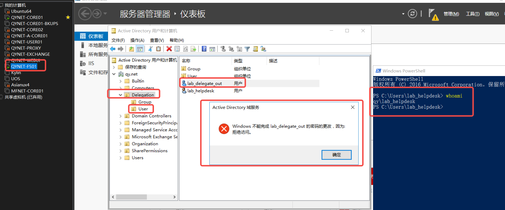

如果成功，说明范围或已有权限与设计不符，停止并记录，不能为了让表格符合预期而忽略结果。只测试新建的 lab_delegate_out，不测试 Administrator、qianyue 或 recovery_test。

### 6.3 无关属性修改

Helpdesk 打开 lab_delegate_in 的“常规”，尝试修改“描述”为一个实验标记。

预期没有权限写入。若成功，检查是否额外授予了写所有属性或来自其他组的授权；由管理员恢复原描述并修正设计。

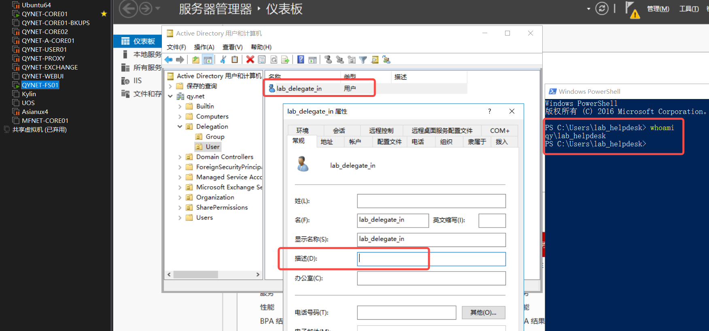

本次不用删除用户作为负向测试，避免配置异常时真的删掉对象。

### 6.4 PowerShell 等价操作（与 GUI 二选一）（仅供参考）

在 Helpdesk 本人的普通窗口，安装 AD 模块后可执行：

```powershell
whoami
$dc = 'QYNET-CORE01.qy.net'

# 显式使用当前 Helpdesk 身份；不另填域管理员 Credential
$password = Read-Host '输入新的合规实验密码' -AsSecureString
Set-ADAccountPassword -Identity lab_delegate_in -Server $dc -Reset -NewPassword $password -ErrorAction Stop
Set-ADUser -Identity lab_delegate_in -Server $dc -ChangePasswordAtLogon $true -ErrorAction Stop
```

以上会真实改变测试账号密码，不要在已经完成 GUI 验收后无意重复执行。

范围外和无关属性可分开验证：

```powershell
# 预期权限拒绝；逐条执行、记录实际错误，不整段批量跑
$password = Read-Host '输入范围外测试的合规密码' -AsSecureString
Set-ADAccountPassword -Identity lab_delegate_out -Server $dc -Reset -NewPassword $password -ErrorAction Stop

Set-ADUser -Identity lab_delegate_in -Server $dc -Description '委派范围验证' -ErrorAction Stop
```

参考：[Set-ADAccountPassword](https://learn.microsoft.com/en-us/powershell/module/activedirectory/set-adaccountpassword)、[Set-ADUser](https://learn.microsoft.com/en-us/powershell/module/activedirectory/set-aduser)。

## 七、撤销权限，并证明失去操作能力

本次选择 **撤销委派 ACE**，而不只是将操作员移出组，便于观察 ACL 本身的授权作用。

CORE01 管理员：

1. 查看第五节的修改前后记录。
2. 在 User OU“安全 → 高级”中，识别本次为 GG_Helpdesk_PwdReset 新增的各条显式 ACE。
3. 仅移除这些新条目；不删除其他组权限，不清空 DACL，不重置整套继承。
4. 若看到的是继承条目，先查实际授权来源，不强行关闭对象继承来绕过。
5. 保留 Helpdesk 的组成员关系不变，截图证明撤销的是权限而非身份。

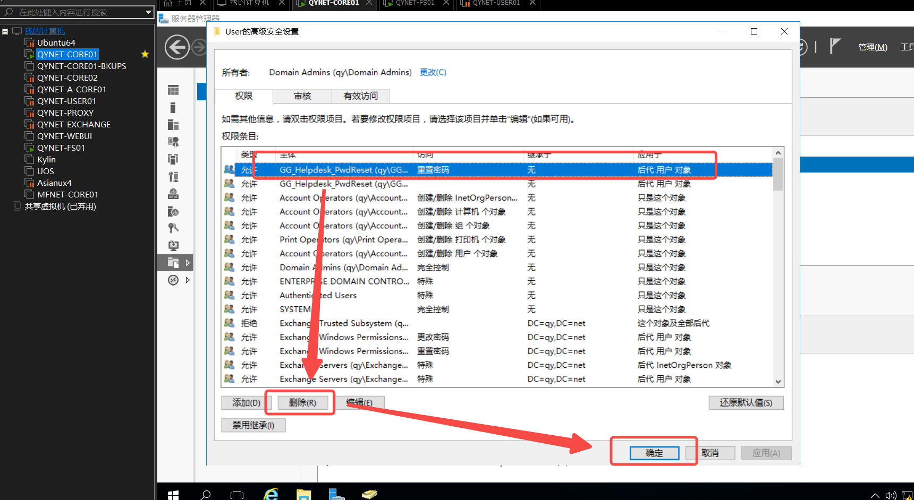
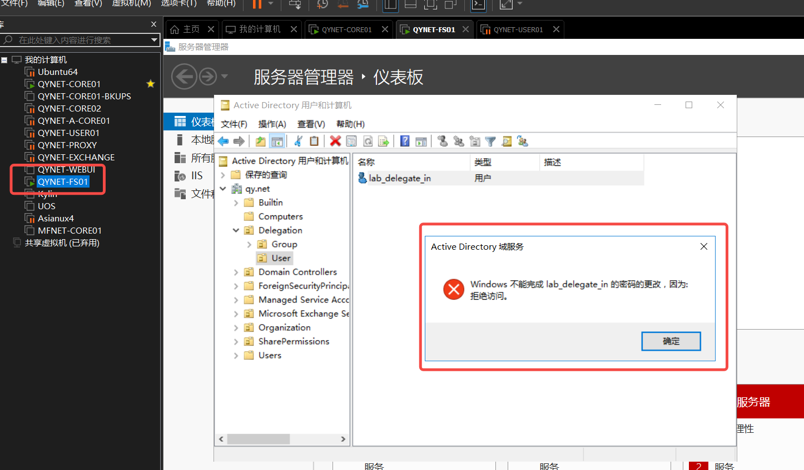

Helpdesk 在新登录会话中再次尝试重置 lab_delegate_in，明确选择 CORE01。预期权限拒绝。

撤销权限不会把目标用户的密码恢复成原密码，也不会删除账号；本次测试密码由你妥善管理。

### 7.1 实际验收结果

| 阶段 | 操作身份 | 操作 | 预期 | 实际结果与证据 |
| --- | --- | --- | --- | --- |
| 委派前 | lab_helpdesk | 重置 in 密码 | 拒绝 | 拒绝访问，见 4.1.5 |
| 委派后 | lab_helpdesk | 重置 in 密码 | 成功 | 提示密码已更改，见 6.1.2 |
| 委派后 | lab_helpdesk | 设置 in 下次改密 | 成功 | 未验证通过：选项灰色、未勾选，pwdLastSet 非零 |
| 委派后 | lab_delegate_in | 控制台首次登录改密 | 成功 | 未提供该阶段记录，不计为通过 |
| 委派后 | lab_helpdesk | 重置 out 密码 | 拒绝 | 拒绝访问，见 6.2.1 |
| 委派后 | lab_helpdesk | 修改 in 描述 | 拒绝 | 截图仅展示属性页，未展示保存结果，暂不下结论 |
| 撤销后 | lab_helpdesk | 再次重置 in 密码 | 拒绝 | 拒绝访问，见 7.1.2 |

本次已证明密码重置权限的范围边界与撤销效果；强制改密、无关属性写入和全部相关 ACE 的清理状态，不能仅凭现有截图宣称全部验证完成。

## 八、排错时先区分什么？

| 现象 | 优先核对 |
| --- | --- |
| 看得到用户，却无法重置 | 读取与重置是不同权限，查 ACE 和目标对象范围 |
| 范围内也拒绝 | Helpdesk 当前身份、令牌组、DC、继承、ACE 对象类型 |
| 密码重置成功，强制改密失败 | pwdLastSet 相关写权限、目标账号标志及实际报错 |
| 报密码不合规 | 有效域／细粒度密码策略、历史等，不急着加权限 |
| 范围外也能重置 | 授权是否配置在 Delegation／域根父级，或已有高权限组 |
| 某些管理员账号不继承 | 受保护对象机制；本实验不用高权限账号，不改 AdminSDHolder |
| 撤销后仍然成功 | 是否漏删 ACE、其他组授权、连接了别的 DC 或尚有复制差异 |

默认域策略和受保护账号不是本实验的修复对象。[受保护对象说明](https://learn.microsoft.com/en-us/windows-server/identity/ad-ds/plan/security-best-practices/appendix-c--protected-accounts-and-groups-in-active-directory)

### 8.1 可选审计证据

若 DC 已启用相应“用户账户管理”审计，可由管理员查看 Security 中的 4724（尝试重置账号密码）。区分主体操作员、目标账号和成功／失败关键字。

无事件不代表没发生操作；先核对审计策略、查询范围与保存情况。本次不为补截图修改全域审计 GPO。Helpdesk 无权读取 Security 日志也不等于委派失败。

## 九、关键总结

- **委派本质是 AD 对象 ACL 授权，不是把操作员变成管理员。** 本次将重置密码权限授予全局安全组，并限定到 Delegation/User 的后代用户对象。
- **范围边界已验证。** 同一 Helpdesk 在委派前不能重置 in；委派后可以重置 in，但不能重置位于父 OU 的 out。
- **重置密码与强制改密不是同一件事。** 本轮目标设置了密码永不过期，强制改密框灰色、pwdLastSet 非零，不能将重置成功当作强制改密成功。
- **撤销需要看权限条目和复测。** 移除重置密码 ACE 后，in 再次拒绝重置；授权时还出现了另一条特殊权限 ACE，是否也已移除需核对最终高级安全列表，不能仅因重置失败就认定所有委派条目都已清理。

最终按本次记录保留 Delegation OU、三个测试账号和委派组；已验证重置权限撤销后的拒绝结果。共享盘、旧账号和 GPO 不属于本次变更范围。

---

相关笔记：

- [共享权限与 AGDLP 实训](/posts/springtsuki/notes/windowsad/labs/sharepermissions/1010-share-permissions/)
- [GPO 共享盘自动映射与验收](/posts/springtsuki/notes/windowsad/labs/gpo/1013-gpo/)
- [组与成员](/posts/springtsuki/notes/windowsad/powershell/915-group/)
