# GPO 共享盘自动映射与验收

这次不再重复“建一个限制控制面板的 GPO”，而是让已有 FS01 共享变成用户登录后自动出现的部门共享盘。

核心问题：**GPO 处理范围、映射项是否命中、SMB 资源权限，是三件不同的事。**

本次主要以 GUI 配置，PowerShell 用于身份、连通性和策略结果验证。文中的等价命令供复现参考；实际执行情况以截图及操作记录为准。

## 一、场景与交付目标

公司有一份部门共享：

- 只读成员自动获得 R:，可以读取，不能写入。
- 可修改成员自动获得同一个 R:，可以读取、创建、修改和删除测试文件。
- 不符合映射条件的用户不自动获得 R:。
- 将 GPO 应用、映射项命中与资源读写分层验证，不用单一现象代替完整结论。

本次范围截止第五节的部署与验收，最后汇总实际结果。未实施人为故障、映射生命周期清理或动作对照实验，这些内容不计入本次完成范围。

### 1.1 沿用现有环境

| 位置 | 用途 |
| --- | --- |
| CORE01／CORE02 | AD 与 GPMC 管理 |
| QYNET-FS01.qy.net | 复用已有 LabShare，共享文件夹仍为 C:\ADLab\SharePermissions\Data |
| USER01 | 三个普通实验用户分别登录测试 |
| SharePermissions/User | 复用上一份实训的三个普通用户，不新建或移动用户 |
| SharePermissions/Group | 保留已有共享授权组，仅新建映射资格组 |
| Labs/GPO/img | 本篇截图 |

FS01 的完整主机名仍为 **QYNET-FS01.qy.net**，访问统一使用 `\\QYNET-FS01.qy.net\LabShare`，不混用 IP、别名与完整域名。

沿用上一份实训的 `OU=User,OU=SharePermissions,DC=qy,DC=net` 和 `OU=Group,OU=SharePermissions,DC=qy,DC=net`。开始前重新核对三个用户的位置、启用状态与既有 GPO，不把历史截图当作本次实时检查结果。不修改 Organization 上已有 Software-GPO，也不修改 Policy-User、Policy-WSUS、默认域策略。

不移动 USER01，不配置环回，不在域根链接新策略，不改现有共享 ACL 来制造本次故障。本次只新增映射资格组及 ro、rw 的映射成员关系，保留已有共享授权。

## 二、设计两条独立关系

复用上一份实训的三个普通用户，保留已有共享授权，不再创建 lab_drive 用户：

| 用户 | 共享访问授权 | 自动映射资格 |
| --- | --- | --- |
| lab_share_ro | 保留现有 GG_LabShare_Read 成员关系 | 加入新 GG_GPOLab_DriveMap |
| lab_share_rw | 保留现有 GG_LabShare_Modify 成员关系 | 加入新 GG_GPOLab_DriveMap |
| lab_share_no | 保持不加入共享授权组 | 初始不加入映射组 |

```text
自动映射：
用户 → GG_GPOLab_DriveMap → GPP 映射项命中 → 尝试创建 R:

文件授权（沿用第二份实训）：
用户 → GG_LabShare_Read / Modify → DL_LabShare_Read / Modify → 共享 ACL + NTFS ACL
```

**GG_GPOLab_DriveMap 只决定是否尝试映射，不给文件权限。** 没有自动盘符也不代表无法手动访问 UNC；出现盘符也不代表每个文件操作都被授权。


### 2.1 GUI 准备

管理端打开 `dsa.msc`：

1. 打开现有 SharePermissions/User，确认 lab_share_ro、lab_share_rw、lab_share_no 均存在、已启用且可登录 USER01。不移动用户、不重置密码、不添加管理员权限；如果之前清理时已禁用，确认仍用于实验后再启用。
2. 在现有 SharePermissions/Group 新建 GG_GPOLab_DriveMap，类型“安全”，作用域“全局”。
3. 只将 lab_share_ro、lab_share_rw 加入映射组；保留两人原有共享授权，确认 lab_share_no 没有额外授权。先记录原始成员关系，便于恢复临时变更。
4. 确认旧的两条 GG → DL 嵌套仍在。
5. 检查旧共享的 Modify 组共享权限已恢复 Change，不仍停留在上一份实验的 Read 故障状态。
6. 如发现重名对象，不覆盖；先确认用途，再替换本任务全部相关名称。

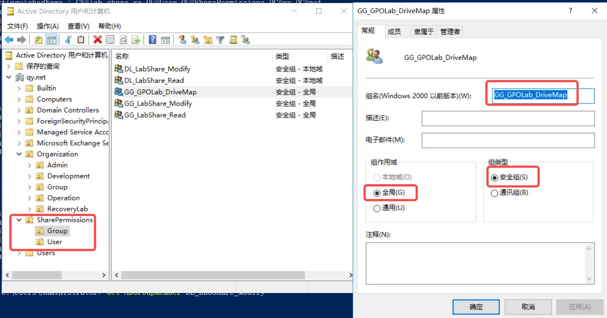
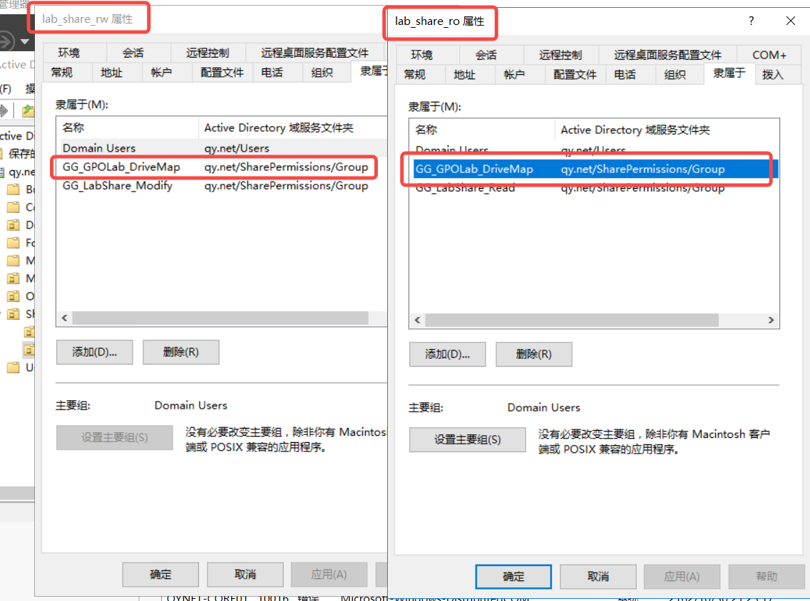

辅助查询：

```powershell
# AD 管理端
Get-ADUser lab_share_ro | Select-Object Name,Enabled,DistinguishedName
Get-ADUser lab_share_rw | Select-Object Name,Enabled,DistinguishedName
Get-ADUser lab_share_no | Select-Object Name,Enabled,DistinguishedName
Get-ADGroupMember GG_GPOLab_DriveMap
Get-ADGroupMember GG_LabShare_Read
Get-ADGroupMember GG_LabShare_Modify
Get-ADGroupMember DL_LabShare_Read
Get-ADGroupMember DL_LabShare_Modify

# FS01 管理员：仅读取，不改 ACL
Get-SmbShareAccess -Name LabShare
(Get-Acl 'C:\ADLab\SharePermissions\Data').Access |
    Select-Object IdentityReference,FileSystemRights,AccessControlType,IsInherited
```

### 2.2 客户端基线：先证明共享本身可用

FS01、DC、USER01 应已开机。分别用 ro、rw 登录 USER01，在自己的普通窗口：

```powershell
whoami
whoami /groups
Resolve-DnsName QYNET-FS01.qy.net
Test-NetConnection QYNET-FS01.qy.net -Port 445
Get-Content '\\QYNET-FS01.qy.net\LabShare\readme.txt'

# 检查 R: 是否已被本地设备、旧映射或其他用途占用
net use
Get-PSDrive -PSProvider FileSystem
```

若 R: 已占用，停止，另选所有实验用户均空闲的固定盘符，并替换本篇各处；不删除他人的映射来腾位置。

ro 应能读取，rw 应能读写。先解决共享基线异常再部署映射，不把两类故障混在一起。遇到多套凭据冲突，不输入管理员账号“帮忙连接”，也不执行 `net use * /delete`。

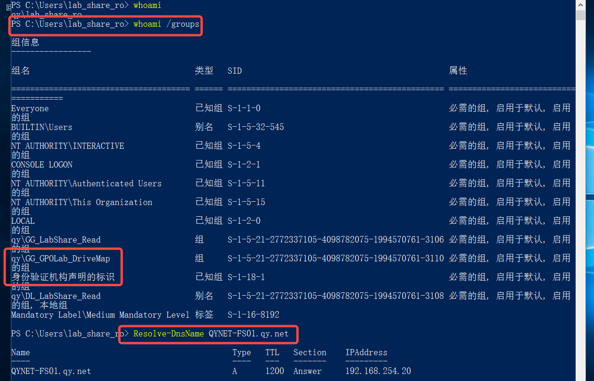
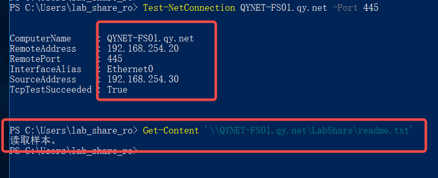
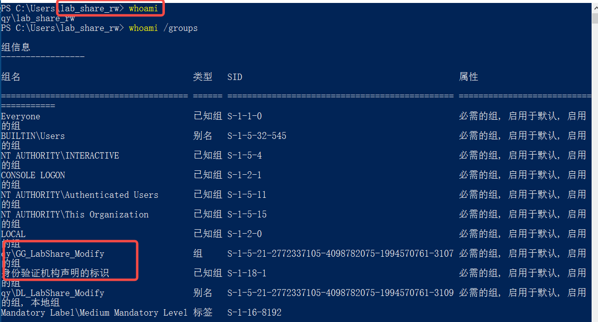
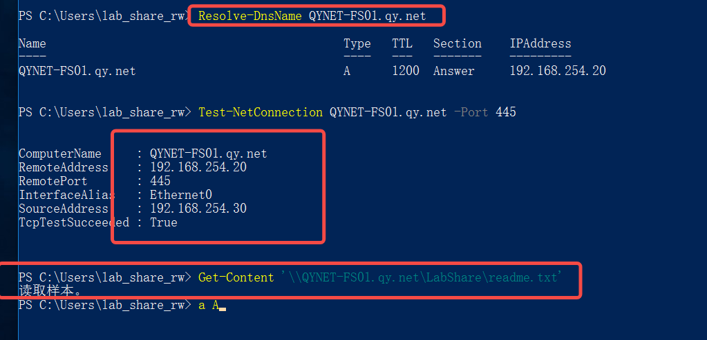

## 三、在现有用户 OU 创建 GPO

### 3.1 创建与作用域

GPMC（`gpmc.msc`）：

1. 展开 qy.net → SharePermissions → User。
2. 右键 User →“在这个域中创建 GPO 并在此处链接”。
3. 命名 **LAB-GPO-User-DriveMap**，确认链接启用、用户配置部分启用。
4. **本任务保留默认 Authenticated Users 的读取与应用权限，不收窄 GPO 安全筛选。**
5. WMI 筛选保持“无”。访问资格在映射项内部的项目级目标筛选中区分。

这样 no 用户也可以处理到整份 GPO，但映射项不命中。这正是本次要观察的区别：**GPO 已应用 ≠ 每个首选项都执行。**

仅链接到 SharePermissions/User，不链接 SharePermissions 根层或 Organization。开始前确认该 User OU 没有未知非实验用户。

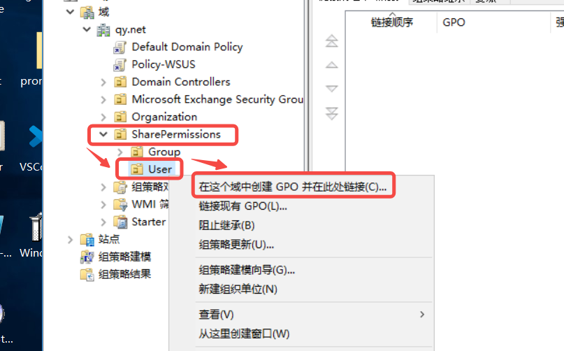
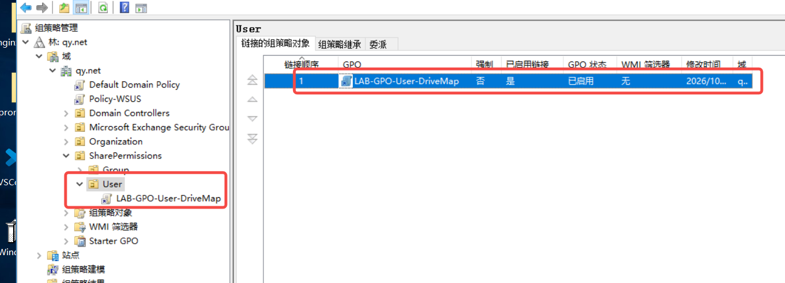

### 3.2 驱动器映射项

编辑该 GPO：

“**用户配置 → 首选项 → Windows 设置 → 驱动器映射**”，右键 →“新建 → 映射驱动器”。

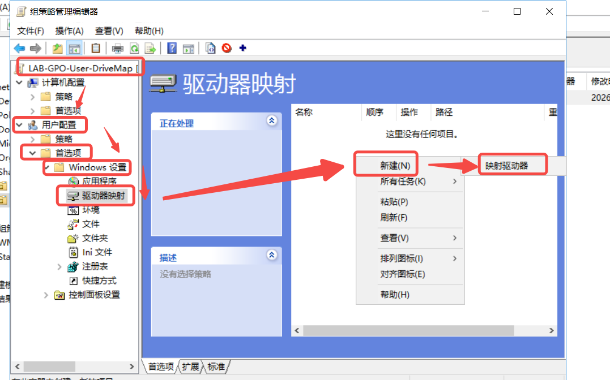

| 字段 | 本次填写 |
| --- | --- |
| 操作 | 更新（Update） |
| 位置 | `\\QYNET-FS01.qy.net\LabShare` |
| 重新连接 | 勾选；用于建立可重新连接的映射，不需要在文本框填写解释文字 |
| 标记为（显示标签） | Lab Department Share |
| 驱动器号 | 使用固定 R: |
| 显示／隐藏 | 保持不更改，不隐藏其他驱动器 |

不要选择“使用第一个可用盘符，从……开始”，固定盘符更便于验证，也避免影响其他映射。[首选项自动盘符的注意事项](https://learn.microsoft.com/en-us/troubleshoot/windows-server/group-policy/manual-drive-mappings-removed)

不要设置替代连接账号，不保存域管理员密码。Drive Maps 扩展按用户上下文工作；“在登录用户的安全上下文中运行”在部分版本不可选，不把灰色选项本身当作故障，也不硬改成 SYSTEM。

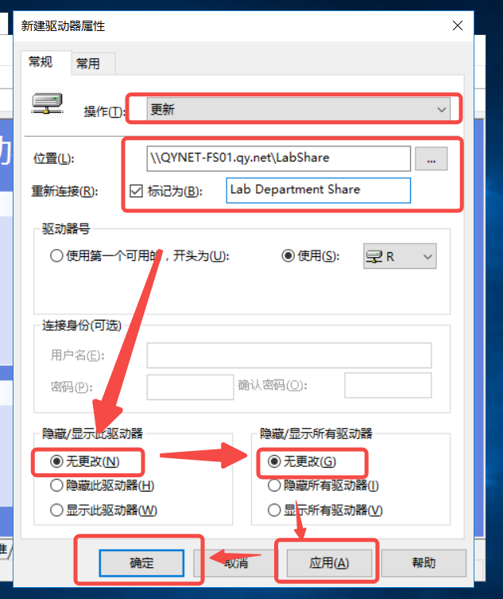

### 3.3 项目级目标筛选（ILT）

双击 R: 映射项，切换到“常用（Common）”页；本次截图的第一个“常规”页用于填写 UNC、操作和盘符，第二个“常用”页用于设置 ILT。

1. 勾选“项目级目标筛选（Item-level targeting）”，打开“目标”。
2. 新建目标项 →“安全组”。
3. 选择 `qy\GG_GPOLab_DriveMap`。
4. 条件选择 **用户是组成员**，不是“计算机是组成员”；不要取反。
5. 只保留这一条条件，不增加未知 AND／OR 条件。
6. 不勾选“仅应用一次且不重新应用”。
7. **本次不勾选“当不再应用项目时删除此项目”**，未进行退出范围后的自动清理实验。
8. 保存，截图常规字段与完整目标条件。

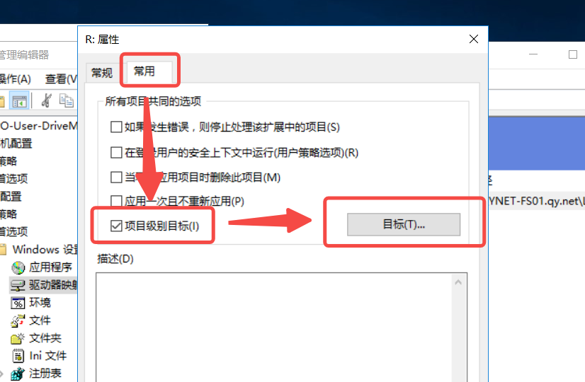
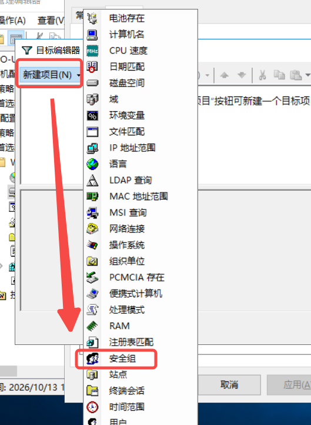
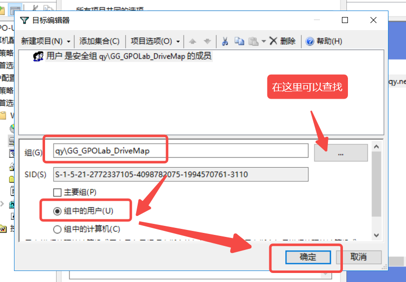
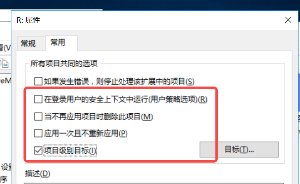

GPO 安全筛选决定整份 GPO 的应用资格；ILT 决定其中某一项是否执行，两者不是同一个开关。[项目级目标筛选](https://learn.microsoft.com/en-us/previous-versions/windows/it-pro/windows-server-2012-r2-and-2012/dn789189(v=ws.11))

## 四、刷新与验收：在普通用户自己的会话里看

组成员变更复制到相关 DC 后，完整注销 USER01，再分别登录三名用户。不要用管理员 PowerShell 的映射状态代表普通用户的结果；提升窗口与普通桌面也可能看到不同的映射。

```powershell
whoami
whoami /groups
gpupdate /target:user /force
gpresult /scope user /r

# 如果刷新后没有出现，记录现象，完整注销重登后再看
net use
Get-PSDrive -PSProvider FileSystem

# 保存当前用户自己的结果报告
$reportDir = Join-Path $env:USERPROFILE 'Documents\GPOLab'
New-Item -ItemType Directory -Path $reportDir -Force | Out-Null
gpresult /scope user /h "$reportDir\drive-map.html" /f
```

用普通资源管理器打开“此电脑”，确认 R: 的 UNC 目标正确，不只看标签。

### 4.1 ro：映射成功不等于能写

读取 R: 中 readme.txt，再在资源管理器尝试新建一个实验文本文件，记录拒绝结果。预期可以读取，不能写入。

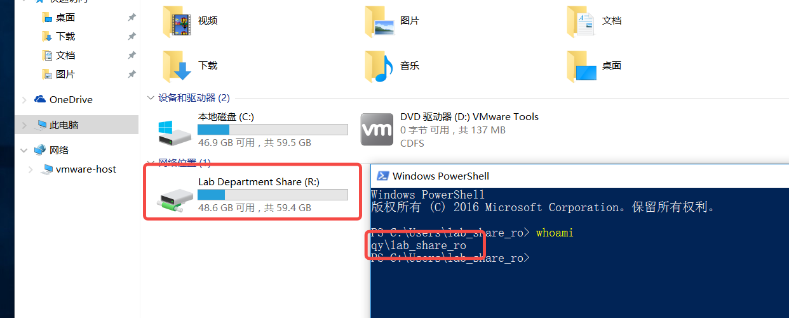
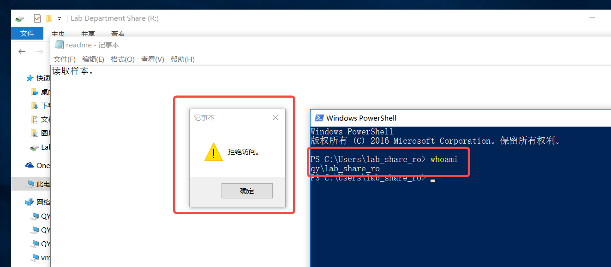

### 4.2 rw：验证创建、修改、删除

本次通过资源管理器验证 rw 的文件操作，操作记录包含创建、修改和删除；截图中实际使用的测试文件名为 `testGPO`，资源管理器隐藏了扩展名。

下图直接展示文件创建成功，修改和删除过程没有单独截图，不将这一张图视作全部操作的独立证明。后面的 `drive-rw-test.txt` 命令是等价复现示例，不是截图中实际执行的命令记录。

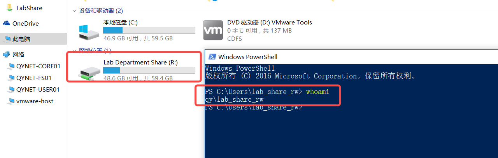
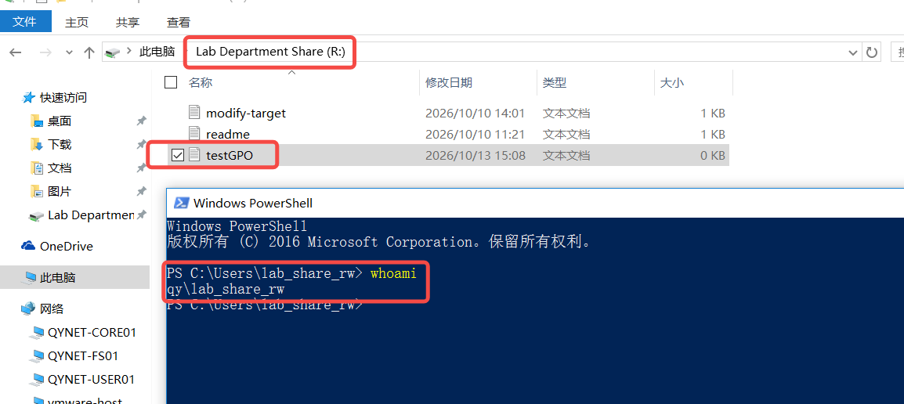

命令等价操作：

```powershell
Get-Content 'R:\readme.txt'
Set-Content 'R:\drive-rw-test.txt' -Value '共享盘映射实训' -Encoding UTF8
Add-Content 'R:\drive-rw-test.txt' -Value '修改测试'
Get-Content 'R:\drive-rw-test.txt'
Remove-Item 'R:\drive-rw-test.txt' -Confirm
```

### 4.3 no：GPO 可以应用，但没有自动盘符

no 不在映射组内，预期没有本实验 R:。其 gpresult 仍可能列出 LAB-GPO-User-DriveMap，不能因此认定 ILT 失效。

没有 R: 只证明没有这份映射；no 本次也没有共享授权，所以直接访问 UNC 预期被拒绝。两项结论分开记录。

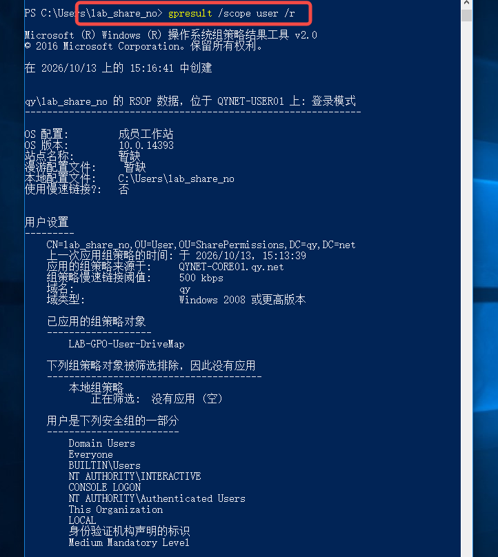

这张截图证明 no 的整份 GPO 已处理、当前令牌未包含映射组；它没有展示“此电脑”或 net use，因此本报告不把“R: 不存在”写成截图直接确认的事实。

| 用户 | GPO 处理情况 | ILT 是否命中 | R: 目标 | 读取 | 写入／删除 |
| --- | --- | --- | --- | --- | --- |
| ro | 未展示本用户 gpresult；已有自动映射结果 | 组成员与配置吻合，结果符合命中预期 | R: 显示 Lab Department Share；配置目标为 LabShare | 样本读取成功 | 修改保存被拒绝；创建、删除拒绝未单独展示 |
| rw | 未展示本用户 gpresult；已有自动映射结果 | AD 成员关系与映射结果吻合 | R: 显示 Lab Department Share；配置目标为 LabShare | UNC 样本读取成功 | 创建成功有截图；修改、删除据操作记录完成，未单独展示 |
| no | gpresult 明确列出 LAB-GPO-User-DriveMap | 当前令牌未包含映射组，符合不命中条件 | 预期无本实验 R:；未展示资源管理器或 net use 结果 | 未展示本轮直接 UNC 访问结果 | 不必继续 |

## 五、收集证据，别用一条命令下结论

| 要回答的问题 | 去哪里看 |
| --- | --- |
| 链接在用户 OU 吗？ | GPMC／Get-GPInheritance |
| 整份 GPO 是否处理？ | 当前用户 gpresult |
| 映射项为何命中／跳过？ | 映射项 ILT、当前用户组、客户端相关日志 |
| 映射是否存在、指向哪里？ | 同一普通会话的资源管理器、net use |
| 实际网络访问身份是谁？ | FS01 管理员 Get-SmbSession |
| 资源是否允许读写？ | 实际文件操作，加共享 ACL 与 NTFS ACL |

管理端：

```powershell
Get-GPInheritance -Target 'OU=User,OU=SharePermissions,DC=qy,DC=net' |
    Format-List GpoLinks,InheritedGpoLinks

Get-GPO -Name 'LAB-GPO-User-DriveMap' |
    Select-Object DisplayName,Id,GpoStatus

# FS01 管理员窗口，客户端访问后查询
Get-SmbSession |
    Select-Object ClientComputerName,ClientUserName,NumOpens
```

客户端事件查看器重点看：

- Windows 日志 → 应用程序：Group Policy Drive Maps 相关事件。
- 应用程序和服务日志 → Microsoft → Windows → GroupPolicy → Operational。
- 按本轮刷新／登录时间、用户与 GPO 名称关联，不只看“有无红色错误”。

4098 常用于首选项执行失败，需要读完整消息和错误码；不是所有 ILT 未命中都会报错，正常跳过也不应硬找一条失败事件。[首选项事件说明](https://learn.microsoft.com/en-us/troubleshoot/windows-server/group-policy/information-group-policy-preferences-events)

本节列出了后续可用的查询入口。当前未附 Get-SmbSession、两层 ACL 的新查询截图或本轮 4098 日志，不将这些命令示例视为已执行的实测记录。本次没有人为注入故障，不要求正常部署必须产生错误日志。

## 六、实训总结

### 6.1 本次配置与观察

| 项目 | 本次记录 |
| --- | --- |
| 完成日期 | 2026-10-13 |
| 客户端 | QYNET-USER01；连通性截图中的来源 IP 为 192.168.254.30 |
| 文件服务器 | QYNET-FS01.qy.net；DNS 与连通性截图显示 192.168.254.20 |
| 复用对象 | SharePermissions 下三个 lab_share 用户及原有 GG／DL 共享授权组 |
| 新增资格组 | GG_GPOLab_DriveMap，全局安全组；ro、rw 为成员 |
| 用户 GPO | LAB-GPO-User-DriveMap，直接链接 SharePermissions/User |
| 映射项 | 用户配置 → 首选项 → Windows 设置 → 驱动器映射 |
| 映射设置 | Update，固定 R:，重新连接已勾选，标记为 Lab Department Share |
| 资源路径 | `\\QYNET-FS01.qy.net\LabShare` |
| ILT | 用户属于 qy\GG_GPOLab_DriveMap |
| 生命周期选项 | 未勾删除不再应用项目，未勾仅应用一次 |
| 本次未执行 | 人为故障、Create／Replace／Delete 对照及退出范围清理 |

截图展示了 ro、rw 的自动映射；ro 保持只读，rw 可以创建文件。no 的 gpresult 列出了同一 GPO，但其令牌没有映射资格组，说明不能把“整份 GPO 已应用”直接等同于“其中每个项目都会执行”。

### 6.2 本次真正需要记住的三层关系

1. **GPO 范围与权限**：用户位置、链接、状态、安全筛选等决定整份 GPO 是否参与处理。
2. **映射项 ILT**：本实验再根据 GG_GPOLab_DriveMap 的用户成员资格，决定是否尝试映射 R:。
3. **资源访问授权**：映射不是授权，文件操作仍受共享 ACL 和 NTFS ACL 共同约束。

本地直接访问 Data 时不经过共享层；通过 R: 访问本实验 SMB 路径时仍经过两层检查。盘符只是入口变化，不会把 ro 的读取权限变成修改权限。

### 6.3 证据范围与保留状态

本篇已经形成“成员关系 → GPO 链接 → 映射设置 → ILT → 普通用户结果”的记录链。尚未单独展示的操作不补造输出，也不为凑截图重复进行故障实验。

本次保留现有共享、账号、映射组、GPO 和映射项，供后续复习使用；没有因为整理报告而删除映射或修改 VM。后续若做故障课题，另行确定范围，不在本篇提前记录未做的实验结果。

---

相关笔记：

- [共享权限与 AGDLP 实训](/posts/springtsuki/notes/windowsad/labs/sharepermissions/1010-share-permissions/)
- [GPO 相关指令](/posts/springtsuki/notes/windowsad/powershell/928-gpo/)
- [组与成员](/posts/springtsuki/notes/windowsad/powershell/915-group/)
