## 一、注册账号，登入 API 平台

入口：[DeepSeek 官方链接](https://www.deepseek.com/)

### 1.1 注册账号：

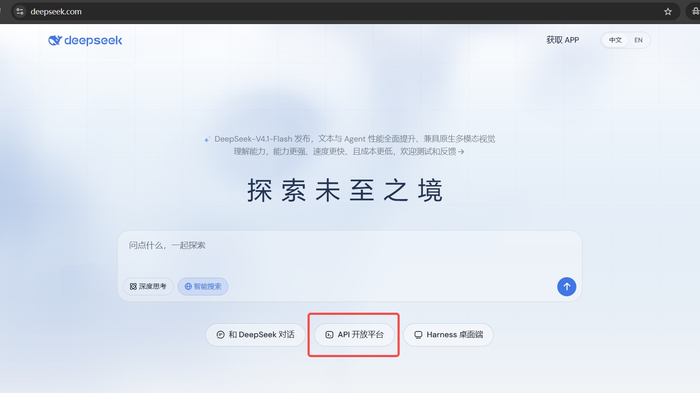
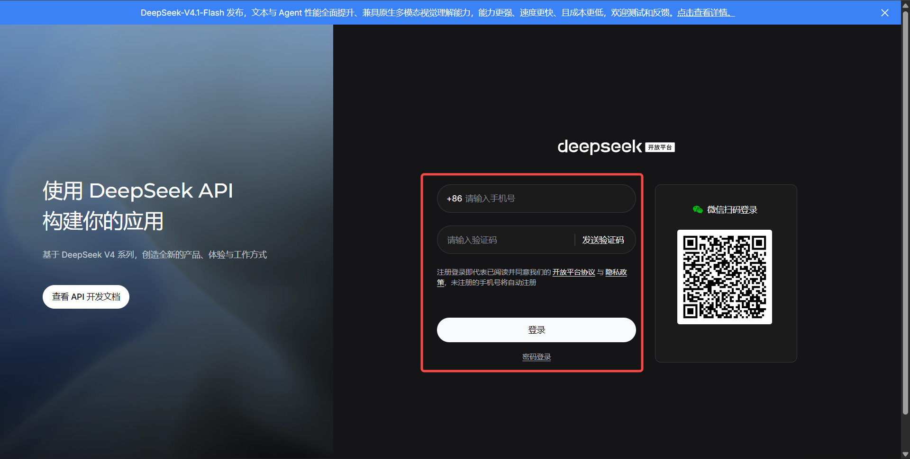

来到主界面后，选择 API Keys：

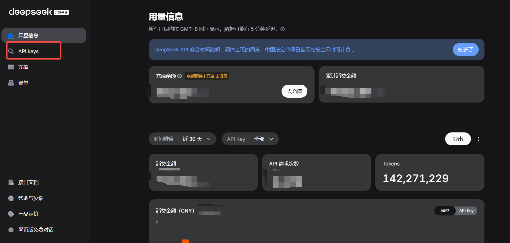

### 1.2 创建 API Keys

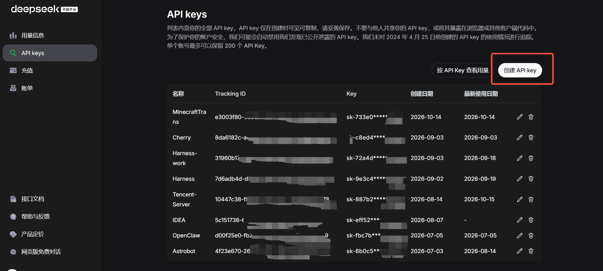
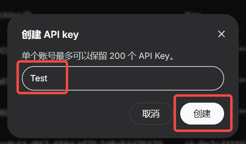

而后点击复制保存这个 API Key 在一个绝对安全的地方，只有你自己知道。如果 Key 被别人知道了，你的钱包就要被电表倒转了。

**严重警告提示：不要与他人共享你的 API key，或将其暴露在浏览器或其他客户端代码中。**

## 二、安装简单翻译 Mods

MCMOD 简单翻译链接：[简单翻译 (SimpleTranslation) - MC百科|最大的Minecraft中文MOD百科](https://www.mcmod.cn/class/23154.html)

点击下载，找到适合你的版本。个人推荐使用 Fabric。

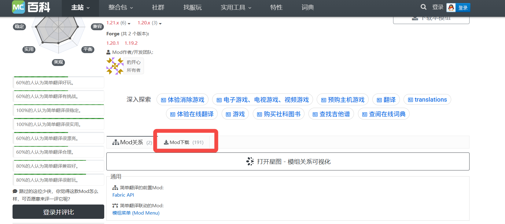
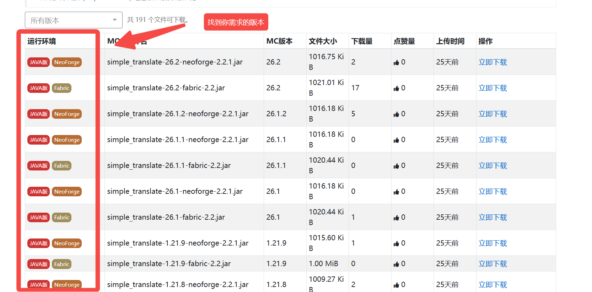

## 三、安装并配置

将 Mod 文件拖曳到 .minecraft/mods 下安装。而后进行配置。

### 3.1 游戏内配置（方法一）

如果需要在游戏内的 GUI 进行配置，则额外需要安装 **模组菜单（modmenu）模组** 及相关前置。如果没有安装的话，则需要先进入任意存档后，按**U**进行配置（会直接跳转到此模组的配置页）。

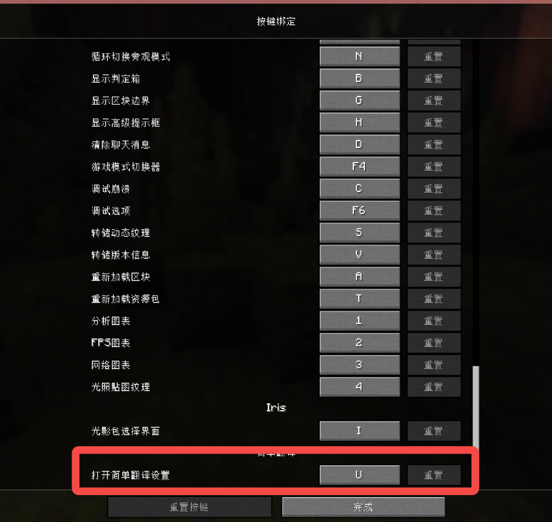

通过模组菜单进行配置操作如下：

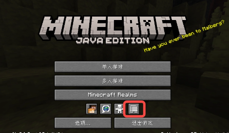
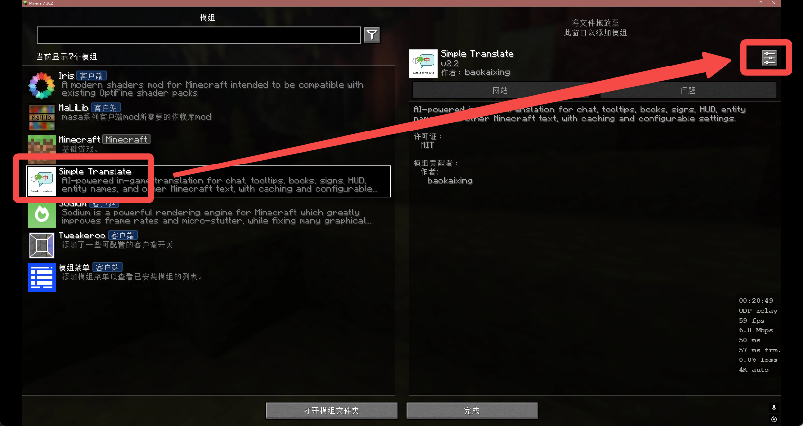
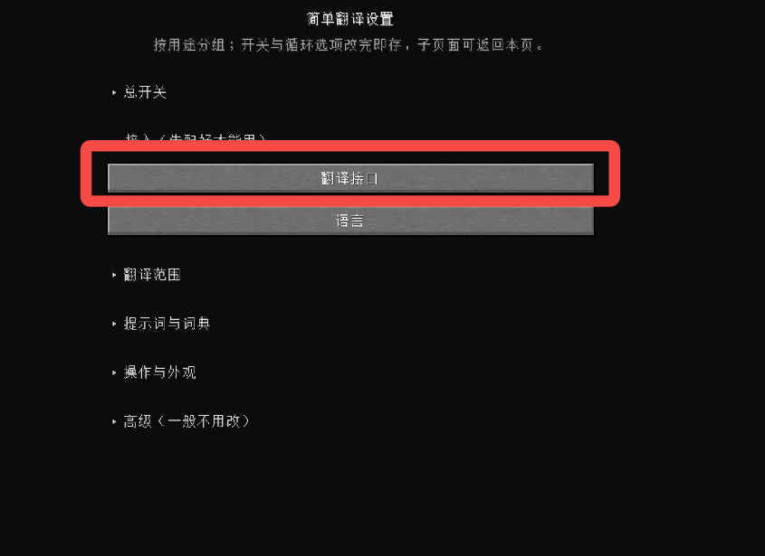

这里以 DeepSeek 为例，进行相关配置，从上至下依次填写。

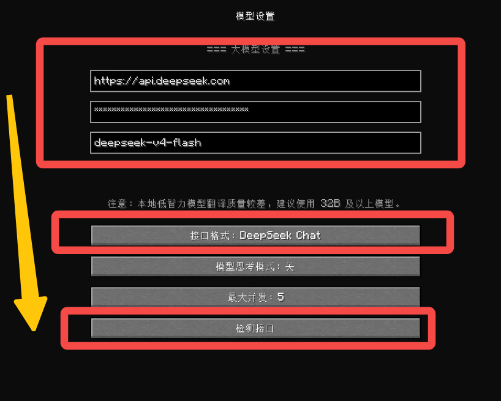

填写参数如下：

```text
    === 大模型设置 ===
https://api.deepseek.com
(此处填写你刚刚获取的API Key)
deepseek-flash

接口格式：DeepSeek Chat
```

最后，点击检测接口确认是否正常。若正常，便会提示**翻译接口可用**。而后，在其他设置中选择自己需要的功能即可。

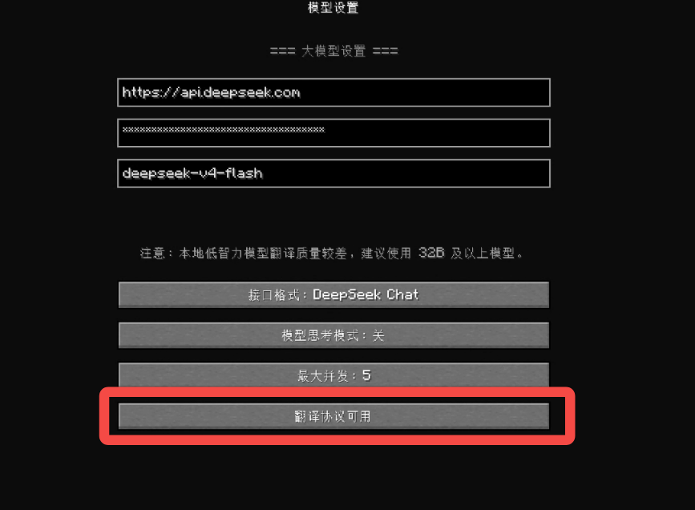

## 四、游戏外配置（方法二）

在 .minecraft\config\simple_translate\simple_translate-client.json 进行内容编辑。同样地，其它的翻译功能也可以在此进行编辑。

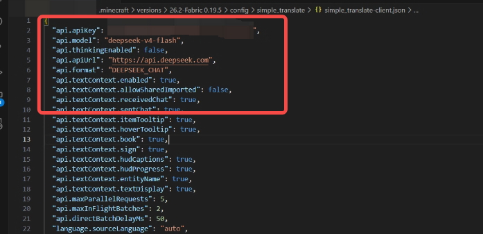

```json
"api.apiKey": " ==此处填写你的API Key== ",
"api.model": "deepseek-v4-flash",
"api.thinkingEnabled": false,
"api.apiUrl": "https://api.deepseek.com",
"api.format": "DEEPSEEK_CHAT",
```

编辑完毕后，回到游戏中进行测试即可。

## 五、充值

这就不用我教了吧，API 官网有个大大的充值按钮。得给大肥鱼吃点Token才会帮你干活。


